# WMS de QEP: arquitectura — diseño

- **Fecha:** 2026-10-31
- **Módulos:** Wms (nuevo), Catalog, Tenancy, Authorization, Audit, Storage, Suppliers, Quotations, Bootstrapper, `qep-frontend`, `qep-android`
- **Estado:** arquitectura en revisión del owner. **D-01, D-02 y D-03 cerradas el 2026-10-31** (las dos primeras aprobadas
  por el owner; la tercera delegada al arquitecto y decidida en §16.1). **Ampliado la noche del 2026-10-31** con §20–28
  para cubrir los 25 entregables del brief (requisitos, flujos, contratos de API, devoluciones, reportes, ADRs completos).
  Nada construido. Es la **Fase 0** del WMS; el primer flujo
  funcional (recepción + app Android) ya tiene su diseño en
  `qep-frontend/docs/superpowers/specs/2026-10-31-wms-recepcion-design.md` (en adelante «spec de recepción») y este
  documento lo asume como entrada, no lo reabre.
  **Ampliado el 2026-11-03 con D-12** (unidad logística —caja o palet, LPN— como dimensión del saldo, decidida por el
  owner; §16.2, WMS-ADR-13): toca §5, §6, §11.2, §12, §14, §17–§20, §22–§26.
- **Verificado contra el código:** `qep-backend` en `develop` (`7f981ab0`; re-verificado en `23ae43b8`, que suma el módulo
  `Loans` con clave `loans` y la migración `AddLoansModuleKey`, última clave de `TenantModuleKeys.All`; re-verificado en
  `67240839` el 2026-11-01 al cerrar la segunda ronda de revisión, S1..S26), `qep-frontend` en `develop`, `qep-android` en
  `develop` (`0167f6d`, WMS-A login mergeado). Las citas al código van por símbolo, no por número de línea: las líneas se
  mueven con cada merge.

---

## 0. Resumen ejecutivo

QEP no tiene inventario. Ningún módulo sabe de bodegas, saldos, lotes ni movimientos; «Bodega» aparece sólo como texto
fijo del Excel para el ERP y como nombre de una dirección de cliente. Lo que sí tiene es una plataforma modular madura
con todos los transversales que un WMS necesita: tenancy con módulos por tenant, permisos con políticas, auditoría
atómica, outbox e inbox por módulo, almacenamiento de archivos en R2 con cuarentena, proveedores, catálogo con
variantes y códigos de barras, pedidos con transportadora, y un escáner de cámara ya escrito en el POS.

La propuesta es **un módulo backend `Wms`** (esquema `wms`, clave de módulo `wms`) con un **ledger de movimientos
inmutable** como núcleo, **saldos materializados en la misma transacción**, y una **dimensión `OwnerId` desde el primer
día** para que el paso de WMS propio a 3PL sea una pantalla y una política de autorización, no una migración de datos.
El dominio se organiza en seis áreas dentro del mismo módulo (Inventory, Warehousing, Inbound, Internal, Control,
Outbound), no en seis módulos: un movimiento y su documento tienen que cerrar en una sola transacción, y partirlos
en módulos los pondría a hablar por outbox.

Las doce decisiones que requieren validación del owner están en §16 (D-12, la unidad logística, se sumó el 2026-11-03). Las tres que cambian el modelo de datos y no se
pueden posponer son: **D-01** (dónde vive el perfil logístico del producto), **D-02** (lote/serie/vencimiento desde el
inicio) y **D-03** (unidad de medida base y conversiones).

---

## 1. Diagnóstico de la arquitectura actual

### 1.1 Lo que existe y el WMS reutiliza (verificado)

| Capacidad | Dónde | Cómo la usa el WMS |
| --- | --- | --- |
| Módulo por tenant | `TenantModuleKey` (`Modules.Tenancy.Domain`), `tenancy.tenant_modules`, `TenantModuleGuard` | Clave `wms`, fuera de `TenantModuleKey.DefaultForNewTenants`; migración de Tenancy para ampliar el `CHECK` (precedentes `AddDeveloperModuleKey`, `AddLoansModuleKey`) |
| Permisos y políticas | `<M>Permissions` + tres registros manuales en `QepServiceCollectionExtensions.AddAuthorization` (definición del permiso, política y rol de sistema) | `WmsPermissions` (16, §11.5); `WmsAuthorization` scoped e inyectable con `EnsureAsync` (403, nunca 404; firma en §10.2) |
| Contexto de ejecución | `IExecutionContext` (`Modules.Tenancy.Application`) | Actor, tenant, permisos en cada handler |
| Auditoría atómica | `IPipelineAuditRecorder` + `AuditDbContext.ConfigureEntry(ownsTable:false)` | `IWmsAuditRecorder` propio; **no** el `IAuditRecorder` compartido (ligado a `TenancyDbContext`; entrada de Integrations en `CLAUDE.md`) |
| Outbox / inbox | `platform.outbox_messages` proyectada con `ExcludeFromMigrations`; `ClaimedOutboxConsumer` copiado por módulo | `WmsOutboxMessage` proyectado sobre la misma tabla (patrón Pipeline, S19), `wms.inbox_messages`, consumidores propios |
| Archivos y fotos | `IObjectStorage`, flujo presignado `POST /files` → `complete` con escaneo y cuarentena | `FileOwnerType.WmsEvidence` (fotos) y `FileOwnerType.WmsExport` (Excel de saldos y movimientos), nuevos, ambos con módulo `wms` en `FileOwnerModules.ByOwnerType`; puerto `IWmsEvidenceStore` con adaptador en Bootstrapper |
| Catálogo | `ProductVariant` con `Code` (único por tenant), `Barcode` (único por tenant, índice parcial `IX_product_variants_tenant_barcode`), `PackagingUnits int[]` | Puerto `IWmsCatalogReader`; adaptador sobre `CatalogVariantReads` |
| Proveedores | `Supplier` (`Modules.Suppliers.Domain`) | Puerto `IWmsSupplierReader`; adaptador en Bootstrapper (no existe puerto genérico hoy) |
| Geografía | `City` (`Modules.Geography`), ya consumida por Companies y Shopify | Puerto `IWmsGeographyReader` para `cityName` del `WarehouseDto`; adaptador `WmsGeographyReader` en Bootstrapper (S6) |
| Pedidos | `Order`, `OrderItem`, `OrderStatus = Pending/Approved/Cancelled/Invoiced`, eventos `quotations.order.created.v1` y `order.cancelled.v1` | Fase 4: consumidor de outbox para crear pedidos de salida desde `quotations.order.approved.v1` (D-09) y `order.cancelled.v1`; **no existe evento de aprobado ni facturado**, y mientras no exista no se consume `order.created.v1` como sustituto (S3) |
| Concurrencia | `Version` + `IsConcurrencyToken` → 412 `concurrency.conflict` | Igual en documentos del WMS |
| Errores | `ApiExceptionHandler.cs` central: `DomainException` → 422 con código; FluentValidation → 422 `validation.failed` | Códigos `wms.*` |
| Observabilidad | Meters `Qep.*`, `QueueMetricsSource`, `/health/ready` | Meter `Qep.Wms`; cola de sincronización móvil en `QueueNames` |
| Pruebas | `PipelineLayerTests.cs`, `PipelineApiHarness.cs` (Testcontainers, base plantilla) | `WmsLayerTests.cs`, `WmsApiHarness` |
| Escáner | `qep-frontend/src/features/pos/hooks/use-camera-scanner.ts` (ZXing + `BarcodeDetector`) | Reutilizable en la web de bodega; la app Android usa ML Kit (spec de recepción §5) |

### 1.2 Lo que NO existe y el WMS tiene que crear

Capacidades de negocio que hoy no existen en ningún módulo y que este spec define:

- Inventario, saldos, movimientos, reservas, bodegas, ubicaciones, lotes, seriales, vencimientos.
- Unidad de medida y conversiones. `PackagingUnits` es una lista de enteros para precios por escala, no un UoM.
- Peso, volumen, dimensiones por variante.
- Órdenes de compra, traslados, recepciones, devoluciones. `docs/estado.md` (fila de Suppliers y Registro) registra que
  «compras e inventario» se recortaron al directorio de proveedores.
- Estados de pedido «despachado» o «entregado», picking, packing, guía o tracking.
- Concepto de **sede** o restricción de permisos por bodega (spec de recepción P-10).

Infraestructura genérica que la plataforma no tiene y que el WMS **no** crea: trabaja con lo que hay, como cada módulo.

- No hay clases base `Entity`/`AggregateRoot`, bus de eventos genérico ni behaviors del dispatcher: el módulo copia el patrón de
  Pipeline y Loans.
- No hay idempotencia genérica (sólo en `POST /api/v1/external/whatsapp/messages`): el WMS trae la suya, §6.4.
- No hay paginación compartida: cada módulo lleva su copia. Conviven dos patrones y el WMS usa los dos según la consulta:
  **cursor opaco** (`ConversationCursor` de Messaging, base64url de la clave de orden) para listas append-only que se recorren
  hacia atrás sin `totalCount`, y `page`/`pageSize` (`ProductPaging`, `CustomerPaging`, `SupplierPaging`) para tablas con conteo
  y totales. El ledger (`GET /stock/movements`) va por cursor sobre `(occurred_at, id)`: el offset se degrada con millones de
  filas y una página se corre cuando entran movimientos mientras el usuario navega. Las demás listas van por página.
- No hay motor de workflows.

Fuera del diagnóstico, a propósito: la sincronización de inventario con Shopify (hoy el scope es `read_orders,read_customers`) es
una no-meta de §2 y no entra en ninguna fase de este spec; y la app móvil es Android nativa (§12), no una PWA.

### 1.3 Restricciones arquitectónicas que condicionan el diseño

1. **Sin FKs entre esquemas.** Referencias blandas por Guid. El WMS guarda `variant_id`, `supplier_id`, `order_id`
   sin FK y congela la foto que necesita (código, nombre), como hacen `OrderItem` y `PosSaleLine`.
2. **Application no ve EF ni Npgsql.** Toda traducción de índice único y de errores de base va en `WmsUnitOfWork`.
3. **Los handlers se registran uno por uno** y `CompositionRootTests` cuenta permisos. Cada corte ajusta esas pruebas.
4. **Las APIs son BFF.** La forma de cada respuesta la decide la pantalla que la dibuja, y el motivo se escribe en el DTO.
5. **El tenant activo sale de `X-Tenant-Id`** y el handler lo compara con la ruta. La app Android ya lo cumple (WMS-A).
6. **Un módulo no referencia Application de otro** salvo Tenancy. Suppliers, Catalog, Quotations, Storage y Geography
   entran por puertos del WMS (`IWmsSupplierReader`, `IWmsCatalogReader`, `IWmsOrderReader`, `IWmsEvidenceStore`,
   `IWmsGeographyReader`) con adaptadores en `src/Bootstrapper/Wms*.cs`, amarrados por `WmsLayerTests`.
7. **`IVariantUsageChecker`** (`src/Bootstrapper/CatalogVariantUsageChecker.cs`) decide si una variante se puede borrar
   mirando `quotation_items`, `order_items` y `sale_lines`. **Las líneas del WMS entran ahí** o Catalog borra variantes
   con movimientos.

### 1.4 Corrección al spec de recepción

El spec de recepción §3 dice que la unicidad del `Barcode` es «por producto, no por tenant». Es falso: existe el índice
único parcial `IX_product_variants_tenant_barcode` sobre `(tenant_id, barcode) WHERE barcode IS NOT NULL`
(`CatalogDbContext.cs:271-274`, migración `20261020220603_AddProductVariants`). La consecuencia práctica se mantiene
(resolver el código primero contra las líneas del documento es lo correcto por velocidad), pero el motivo cambia: no es
ambigüedad del catálogo, es rendimiento y trabajo sin conexión. El spec debe corregirse al tocarlo.

---

## 2. Visión del WMS

El WMS es la **fuente de verdad sobre dónde está físicamente la mercancía, cuánta hay, a quién pertenece y en qué estado
está**, dentro de las bodegas que un tenant opera. No es el sistema comercial (eso es Quotations/POS) ni el contable.

Responde en todo momento, por bodega y propietario: existencia física, disponible, reservado, bloqueado, en tránsito,
esperado; historia completa de cada unidad; quién hizo cada operación, desde qué dispositivo y con qué documento; y qué
está pendiente de recibir, almacenar, preparar y despachar.

### Metas

1. Inventario correcto: nunca saldo negativo no autorizado, nunca un movimiento duplicado, nunca una reserva leída como salida.
2. Trazabilidad reconstruible: cualquier saldo se recomputa desde el ledger y coincide.
3. Operación guiada: el sistema dice dónde poner y de dónde sacar; el operario confirma escaneando.
4. Un modelo que sirva para empresa propia y para operador 3PL sin migrar datos.
5. Integrable: pedidos de QEP, Shopify y sistemas externos entran por casos de uso, nunca tocando saldos.

### No-metas

- Costeo, valoración de inventario y contabilidad (promedio ponderado, PEPS contable). Sale del WMS; un ERP lo lee por eventos.
- Facturación de servicios 3PL (tarifas de almacenamiento). Queda como extensión: el ledger ya guarda lo que se necesita para medirla.
- Microservicios, broker externo, Event Sourcing generalizado.
- Lectores industriales, iOS, PWA (decisión del owner: Android nativo).

### Anti-metas: es un fracaso aunque funcione si…

- Un saldo se edita a mano en cualquier pantalla.
- Un `UPDATE` o `DELETE` sobre `wms.stock_movements` es posible desde la aplicación.
- Un cliente de un 3PL ve una fila de otro propietario por cualquier endpoint, incluido reportes y exportaciones.
- La app móvil reintenta y duplica stock.
- Un pedido de Quotations modifica `wms.stock_balances` directamente desde Bootstrapper.

---

## 3. Análisis de referentes

Resumen de lo que se tomó y de lo que se descartó. Las fuentes del spec de recepción §2 siguen válidas.

| Referente | Qué se toma | Qué no |
| --- | --- | --- |
| Odoo (`stock.move` / `stock.quant`) | Separar **movimientos** (historia) de **quants** (saldo actual); las correcciones de conteo se asientan como movimientos hacia una ubicación de ajuste, nunca editando el quant; ubicaciones **virtuales** para proveedor, cliente, ajuste y tránsito para que todo movimiento tenga origen y destino | Odoo permite editar moves en borrador y mezcla reserva dentro del quant (`reserved_quantity`); aquí la reserva es tabla aparte y el ledger es sólo lo confirmado |
| SAP EWM | Lo recibido en muelle **no es usable** hasta confirmar el putaway; estados de stock como dimensión del saldo (libre, calidad, bloqueado) | La complejidad de tipos de almacén y estrategias por tabla de configuración; aquí son interfaces con dos implementaciones iniciales |
| Dynamics 365 | Varias recepciones parciales por documento, cada una su transacción; bodega de tránsito para traslados; tolerancias de sobrante como configuración | Reservable desde muelle (el owner eligió el modelo EWM, P-4) |
| Prácticas 3PL (AutoStore, Shipedge, Cleverence) | Propietario en **cada fila** de inventario, transacción y documento; aislamiento aplicado en la consulta, no en la pantalla; reglas de slotting por cliente; portal del cliente lee el estado vivo | Instancia separada por cliente: QEP es multi-tenant y el tenant **es** el operador; el cliente del 3PL es un `Owner`, no un tenant |
| Fórmulas ATP (Infor, Sage Intacct, Mecalux) | No hay estándar: `available` se define por configuración. Aquí se fija una definición única y explícita (§5.3) y lo demás son vistas | Incluir «expected» dentro de available: una promesa sobre lo no recibido es decisión comercial, no del WMS |

Fuentes consultadas el 2026-10-31: código de Odoo 14 `stock_quant.py` (Debian sources), guías de Dasolo sobre
`stock.move`, artículos de AutoStore y Cleverence sobre WMS 3PL, documentación de Infor LN/M3 y Sage Intacct sobre
cantidades disponibles. Son vendors y practicantes, no normas.

---

## 4. Bounded contexts y context map

### 4.1 Decisión: un módulo, seis áreas

**Problema.** El prompt pide bounded contexts; la plataforma arma un módulo (= esquema + DbContext + cuatro assemblies)
por contexto. ¿Cuántos módulos es el WMS?

**Alternativas.**

| | A. Un módulo `Wms` con áreas internas | B. Módulos `Inventory`, `Inbound`, `Outbound`, `Warehousing`… | C. Dos módulos: `Inventory` (ledger) y `Warehouse` (documentos) |
| --- | --- | --- | --- |
| Consistencia documento ↔ movimiento | Misma transacción | Por outbox: una recepción confirmada y su movimiento no cierran juntos | Por outbox entre los dos |
| Cumplir «el motor no concentra toda la lógica» | Por disciplina: carpetas y pruebas de arquitectura por namespace | Por construcción | Parcial |
| Costo por módulo (DbContext, inbox, recorder, factory, LayerTests, registros) | 1 | 5–6 | 2 |
| Evolución a módulo aparte | Posible: el ledger está detrás de `IInventoryLedger` | Ya está | Ya está |

**Decisión: A.** Un módulo `Wms` con el Domain dividido en namespaces que las pruebas de arquitectura vigilan:

```
Modules.Wms.Domain
├── Inventory/      ledger, saldos, reservas, estados, lotes, seriales, UoM   ← núcleo, sin dependencias hacia afuera
├── Warehousing/    bodegas, zonas, ubicaciones, propietarios, perfil logístico de variante
├── Inbound/        órdenes de compra, recepciones, novedades de recepción, putaway
├── Internal/       traslados, movimientos internos, ajustes, cambios de estado
├── Control/        conteos, novedades de inventario, reabastecimiento
└── Outbound/       pedidos de salida, olas, picking, packing, despacho          ← fase 4
```

Regla de dependencia interna (amarrada por `WmsLayerTests`): `Inventory` no referencia ningún otro namespace;
`Warehousing` sólo `Inventory`; los demás referencian `Inventory` y `Warehousing`, nunca entre sí. Si un día Outbound
pesa como para ser módulo, la línea de corte ya existe y lo único que cruza es `IInventoryLedger`.

**Consecuencia.** El WMS es un solo esquema `wms`, una migración por cambio, un inbox, un recorder, un harness. Y la
«Inventory Ledger como componente central pero no módulo que concentra todo» del prompt se cumple: `Inventory` es
un namespace con un servicio de dominio y cuatro tablas, y no sabe qué es una orden de compra.

### 4.2 Context map

```mermaid
flowchart LR
  subgraph QEP
    Tenancy[Tenancy<br/>módulos, tenant, actor]
    Authz[Authorization<br/>permisos, roles]
    Audit[Audit<br/>audit.entries]
    Catalog[Catalog<br/>Product, Variant, Barcode]
    Suppliers[Suppliers]
    Storage[Storage<br/>R2, cuarentena]
    Geography[Geography<br/>City]
    Quotations[Quotations<br/>Order, Carrier]
    Shopify[Shopify]
    Reporting[Reporting]
    Wms[(Wms<br/>Inventory · Warehousing · Inbound<br/>Internal · Control · Outbound)]
  end
  Android[qep-android<br/>QEP Bodega]
  Web[qep-frontend<br/>features/wms]
  ERP[ERP / externos]

  Wms -- conformist --> Tenancy
  Wms -- conformist --> Authz
  Wms -- atomic recorder --> Audit
  Wms -- ACL: IWmsCatalogReader --> Catalog
  Wms -- ACL: IWmsSupplierReader --> Suppliers
  Wms -- ACL: IWmsEvidenceStore --> Storage
  Wms -- ACL: IWmsGeographyReader --> Geography
  Quotations -. outbox: order.approved (D-09) / order.cancelled .-> Wms
  Wms -. outbox: wms.shipment.dispatched.v1 .-> Quotations
  Wms -. outbox: wms.balance.changed.v1 .-> Shopify
  Reporting -- SQL crudo en Bootstrapper --> Wms
  Android -- REST + Idempotency-Key --> Wms
  Web -- REST --> Wms
  ERP -- /api/v1/external/wms (API key, scopes) --> Wms
```

Relaciones: con Tenancy y Authorization el WMS es **conformista**; con Catalog, Suppliers, Storage y Geography usa
**anticorruption layer** por puertos (el WMS define el contrato que necesita, Bootstrapper lo adapta); con Quotations y Shopify es
**published language** por eventos de outbox en los dos sentidos; Reporting lee por nombre de tabla como ya hace con
`quotations.orders` y `pos.sales` (`OrdersReportSource`), con las pruebas que lo amarran.

### 4.3 Lo que queda fuera del WMS a propósito

- **El producto comercial** sigue en Catalog. El WMS agrega un **perfil logístico** por variante (D-01), no un catálogo paralelo.
- **El pedido comercial** sigue en Quotations. El WMS crea un `OutboundOrder` propio a partir del evento, con su foto de
  líneas, como Pipeline crea `deal_orders`. Despachar publica un evento; Quotations decide si eso cambia su `OrderStatus`.
- **La transportadora** es de Quotations (`Carrier`). El despacho guarda `carrier_id` + nombre congelado.

---

## 5. Modelo conceptual de inventario

### 5.1 Dimensiones

Un **saldo** se identifica por la tupla:

| Dimensión | Obligatoria | Fuente | Nota |
| --- | --- | --- | --- |
| `tenant_id` | sí | Tenancy | Quién opera la plataforma |
| `owner_id` | sí | `wms.owners` | Dueño de la mercancía. En modelo A hay un único owner «propio» (`Self`), creado perezosamente por `WmsProvisioner` en el primer acceso al módulo (§10.1); en 3PL, uno por cliente |
| `warehouse_id` | sí | `wms.warehouses` | |
| `location_id` | sí | `wms.locations` | Física o virtual; toda unidad está en una ubicación, siempre |
| `variant_id` | sí | Catalog (blando) | La unidad de inventario es la **variante**, nunca el producto; coincide con `VariantId` de pedidos y POS |
| `lot_id` | según perfil | `wms.lots` | `NULL` si la variante no controla lote |
| `handling_unit_id` | no | `wms.handling_units` | Unidad logística (caja o palet, LPN) dentro de la cual está esa cantidad; `NULL` = suelta. D-12 (§16.2) |
| `status` | sí | enum cerrado | `Available`, `Received`, `Quarantine`, `Blocked`, `Damaged`, `InTransit` |
| `expiration_date` | derivada | del lote | No es dimensión propia: vive en `wms.lots` para no duplicarla |
| `uom` | no es dimensión | — | El saldo está **siempre en la unidad base** de la variante (D-03) |
| `serial` | no es dimensión del saldo | `wms.serial_units` | Un serial es una unidad con `quantity = 1` y su propia fila de ubicación actual |

**Por qué el estado es dimensión y no columna aparte.** «Bloqueado», «en cuarentena» o «recibido sin almacenar» son
cantidades de la misma variante en la misma ubicación que no se pueden sumar como disponibles. Si fueran columnas
(`on_hand`, `blocked`, …), cambiar de estado sería un `UPDATE` cruzado, no un movimiento, y se pierde la historia. Como
dimensión, un cambio de estado es un movimiento de `(loc, Quarantine)` a `(loc, Available)` y el ledger lo cuenta.

**Por qué `InTransit` es estado y además hay ubicación virtual de tránsito.** El estado dice «no lo toques»; la
ubicación virtual `TRANSIT` de la bodega **destino** dice «ya salió del origen, todavía no es mío físicamente». Un
traslado despachado mueve de `(origen/PICK-01, Available)` a `(destino/TRANSIT, InTransit)`; recibirlo mueve a
`(destino/REC-01, Received)`. El saldo de la empresa no cambia en el camino, que es lo que el spec de recepción exige.

**Por qué la unidad logística es dimensión y no una tabla de contenido aparte (D-12).** Al recibir se imprime una
etiqueta que identifica un grupo de productos armado como caja o palet; al almacenar se escanea esa etiqueta y el grupo
entero va al bin. Si el contenido de la unidad viviera en su propia tabla, habría dos fuentes de verdad («el palet P1
tiene 60 de V1» y «REC-01 tiene 60 de V1») que se desincronizan con el primer movimiento que toque una sin la otra. Como
dimensión, **el contenido de una unidad son los saldos con su `handling_unit_id`**: una sola fuente, el ledger. Cómo
convive con las demás dimensiones:

| Con | Regla |
| --- | --- |
| `location_id` | Una unidad está en **exactamente una** ubicación: todos sus saldos con `on_hand ≠ 0` comparten `location_id`, y `handling_units.current_location_id` es esa misma. Mover la unidad es mover **todos** sus saldos en un solo batch (§6.1); el ledger lo verifica al final del batch (§6.3) |
| `owner_id` | Una unidad es de un solo dueño (`handling_units.owner_id`); un saldo de otro dueño no entra en ella. En 3PL nunca se mezcla mercancía de dos clientes en un palet |
| `variant_id`, `lot_id` | Unidad mixta (varias variantes o lotes en un palet): **permitida, ratificado por el owner el 2026-11-03** (regla 1 de §16.2). No hace falta nada en el modelo: son varias claves con el mismo `handling_unit_id` |
| `status` | No se fuerza uniforme dentro de la unidad: la unidad recibida entra `Received` y el putaway la pasa entera a `Available`; si se marca dañada una parte sin sacarla, esa clave cambia de estado y sigue en la unidad |
| `serial` | Sin cambio: un serial dentro de una unidad es un saldo de `quantity = 1` con su `handling_unit_id` |
| Reservas (§7) | Una reserva apunta a una clave de saldo, y la clave incluye la unidad: reservar «3 sueltas del palet P1» es reservar la clave con `handling_unit_id = P1`. Picarlas **rompe** la unidad (regla 3 de §16.2) |

### 5.2 Entidades y agregados (`Inventory` y `Warehousing`)

```mermaid
erDiagram
  OWNER ||--o{ STOCK_BALANCE : owns
  WAREHOUSE ||--o{ LOCATION : contains
  LOCATION ||--o{ LOCATION : parent
  LOCATION ||--o{ STOCK_BALANCE : holds
  VARIANT_PROFILE ||--o{ LOT : "if lot-tracked"
  VARIANT_PROFILE ||--o{ SERIAL_UNIT : "if serialized"
  VARIANT_PROFILE ||--o{ UOM_CONVERSION : has
  STOCK_MOVEMENT }o--|| LOCATION : from
  STOCK_MOVEMENT }o--|| LOCATION : to
  STOCK_MOVEMENT }o--o| LOT : lot
  STOCK_MOVEMENT }o--o| SERIAL_UNIT : serial
  STOCK_BALANCE ||--o{ RESERVATION : reserves
  HANDLING_UNIT ||--o{ STOCK_BALANCE : "contents (D-12)"
  HANDLING_UNIT }o--|| LOCATION : "current"
  STOCK_MOVEMENT }o--o| HANDLING_UNIT : "from / to"

  OWNER { uuid id  uuid tenant_id  text name  text kind "Self|Client"  bool is_active }
  WAREHOUSE { uuid id  uuid tenant_id  text code  text name  uuid city_id  bool is_active }
  LOCATION { uuid id  uuid warehouse_id  uuid parent_id  text code  text kind "Zone|Aisle|Rack|Level|Bin|Dock|Virtual"  text role "Receiving|Storage|Picking|Shipping|Quarantine|Returns|Transit|Adjustment|Supplier|Customer"  bool allows_storage  bool allows_picking  numeric max_weight  numeric max_volume  int max_units  int putaway_priority  text status "Active|Blocked|Counting" }
  VARIANT_PROFILE { uuid variant_id  uuid tenant_id  text base_uom  text tracking "None|Lot|Serial"  bool tracks_expiry  numeric weight_kg  numeric volume_m3  text storage_class }
  LOT { uuid id  uuid tenant_id  uuid owner_id  uuid variant_id  text code  date expiration_date  date manufactured_at }
  SERIAL_UNIT { uuid id  uuid tenant_id  uuid owner_id  uuid variant_id  text serial  uuid current_location_id  text status  uuid lot_id }
  STOCK_MOVEMENT { uuid id  uuid tenant_id  uuid owner_id  uuid variant_id  uuid lot_id  uuid serial_unit_id  uuid from_location_id  text from_status  uuid from_handling_unit_id  uuid to_location_id  text to_status  uuid to_handling_unit_id  numeric quantity  text reason  text document_type  uuid document_id  uuid document_line_id  uuid batch_id  text idempotency_key  uuid reverses_movement_id  timestamptz reverses_occurred_at  uuid actor_id  text actor_type  text device_id  timestamptz occurred_at  timestamptz recorded_at }
  STOCK_BALANCE { uuid tenant_id  uuid owner_id  uuid warehouse_id  uuid location_id  uuid variant_id  uuid lot_id  uuid handling_unit_id  text status  numeric on_hand  numeric reserved  bool allows_negative  bigint version  timestamptz updated_at }
  RESERVATION { uuid id  uuid tenant_id  uuid owner_id  uuid variant_id  uuid warehouse_id  uuid location_id  uuid lot_id  numeric quantity  text demand_type  uuid demand_id  text status "Open|Consumed|Released|Expired"  timestamptz expires_at }
  HANDLING_UNIT { uuid id  uuid tenant_id  uuid owner_id  uuid warehouse_id  uuid current_location_id  text kind "Box|Pallet"  text code "HU:{id-corto}"  text sscc "NULL sin prefijo GS1"  text status "Building|Active|Closed"  uuid receipt_id  bigint version  timestamptz created_at  timestamptz closed_at }
```

`RESERVATION` gana `handling_unit_id` con la clave cuando lleguen las reservas (fase 3): la tabla nace vacía en WMS-D y
agregarle una columna nullable entonces no reescribe nada.

**Agregados.** Pocos y con una razón cada uno:

| Agregado | Raíz | Invariantes que protege |
| --- | --- | --- |
| `Warehouse` | `Warehouse` + árbol de `Location` | Códigos únicos por bodega; un bin no tiene hijos; las virtuales (`Transit`, `Adjustment`, `Supplier`, `Customer`) existen exactamente una vez por bodega, no admiten `allows_storage` y son de solo lectura (§8). `Location.AllowsNegative => Role is Supplier or Customer or Adjustment` es una propiedad calculada del dominio, sin columna en `locations` (S1) |
| `Owner` | `Owner` | Un `Self` por tenant; un `Client` no se desactiva con saldo > 0 |
| `VariantLogisticsProfile` | perfil | `tracking` no cambia de `None` a `Lot/Serial` con saldo > 0 sin un «movimiento de identificación» (D-02) |
| `Lot` | `Lot` | Único por `(owner, variant, code)`; vencimiento obligatorio si el perfil `tracks_expiry` |
| **`InventoryLedger`** (servicio de dominio) | no es agregado; es el único escritor de `StockMovement` + `StockBalance` | §6 |
| `Reservation` | `Reservation` | `reserved ≤ on_hand` de su saldo; una demanda no reserva dos veces la misma línea |
| `HandlingUnit` (D-12) | `HandlingUnit` | Un dueño, una bodega, una ubicación actual; `Building → Active → Closed` (`Closed` es terminal y su código no se reutiliza); **no guarda contenido**: el contenido son los saldos con su id. Su `current_location_id` cambia sólo en el mismo batch que mueve todos sus saldos; una unidad que queda sin saldo se cierra en esa misma transacción (regla 3 de §16.2) |

`StockMovement` y `StockBalance` **no son agregados**: son el registro y la proyección que el ledger escribe. Nadie
más tiene un repositorio para ellos con métodos de escritura.

### 5.3 Fórmulas

Sea `B(k)` el saldo de la clave `k = (tenant, owner, warehouse, location, variant, lot, handling_unit, status)`.
`handling_unit` (D-12) no cambia ninguna fórmula de existencia: `available`, `pickable` y el resumen suman igual una
clave suelta que una dentro de una unidad.

```
on_hand(k)      = Σ quantity(m) ∀ m con (to_location, to_handling_unit, to_status) = k
                − Σ quantity(m) ∀ m con (from_location, from_handling_unit, from_status) = k   -- recomputable desde el ledger

reserved(k)     = Σ quantity(r) ∀ r ∈ reservations, r.status = Open, key(r) = k  -- nunca en el ledger

available(k)    = on_hand(k) − reserved(k)      si k.status = Available y la ubicación es física (no virtual)
                = 0                             en cualquier otro caso
pickable(k)     = available(k)                  si además location.allows_picking   -- lo que la asignación puede tomar hoy
                = 0                             si la ubicación es sólo de reserva (hay que reabastecer primero)

blocked(v,w,o)  = Σ on_hand(k) ∀ k.status ∈ {Blocked, Quarantine, Damaged}
received(v,w,o) = Σ on_hand(k) ∀ k.status = Received                             -- en muelle, sin almacenar
in_transit(v,w,o) = Σ on_hand(k) ∀ k.location.role = Transit                      -- ya salió del origen
expected(v,w,o) = Σ (ordered − received) ∀ líneas abiertas de PurchaseOrder/Transfer hacia w   -- documentos, no ledger

Invariantes (una sola redacción, la misma de §6.3 y §11.2):
  allows_negative(k) = k.location.role ∈ {Supplier, Customer, Adjustment}   -- columna de stock_balances escrita por el ledger;
                                                                             -- TRANSIT es virtual y NO admite negativo
  on_hand(k) ≥ 0 OR allows_negative(k)                                       -- CHECK
  reserved(k) ≥ 0 AND (allows_negative(k) OR reserved(k) ≤ on_hand(k))       -- CHECK
  Σ_k on_hand(k) sobre todas las ubicaciones incluidas las virtuales = 0   (doble partida: todo salió de algún lado)
  ∀ u ∈ handling_units: |{ k.location : k.handling_unit = u, on_hand(k) ≠ 0 }| ≤ 1   -- una unidad, una ubicación (D-12)
```

`available` responde «¿cuánto puedo prometer?» y cuenta toda la mercancía vendible aunque esté en una ubicación de
reserva; `pickable` responde «¿cuánto puedo tomar ahora sin reabastecer?» y es lo que usa la asignación de picking
(§7) para elegir ubicaciones. Separarlos evita que un bin de reserva lleno aparezca como «sin existencia» en el resumen
(corrección del 2026-11-01 al planear WMS-D; la versión anterior metía `allows_picking` en `available`).

Una **reserva no es una salida**: no toca `on_hand`. Se consume cuando el picking confirma el movimiento hacia
`(SHIP, Available)` o `(Customer, —)`, en la misma transacción que la crea como movimiento.

### 5.4 Flexibilidad por producto

El perfil logístico (`wms.variant_profiles`) decide qué dimensiones aplican a cada variante:

| Configuración | Efecto en captura | Efecto en saldo |
| --- | --- | --- |
| `tracking = None` | Sólo cantidad | `lot_id = NULL` |
| `tracking = Lot` (+ `tracks_expiry`) | Pide lote (y vencimiento al crearlo) | Una clave por lote; FEFO posible |
| `tracking = Serial` | Pide un serial por unidad; `quantity = 1` por movimiento | Clave por variante; detalle en `serial_units` |
| `base_uom` + `uom_conversions` | La app puede capturar «3 cajas»; el ledger guarda `36 UND` y en el movimiento `captured_uom = CAJA, captured_qty = 3` | Siempre en base |
| `weight_kg`, `volume_m3`, `storage_class` | Nada | Entrada del putaway y de capacidad de ubicación |

**Kits y compuestos.** Fuera de fase 1–4. Cuando entren: un kit **no tiene saldo propio**; se arma en picking (kit
dinámico) o se produce con un documento `Assembly` que consume componentes y produce el kit (movimientos hacia/desde
una ubicación virtual `Production`). El ledger no cambia; es un documento más.

---

## 6. Diseño preliminar del Inventory Ledger

### 6.1 Forma del movimiento: una fila, origen y destino

**Alternativas.** (a) Doble entrada estricta: dos filas por movimiento (débito y crédito). (b) Una fila con
`from` y `to` (Odoo). (c) Una fila con `delta` con signo sobre una clave.

**Decisión: (b).** Una fila expresa un hecho físico («18 UND pasaron de REC-01 a A-01-02») y la doble partida se
garantiza por construcción: ambas claves obligatorias. (a) duplica filas y permite asientos cojos si falla a medio
camino; (c) pierde el «desde dónde» y obliga a emparejar filas para reconstruir un traslado.

Las ubicaciones **virtuales** cierran el sistema: una recepción viene de `SUPPLIER` (virtual, una por bodega), una
venta va a `CUSTOMER`, un ajuste positivo viene de `ADJUSTMENT`, una merma va a `ADJUSTMENT`. Los saldos de las
virtuales se escriben (para que la suma total sea cero) pero no se exponen como existencia. Sólo `SUPPLIER`, `CUSTOMER` y
`ADJUSTMENT` pueden quedar negativos: el ledger escribe `allows_negative = true` en sus saldos a partir de
`Location.AllowsNegative` (S1). `TRANSIT` también es virtual pero **no** admite negativo: lo que está en tránsito salió de
verdad de un origen, y un `TRANSIT` negativo sería recibir lo que nunca se despachó.

**La unidad logística en el movimiento (D-12).** Como el estado, la unidad puede ser distinta en los dos extremos, así
que el movimiento lleva **dos** columnas, `from_handling_unit_id` y `to_handling_unit_id` (nullable las dos), y no una:

| Hecho | `from_handling_unit_id` | `to_handling_unit_id` |
| --- | --- | --- |
| Recibir dentro de un palet armado en el muelle | `NULL` (`SUPPLIER`) | `P1` |
| Almacenar o trasladar la unidad entera | `P1` | `P1` |
| Sacar sueltas de la unidad (picking, movimiento parcial): la rompe | `P1` | `NULL` |
| Movimiento de mercancía suelta, como hasta hoy | `NULL` | `NULL` |

Variante, dueño y lote siguen siendo iguales en los dos extremos; cambian ubicación, estado y unidad. Mover una unidad
entera escribe **una fila por clave de su contenido**, todas en el mismo `batch_id` y con el mismo `handling_unit_id` en
los dos lados: la historia sigue siendo «18 UND de V1 pasaron de REC-01 a A-01-02», y la del palet es el filtro por
`handling_unit_id`. Pasar mercancía de una unidad a otra (reempacar) no entra en el primer corte.

### 6.2 Inmutabilidad

- La aplicación no tiene método de `Update`/`Delete` sobre `stock_movements`; EF los mapea sin tracking de cambios.
- **Además**, un trigger `BEFORE UPDATE OR DELETE ON wms.stock_movements` lanza `RAISE EXCEPTION 'wms.ledger.immutable'`.
  Lo que un `ExecuteUpdate` o un SQL a mano podría hacer, la base lo rechaza. El `Down` de la migración del ledger queda
  **vacío, con un comentario** que explica por qué: el ledger no se baja (S11). No copia el `Down` de
  `AddCustomerDataConsents`, que sí borra su tabla y por eso «nunca se corre»; aquí la protección está en que el `Down`
  no hace nada.
- Un trigger por fila **no cubre** `TRUNCATE`, `DROP` ni `DETACH PARTITION`. Eso se cierra en la plataforma, no en una
  migración: el rol con el que corre la aplicación no recibe `TRUNCATE` sobre `wms.stock_movements`, y `DROP`/`DETACH`
  quedan para el procedimiento de archivado de §11.2, que corre con otro rol (S11).
- Corrección = **movimiento compensatorio** (`reason = Reversal`, `reverses_movement_id` apuntando al original) más, si
  aplica, el movimiento correcto. Los dos llevan la misma `batch_id` para que la historia los muestre juntos.
  `reverses_movement_id` es una **referencia blanda**, sin FK: PostgreSQL no admite una FK hacia una tabla particionada
  salvo por la clave completa, y la PK es `(id, occurred_at)`. Por eso va acompañada de `reverses_occurred_at timestamptz`,
  que ubica la partición del original sin recorrerlas todas (S4). Un movimiento se reversa **una sola vez**: el segundo
  intento responde 422 `wms.movement.already_reversed`. La ruta es `POST /stock/movements/{id}/reverse` (RF-025), **IK**:
  un movimiento no tiene `version` de la que derivar una clave de servidor, así que el header es obligatorio (§6.4).
- El compensatorio invierte también la unidad: `from_handling_unit_id` y `to_handling_unit_id` se intercambian como la
  ubicación y el estado (D-12). Reversar **una** fila de un movimiento de unidad entera dejaría la unidad en dos
  ubicaciones, y el ledger lo rechaza con `wms.handling_unit.split_location` (§6.3). Si hace falta una ruta que revierta el
  batch completo de una unidad, la define el corte que trae las unidades; hasta entonces, la corrección es moverla otra vez.

### 6.3 Actualización del saldo: síncrona, misma transacción

**Alternativas.** (a) Proyección asíncrona por outbox. (b) Recomputar desde el ledger en cada lectura. (c) Upsert
síncrono dentro de la transacción del movimiento.

**Decisión: (c).** El prompt lo exige («no uses asíncrono para lo que requiera confirmar consistencia») y la operación
lo necesita: la app tiene que saber **al confirmar** si el saldo alcanzaba. (b) no escala: a 10⁶ movimientos una suma
por lectura es inaceptable. (a) deja una ventana donde dos despachos ven el mismo saldo.

Mecánica, en SQL dentro de `WmsUnitOfWork` (Infrastructure):

```sql
INSERT INTO wms.stock_balances (tenant_id, owner_id, warehouse_id, location_id, variant_id, lot_id, handling_unit_id, status, on_hand, reserved, allows_negative, version, updated_at)
VALUES (@tenant, @owner, @wh, @loc, @variant, @lot, @handlingUnit, @status, @delta, 0, @allowsNegative, 1, now())
ON CONFLICT (tenant_id, owner_id, location_id, variant_id, lot_id, handling_unit_id, status)   -- índice único NULLS NOT DISTINCT (D-12)
DO UPDATE SET on_hand = wms.stock_balances.on_hand + EXCLUDED.on_hand,
              version = wms.stock_balances.version + 1,
              updated_at = now()
RETURNING on_hand, reserved;
```

- `@allowsNegative` lo deriva el ledger de la ubicación que ya cargó para validar el movimiento
  (`Location.AllowsNegative => Role is Supplier or Customer or Adjustment`); `stock_balances` no tiene columna
  `location_is_virtual` ni hace join a `locations` para el `CHECK` (S1).
- Los dos `CHECK`, con la redacción única de §5.3: `CHECK (on_hand >= 0 OR allows_negative)` y
  `CHECK (reserved >= 0 AND (allows_negative OR reserved <= on_hand))`. El primero convierte un saldo insuficiente en un
  error de base que el ledger traduce por nombre de constraint a `wms.stock.insufficient` (422), con `available` en las
  extensiones del problem. Como el upsert no pasa por `SaveChanges`, el ledger captura la `PostgresException` `23514` por
  `ConstraintName` directamente.
- El `UPDATE` de `ON CONFLICT` toma el bloqueo de fila: dos operarios sobre el mismo saldo se serializan en la base, sin
  `SELECT FOR UPDATE` explícito.
- **Orden de claves.** Un movimiento toca dos saldos (origen y destino) y un lote de picking toca muchos. Para evitar
  deadlocks, el ledger ordena las claves de un batch por `(location_id, variant_id, lot_id, handling_unit_id, status)`
  (nulos primero; `owner_id` al final para que el orden sea total, `StockKeyComparer`) antes de ejecutar,
  siempre en el mismo orden. Es la misma lección de `BusinessHoursRepository.SwapDefaultAsync` (CLAUDE.md). Por eso hay un
  solo lote por transacción: un segundo lote tomaría saldos después de haber bloqueado la cola de cambios.
- **Unidades logísticas en el batch (D-12, desde el corte que las crea).** Todo comando que toque saldos con
  `handling_unit_id` bloquea **primero** las filas de `wms.handling_units` involucradas (`SELECT … FOR UPDATE`, por `id`
  ascendente) y **después** lee el contenido y escribe los saldos en el orden de arriba: así «mover el palet entero» y
  «sacar 3 sueltas del palet» se serializan en la unidad y nunca toman bloqueos en orden opuesto. Al final del batch, el
  ledger verifica con una consulta que cada unidad tocada tiene sus saldos con `on_hand ≠ 0` en **una sola** ubicación,
  igual a su `current_location_id`, y del mismo dueño; si no, 422 `wms.handling_unit.split_location` (o
  `wms.handling_unit.owner_mismatch`) y la transacción se deshace. Una unidad que queda sin saldo pasa a `Closed` en la
  misma transacción. En WMS-D la columna existe en la clave pero ningún endpoint la llena: siempre es `NULL`.
- **Cola de `balance.changed`.** La última escritura del lote es un solo `INSERT … ON CONFLICT … DO UPDATE` multi-fila y
  ordenado sobre `wms.balance_change_queue`. No es `DO NOTHING` porque eso no bloquea una fila ya commiteada: el worker podría
  sacarla antes del commit del movimiento, publicar el saldo viejo y perder el cambio para siempre. El costo es que los
  escritores de una misma `(tenant, dueño, bodega, variante)` se serializan desde el encolado hasta confirmar.
- `reserved` sólo lo mueve el agregado `Reservation`, también con upsert; el segundo `CHECK` impide que una reserva
  supere el saldo físico, y un movimiento que dejaría `on_hand < reserved` falla con `wms.stock.reserved` salvo que
  consuma la reserva (§7).

### 6.4 Idempotencia del movimiento

Cada comando que produce movimientos lleva una **clave de idempotencia**, y hay **una sola regla** para saber de dónde
sale (S2):

| Grupo | Rutas | De dónde sale la clave | Marca en §24 |
| --- | --- | --- | --- |
| Mutaciones **sin documento previo** | `POST /adjustments`, `POST /imports/initial-balances/commit`, `POST /stock/movements/{id}/reverse` (RF-025: un movimiento no tiene `version`; la reversa es por movimiento, no hay ruta de reversa por ajuste) y, en fase 2, conteos, novedades, movimientos internos, putaway y las demás operaciones rápidas de la app | Header `Idempotency-Key: <uuid>` **obligatorio**; si falta, 428 `wms.idempotency_key_required` (reutiliza `PreconditionRequiredException`). Desde la app es el UUID del evento de la cola local (spec de recepción §7); desde la web, un UUID v4 por intento, reenviado en los reintentos | **IK** |
| Acciones sobre un **documento existente** | `/adjustments/{id}/post`, `/receipts/{id}/confirm`, `/transfers/{id}/dispatch`, `/transfers/{id}/receive`, `/discrepancies/{id}/resolve` | El servidor deriva la clave: `"{documento}:{id}:{acción}:{version}"`. El header **se ignora si viene**; la protección contra el doble clic es la `Version` del documento (412 si cambió) más el recibo | **SK** (server key) |

Las dos guardan el recibo en el mismo sitio: `wms.operation_receipts (tenant_id, idempotency_key, request_hash,
response_json, created_at)` con PK `(tenant_id, idempotency_key)`. El handler inserta el recibo **en la misma
transacción** que los movimientos; una repetición choca con la PK, el unit of work lo traduce y el endpoint **devuelve la
respuesta guardada con 200**, no 409: para la app, reintentar tiene que ser indistinguible de haber acertado a la primera.
Si la misma clave llega con otro cuerpo (`request_hash` distinto) sí es 409 `wms.idempotency_key_reused`, como el
precedente de la API externa.

Dos reglas más del filtro de idempotencia:

- **Tenant antes que recibo.** El filtro compara `executionContext.TenantId` con el `tenantId` de la ruta **antes** de
  buscar el recibo y responde 403 si difieren. Nunca revela si la clave existe en otro tenant (S2).
- **Ventana de `occurredAt`.** El cliente manda la hora del hecho y el servidor sólo la acepta en
  `[now − 30 días, now + 5 min]`; fuera de ahí, 422 `wms.movement.occurred_at_out_of_range` (S12). Es la misma ventana
  que acota una sesión offline (30 días), así que un evento más viejo que eso se rechaza con ese mismo 422 y no hay un
  código aparte (S13). La consecuencia para las particiones está en §11.2: ningún mes dentro de la ventana se desprende.

Retención de `operation_receipts`: **45 días** (sesión offline máxima de 30 más margen, S13). Un recibo purgado antes de
que la app sincronice haría que el reintento se tomara como operación nueva; la ventana de `occurredAt` lo impide,
porque un evento de más de 30 días ya no entra.

Esto no existe hoy como pieza genérica en QEP; nace dentro de `Wms` y, si un segundo módulo lo necesita, se sube a
BuildingBlocks.

### 6.5 Verificación del saldo

Un `BackgroundService` nocturno (`BalanceReconciliationWorker`) recomputa `on_hand` desde el ledger por bodega y lo
compara con `stock_balances`. Una diferencia **no se corrige sola**: escribe `wms.balance_checks` con la clave, los dos
valores y el último `movement_id` visto, sube el gauge `qep_wms_balance_drift` y crea una novedad de inventario tipo
`LedgerDrift`. Es la red de seguridad que vuelve recomputable la promesa de §2. Hasta que exista el agregado `Discrepancy`
(fase 2), WMS-D entrega sólo `balance_checks` + gauge; la novedad se conecta en el corte que trae las novedades.

### 6.6 Ejemplo completo: recepción parcial de una compra

Orden de compra `OC-0042`, 100 UND de la variante `V1` (lote obligatorio), bodega `BOG`, owner `Self`.

1. El operario cuenta 60 UND del lote `L-2609` desde la app (eventos delta `+40`, `+20`, cada uno con su UUID). Eso
   **no** toca el ledger: son `receipt_line_counts` del `Receipt` abierto.
2. «Confirmar recepción» (con conexión) ejecuta `ConfirmReceiptCommand` con clave derivada en el servidor
   `"Receipt:{id}:confirm:3"` (SK, §6.4):
   - crea el lote si no existe;
   - el ledger escribe **un** movimiento `SUPPLIER → (REC-01, Received)`, 60, `reason = Receipt`, `document = Receipt/línea`,
     `batch_id = b1`;
   - upsert de dos saldos: `SUPPLIER: −60` (su fila lleva `allows_negative = true`), `REC-01/Received: +60`;
   - la línea de la OC pasa a `received = 60`, el documento sigue `PartiallyReceived`, `expected` baja a 40;
   - audit entry `wms.receipt.confirmed` y outbox `wms.receipt.confirmed.v1`, todo en el mismo `SaveChanges`.
3. Putaway: otra persona escanea `A-01-02` y pone 36, luego `A-01-03` y pone 24. Dos movimientos
   `(REC-01, Received) → (A-01-02, Available)` 36 y `→ (A-01-03, Available)` 24, `reason = Putaway`. Recién ahora
   `available(V1, BOG) = 60`.

   **Con unidad logística (D-12).** Si en el paso 1 el operario armó el palet `P1` con las 60 y lo cerró desde la app, la
   etiqueta `HU:{id-corto}` se imprime en ese momento, y la confirmación escribe
   `(SUPPLIER, —, NULL) → (REC-01, Received, P1)` 60; `P1` pasa de `Building` a `Active` en `REC-01`. En el putaway el
   operario escanea la etiqueta del palet y luego `A-01-02`: el ledger escribe `(REC-01, Received, P1) → (A-01-02,
   Available, P1)` 60 —una fila por clave del contenido, aquí una sola— y `P1.current_location_id = A-01-02` en la misma
   transacción. Repartir 36 y 24 en dos bins, como arriba, es sacar sueltas: `(…, P1) → (A-01-02, Available, NULL)` 36 y
   `→ (A-01-03, Available, NULL)` 24; `P1` queda sin saldo y se cierra (regla 3 de §16.2).
4. Al día siguiente llegan 45 (5 de más). El `Receipt` nuevo confirma 40 contra la línea
   (`SUPPLIER → (REC-01, Received)` 40) y registra una `ReceiptDiscrepancy` tipo `Overage` por 5 en estado `Reported`.
   Las 5 físicas entran al ledger **en la misma confirmación** como `(REC-01, Quarantine)`, vía un movimiento
   `SUPPLIER → (REC-01, Quarantine)` 5 con `document = Discrepancy`: existen, están en la bodega, no son vendibles, y el
   ledger lo sabe (D-05, S3). Toda cantidad física recibida entra al ledger al confirmar; sólo el faltante no genera
   movimiento.
5. Un supervisor resuelve la novedad (§9.3). `AcceptIntoStock`: movimiento `(REC-01, Quarantine) → (REC-01, Received)` 5,
   y de ahí putaway normal. `ReturnToSupplier`: `(REC-01, Quarantine) → SUPPLIER` 5, `reason = ReturnToSupplier`. En los
   dos casos ese es el **segundo** movimiento de la novedad; el primero lo escribió la confirmación.

Cada paso es reconstruible, cada paso tiene actor, dispositivo y documento, y ninguno editó una cantidad.

---

## 7. Modelo de reservas (fase 3)

| Regla | Detalle |
| --- | --- |
| Granularidad | Una reserva apunta a una **clave de saldo** concreta (ubicación y lote), no a «la bodega». Reservar «en algún lado» es una **asignación** que el motor de picking resuelve en reservas concretas |
| Quién reserva | `OutboundOrder` al liberarse a picking; `Transfer` al despacharse si la política lo pide; nunca un sistema externo directamente (usa `ReserveStockCommand` con scope) |
| Vida | `Open → Consumed` (el picking confirmó el movimiento) · `Open → Released` (cancelación, cambio de línea) · `Open → Expired` (TTL opcional por tenant, para pedidos abandonados) |
| Invariante | `reserved(k) ≤ on_hand(k)`; un movimiento que saca de `k` más de `on_hand − reserved` falla con `wms.stock.reserved` salvo que **consuma** la reserva |
| Sobreventa | Se evita en la base: el `CHECK` sobre `stock_balances` y la serialización por fila del upsert; no hay comprobación previa en el handler que una carrera pueda saltarse |
| Unidad logística (D-12) | La clave reservada incluye `handling_unit_id`. Reservar una unidad entera es reservar todas sus claves; reservar sueltas de una unidad es reservar esa clave, y picarlas rompe la unidad (regla 3 de §16.2). La columna entra en `reservations` con la fase 3 |
| Estrategia de elección | `IPickAllocationStrategy` con `Fifo` (por `lot.manufactured_at`, luego `movement.occurred_at`), `Fefo` (por `lot.expiration_date`), `LocationPriority`. Ordenamiento SQL determinístico, sin heurística |

---

## 8. Ubicaciones y estructura física

- Árbol por `parent_id` con `kind` jerárquico: `Zone > Aisle > Rack > Level > Bin`; `Dock` y `Virtual` cuelgan directo de
  la bodega. La **profundidad es libre**: un tenant pequeño puede tener `Zone > Bin`.
- `code` único por bodega y **escaneable**: la etiqueta del bin es un Code 128 con `code`; la app resuelve el código contra
  las ubicaciones de la bodega descargadas (cache local).
- `role` fija qué documentos pueden usarla: `Receiving` (recepción), `Storage`, `Picking` (reabastecible), `Shipping`,
  `Quarantine`, `Returns`, `Transit`, `Adjustment`, `Supplier`, `Customer`. Las últimas cuatro son virtuales, se crean con
  la bodega y no se borran. Son además **de solo lectura**: un `PUT` sobre una virtual responde 422
  `wms.location.virtual_immutable`; no se desactivan ni se mueven de padre (S22). De las cuatro, sólo `Supplier`,
  `Customer` y `Adjustment` admiten saldo negativo (`Location.AllowsNegative`, propiedad calculada del dominio, sin
  columna); `Transit` es virtual y **no** lo admite: un faltante al recibir deja saldo positivo en `TRANSIT` y abre
  novedad (§9.2), nunca lo lleva por debajo de cero (S1).
- Capacidades (`max_weight`, `max_volume`, `max_units`) y `storage_class` permitida son **entradas del putaway**, no
  bloqueos duros en fase 2: el operario puede forzar con motivo, y queda en el movimiento (`override_reason`).
- `status`: `Active`, `Blocked` (nada entra ni sale), `Counting` (congelada durante un conteo: entra o sale sólo con el
  documento de conteo).
- Materialización del camino (`path` tipo `BOG/A/01/02`) se guarda desnormalizado para búsquedas y recorridos; se recalcula
  al mover un nodo.

---

## 9. Máquinas de estado

Las transiciones viven en el agregado, como en el resto de QEP; no hay motor configurable. Lo **configurable por
tenant** es lo que decide una rama (tolerancia de sobrante, si la recepción exige putaway antes de vender, TTL de reservas),
no la forma de la máquina.

### 9.1 Recepción (`Receipt`) y documento origen

```mermaid
stateDiagram-v2
  [*] --> Draft: crear OC / traslado
  Draft --> Open: aprobar
  Open --> PartiallyReceived: confirmar recepción parcial
  PartiallyReceived --> PartiallyReceived: otra recepción
  PartiallyReceived --> Received: completa o «cerrar con faltante»
  Open --> Received: recepción total
  Received --> Closed: sin novedades abiertas y sin stock en Received
  Open --> Cancelled
  Draft --> Cancelled
  PartiallyReceived --> Cancelled: sólo remanente; lo recibido queda
```



`Receipt` (la sesión de conteo): `Counting → Confirmed`, o `Counting → Discarded`. Un documento tiene a lo sumo un
`Receipt` en `Counting`. Un evento de conteo que llega con el `Receipt` ya confirmado **se acepta** y crea una
`ReceiptDiscrepancy` tipo `LateCount` (spec de recepción §4).

Acciones permitidas por estado (extracto): contar sólo en `Open|PartiallyReceived`; cancelar nunca si `received > 0`
en alguna línea sin pasar por `Closed`; editar cantidades de la OC sólo en `Draft`.

### 9.2 Traslado

`Draft → Approved → Dispatched → (PartiallyReceived →) Received → Closed`, más `Cancelled` sólo hasta `Approved`.
`Dispatched` es el único paso que mueve stock en origen (`→ TRANSIT/InTransit`). Un faltante al recibir deja saldo en
`TRANSIT` y abre una novedad `TransitShortage`; el traslado no cierra hasta resolverla.

### 9.3 Novedad (`Discrepancy`, de recepción o de inventario)

`Reported → UnderReview → Approved → Processed`, con `Rejected` y `Cancelled` desde `Reported|UnderReview`.

Una novedad produce movimientos en **dos momentos**, no en uno (S3, D-05):

1. **Al confirmar la recepción**, toda cantidad física recibida entra al ledger. Las líneas esperadas entran en
   `Received`; el **sobrante** y lo que **«no venía»** entran en `Quarantine` en la misma ubicación de recepción, con la
   novedad en `Reported` y `document = Discrepancy`. El **faltante** no genera movimiento: no hay nada físico que mover.
   Lo «no venía» sin variante identificada no entra al ledger (exige variante) y queda en `wms.unidentified_stock` hasta
   que el supervisor la identifique (§22.3).
2. **Al resolver**, `Approved → Processed` genera el **segundo** movimiento, y lo genera **el comando de resolución** con
   la decisión elegida. La lista de resoluciones es única y §22.3 la cita de aquí:

   | Resolución | Movimiento |
   | --- | --- |
   | `AcceptIntoStock` | `(REC, Quarantine) → (REC, Received)`; de ahí putaway normal. Si la novedad no tenía movimiento (sin identificar), primero `SUPPLIER → (REC, Quarantine)` |
   | `ReturnToSupplier` | `(REC, Quarantine) → SUPPLIER` |
   | `WriteOff` | `(REC, Quarantine) → ADJUSTMENT` |
   | `Relocate` | `(REC, Quarantine) → (ubicación elegida, Quarantine)`: la mercancía sigue bloqueada, pero despeja el muelle |
   | `Ignore` | **Sin movimiento.** Cierra la novedad tal como está; es la salida normal de un faltante aceptado (no hay unidades que mover) |

`Processed` guarda `batch_id` de los movimientos (vacío en `Ignore`) y `resolved_by`. Dos reglas que S3 no fijaba y
quedan decididas aquí (se ratifican al planear WMS-C): **`Rejected` sólo cabe mientras la novedad no haya metido
mercancía al ledger** (un faltante que resulta no serlo, un «no venía» sin identificar que se devuelve en el muelle);
una novedad con unidades en `Quarantine` se resuelve con una de las cinco resoluciones, nunca se rechaza. Y **`Relocate`
mueve dentro de `Quarantine`**, de la ubicación de recepción a la ubicación elegida: no cambia el estado, sólo el sitio.


### 9.4 Conteo

`Planned → InProgress → Counted → (RecountRequested → Counted →) Reconciling → Closed`. Al pasar a `InProgress` las
ubicaciones del alcance quedan `Counting`. `RecountRequested` (S3) es el estado en que una varianza fuera de tolerancia
pide **reconteo por otra persona** (§22.2); de ahí se vuelve a `Counted`. `Reconciling` genera un `Adjustment` propuesto
por cada diferencia; el `Adjustment` tiene su propia máquina
`Proposed → Approved → Posted` (o `Rejected`), y sólo `Posted` mueve stock desde o hacia `ADJUSTMENT`. Umbral de
aprobación automática por valor o cantidad: configuración del tenant (fase 3).

### 9.5 Pedido de salida (fase 4)

`Received → Allocated → Released → Picking → Picked → Packing → Packed → Shipped`, con `Cancelled` hasta `Picking`,
`Short` cuando el picking no completa, y `PartiallyShipped` si el tenant permite despacho parcial. `Allocated` crea
reservas; `Picked` las consume con movimientos a `SHIP/Available`; `Shipped` mueve `SHIP → CUSTOMER` y publica
`wms.shipment.dispatched.v1`. **La salida física del inventario ocurre en `Shipped`**, no antes.

---

## 10. Multi-tenancy y modelo 3PL

### 10.1 Separación de los tres ids

| Id | Significa | Quién lo fija |
| --- | --- | --- |
| `tenant_id` | La empresa que usa QEP y **opera** la bodega | Tenancy |
| `warehouse_id` | El sitio físico | El tenant |
| `owner_id` | El dueño de la mercancía | Fila de `wms.owners`: `Self` (único, creado perezosamente en el primer acceso) o `Client` |

**El `Owner Self` nace en el primer acceso, no al activar el módulo** (S5). Tenancy no publica nada al prender una
capacidad, así que no hay «al activar» que escuchar; es el mismo caso del embudo de Pipeline. `WmsProvisioner`
(Infrastructure) lo crea con `INSERT … ON CONFLICT DO NOTHING` contra el índice único del `Self` por tenant, patrón
`PipelineProvisioner`, y es el **único** que escribe el `Self`: `IOwnerRepository.GetSelfAsync` lanza
`InvalidOperationException` si no existe, porque eso significa que un handler se saltó el provisioner. Los `GET` de
listado (`/owners`, `/warehouses`, `/stock`) llaman al provisioner antes de leer, como hace Pipeline con el embudo: la
regla «un `GET` no escribe» tiene esa única excepción, y queda dicha aquí.

Modelo A (WMS propio): todo saldo lleva `owner = Self`; la pantalla no muestra el propietario. Modelo B (3PL): el tenant
crea `Client`s y cada documento declara el propietario; la pantalla filtra por él. **El esquema es el mismo**; no hay
migración entre modelos.

### 10.2 Visibilidad por propietario

Es el punto donde la autorización de QEP **no alcanza**: los permisos son por tenant y hoy no hay restricción por bodega
ni por propietario (spec de recepción P-10).

**Propuesta: scope de acceso en el WMS, no un modelo nuevo de Authorization.**

- Tabla `wms.member_scopes (id, tenant_id, member_id, owner_id NULL, warehouse_id NULL)`. Sin filas, el miembro ve todo
  el tenant (comportamiento de hoy). Con filas, sólo esas combinaciones. Nace **vacía** en `InitialWms` (D-07, S18) con
  PK técnica `id`, índice `IX_member_scopes_tenant_member (tenant_id, member_id)` y
  `CK_member_scopes_target (owner_id IS NOT NULL OR warehouse_id IS NOT NULL)`; **sin FKs** a `owners` ni `warehouses`
  todavía. Como está vacía, fase 3 puede cambiarle la forma por migración sin mover datos.
- `WmsAuthorization` es una **clase inyectable scoped**, `WmsAuthorization(ITenantModules tenantModules)`, no la
  estática de Loans. Expone `EnsureAsync(IExecutionContext ctx, Guid tenantId, string permission, Guid? ownerId = null,
  Guid? warehouseId = null, CancellationToken ct = default)` y `static Denied()`. `EnsureAsync` evalúa permiso **y**
  scope, y responde 403 `authorization.denied` igual que el resto (nunca 404, nunca distinto para «no existe» y «no es
  tuyo»). La firma es esa desde WMS-B y los dos opcionales se ignoran hasta fase 3 (S18): los handlers de fase 1 y 2 ya
  la llaman con `ownerId` y `warehouseId` para que activar el scope no toque ningún caso de uso.
- Los repositorios de lectura reciben el `WmsAccessScope` resuelto y lo aplican en el `WHERE`. No hay query de
  inventario sin scope, incluidas exportaciones y reportes de Bootstrapper (que reciben el scope como parámetro).
- Un **cliente del 3PL que entra a QEP** es un miembro del tenant operador con un rol de pocos permisos
  (`wms.stock.read`, `wms.document.read`) y un scope de un solo `owner`. No es un tenant aparte: su mercancía está en la
  bodega del operador y la operan los empleados del operador.

Por qué así y no un «permiso por recurso» en Authorization: Authorization resuelve claims por request y los permisos son
globales al tenant; meter recursos ahí toca el núcleo de autenticación de toda la plataforma para una necesidad de un
módulo. Si un segundo módulo necesita scopes (sedes de POS, por ejemplo), se generaliza entonces.

### 10.3 Lo que el owner guarda además

Configuración por propietario (`wms.owner_settings`): tolerancia de sobrante, política de recepción ciega, estrategia
de picking por defecto, si exige lote. Auditoría: toda `audit.entries` del WMS lleva `owner_id` en `changed_fields`, que
el WMS escribe como **objeto JSON** serializado, no como arreglo de nombres. Geography y Shopify ya escriben objetos ahí,
serializando en el handler; lo nuevo del Wms es que `WmsAuditRecorder` recibe el diccionario y lo serializa él mismo
(`JsonSerializer.Serialize(changedFields)`), y el plan B lo deja dicho (S23). Sirve para filtrar por cliente. Tarifas de almacenamiento: fuera de alcance; el ledger + `stock_balances.updated_at` + un snapshot
diario (`wms.balance_snapshots`, fase 5) dan la base de «unidades-día por propietario».

---

## 11. Arquitectura técnica

### 11.1 Módulo

```
src/Modules/Wms/
  Modules.Wms.Domain/            Inventory/ Warehousing/ Inbound/ Internal/ Control/ Outbound/  WmsErrorCodes.cs  WmsDomainException.cs
  Modules.Wms.Application/       WmsPermissions.cs  WmsSupport.cs (WmsAuthorization scoped sobre ITenantModules, WmsCaller, WmsNotFound, WmsVersions)
                                 WmsPorts.cs (repositorios, IWmsUnitOfWork, IInventoryLedger, IWmsAuditRecorder, IWmsCatalogReader,
                                 IWmsSupplierReader, IWmsEvidenceStore, IWmsOrderReader, IWmsGeographyReader) · <CasoDeUso>.cs por carpeta de área
  Modules.Wms.Infrastructure/    WmsInfrastructureExtensions.cs  WmsDatabaseInitializer.cs  WmsProvisioner.cs (Owner Self perezoso, §10.1)
                                 Persistence/ (WmsDbContext, Schema="wms", WmsDbContextFactory, Migrations/, WmsUnitOfWork, InventoryLedger,
                                 WmsAuditRecorder, WmsInbox, OperationReceipts, WmsOutboxMessage sobre platform.outbox_messages)
                                 Messaging/ (ClaimedOutboxConsumer, OrderEventsProcessor…)
                                 Workers/ (BalanceReconciliationWorker, ReservationExpiryWorker, WmsExportDeliveryWorker)
  Modules.Wms.Api/               WmsEndpoints.cs  MapGroup("/api/v1/tenants/{tenantId:guid}/wms")  + un archivo por recurso
src/Bootstrapper/Wms*.cs         WmsCatalogReader, WmsSupplierReader, WmsEvidenceStore, WmsOrderReader, WmsGeographyReader; registros de handlers y permisos
tests/ArchitectureTests/.../WmsLayerTests.cs
tests/Modules/Wms/Modules.Wms.UnitTests  ·  Modules.Wms.IntegrationTests (WmsApiHarness)
```

Patrones: CQ propio de QEP (`ICommandHandler`/`IQueryHandler`, dispatcher por reflection, **sin MediatR**: la
plataforma no lo usa y no se introduce), FluentValidation en el handler con los comandos **aplanados** (el request no se
anida dentro del comando, para que la clave del mapa `errors` sea el campo, `ContactEmail`, y las listas vayan como
`Conversions[0].Code`; S25), `DomainException` con código, repositorio por agregado + `IWmsUnitOfWork`, `Version` como
token de concurrencia en documentos.

### 11.2 Persistencia (PostgreSQL 18, esquema `wms`)

| Tabla | Claves e índices | Nota de volumen |
| --- | --- | --- |
| `owners`, `warehouses`, `locations` | `UNIQUE (tenant_id, code)` / `(warehouse_id, code)`; índice `(warehouse_id, role)`; `path` con `text_pattern_ops` | Pequeñas |
| `variant_profiles` | PK `(tenant_id, variant_id)` | Una por variante |
| `lots`, `serial_units` | `UNIQUE (tenant_id, owner_id, variant_id, code)`; `serial_units UNIQUE (tenant_id, variant_id, serial)`; índice `(current_location_id)` | Serial puede ser grande: índice por ubicación, no por tenant solo |
| **`stock_movements`** | PK `(id, occurred_at)` (UUID v7 + columna de partición); `from_handling_unit_id` y `to_handling_unit_id` nullable (D-12, §6.1), con FK a `handling_units` cuando la tabla exista; la unicidad de la clave de idempotencia vive en `operation_receipts` (ADR-06; el motivo, en ADR-10); `idempotency_key` se guarda igual en el movimiento para trazar; `reverses_movement_id` + `reverses_occurred_at` como referencia blanda (S4); índices `(tenant_id, variant_id, occurred_at DESC)`, `(tenant_id, document_type, document_id)`, `(from_location_id, occurred_at)`, `(to_location_id, occurred_at)`, `(batch_id)`; trigger de inmutabilidad | **Particionada por rango de `occurred_at` (mensual, límites en UTC)** desde el inicio. Es barato ahora y muy caro después: con 1–5 k movimientos/día por tenant mediano y decenas de tenants, llega a 10⁷ filas en el primer año. Archivado = `DETACH PARTITION` + volcado a R2, **nunca de un mes dentro de la ventana de `occurredAt`** de §6.4 (`[now − 30 días, now + 5 min]`): una sincronización tardía no puede caer en una partición desprendida (S12). La partición `DEFAULT` existe como red |
| **`stock_balances`** | `UNIQUE (tenant_id, owner_id, location_id, variant_id, lot_id, handling_unit_id, status) NULLS NOT DISTINCT` (`handling_unit_id` desde D-12, nullable: `NULL` = suelta); índice parcial `(handling_unit_id) WHERE handling_unit_id IS NOT NULL` para leer el contenido de una unidad (con el corte que crea las unidades); índices `(tenant_id, variant_id, status)`, `(location_id)`; `allows_negative boolean NOT NULL` escrita por el ledger en el upsert (S1); `CHECK (on_hand >= 0 OR allows_negative)`, `CHECK (reserved >= 0 AND (allows_negative OR reserved <= on_hand))`; filas con `on_hand = 0 AND reserved = 0` se podan por worker | Filas = claves vivas, acotado |
| `reservations` | índice parcial `(tenant_id, owner_id, location_id, variant_id, lot_id, status) WHERE status = 'Open'`; `(demand_type, demand_id)` | Media |
| `handling_units` (D-12) | PK `id`; `UNIQUE (tenant_id, code)`; `UNIQUE (tenant_id, sscc) WHERE sscc IS NOT NULL`; índices `(tenant_id, current_location_id) WHERE status <> 'Closed'` y `(tenant_id, receipt_id)`; `Version`. El `HU:` y el SSCC se registran además en `identifiers` con `kind = LogisticUnit` (§25) | Media: una por caja o palet recibido; las `Closed` no se borran (la historia las nombra) |
| `operation_receipts` | PK `(tenant_id, idempotency_key)`; purga a **45 días** (S13) | Alta rotación |
| Documentos (`purchase_orders`, `transfers`, `receipts`, `discrepancies`, `counts`, `adjustments`, `outbound_orders`, …) | `UNIQUE (tenant_id, number)`; `Version`; índices por estado y bodega | Normal |
| `member_scopes` | PK técnica `id`; `IX_member_scopes_tenant_member (tenant_id, member_id)`; `CK_member_scopes_target (owner_id IS NOT NULL OR warehouse_id IS NOT NULL)`; sin FKs a `owners`/`warehouses` todavía | Nace vacía en `InitialWms` (D-07, S18); fase 3 la cambia por migración sin mover datos |
| `inbox_messages`, `balance_checks`, `owner_settings` | | |

**`wms.v_stock_summary`** (S10) es la única vista de resumen y todos la usan (ADR-04): agrupa `stock_balances` por
`(tenant_id, owner_id, warehouse_id, variant_id)` con join a `locations` para leer `l.is_virtual` y `l.allows_picking`
(no son columnas de `stock_balances`), y expone `tenant_id, owner_id, warehouse_id, variant_id, on_hand, received,
available, pickable, reserved, blocked, in_transit` con las fórmulas de §5.3: `on_hand` suma sólo ubicaciones físicas;
`available = Σ (on_hand − reserved)` de claves `Available` en ubicación física; `pickable` es lo mismo restringido a
`allows_picking`; `received`, `blocked` e `in_transit` por `status` y `role`. `expected` **no** está en la vista: se
compone aparte desde los documentos abiertos (§5.3), y en WMS-D vale 0 porque todavía no hay documentos.
`wms.v_stock_rows` (la vista por clave sobre la que se define el resumen) expone además `handling_unit_id`; el resumen no
cambia porque agrupa por variante (D-12).

Sin FKs hacia otros esquemas (regla de la plataforma). **Ninguna FK apunta a `stock_movements`** (está particionada y su
PK es compuesta; `reverses_movement_id` es blanda, S4). Las FKs internas restantes sí existen, con `ON DELETE RESTRICT`:
una ubicación con movimientos no se borra, se desactiva.

### 11.3 Consistencia y concurrencia (resumen)

| Riesgo | Mecanismo |
| --- | --- |
| Movimiento duplicado por reintento | PK `(tenant_id, idempotency_key)` de `operation_receipts`, insertado en la misma transacción que los movimientos (§6.4, ADR-06) |
| Reserva duplicada | `UNIQUE (demand_type, demand_id, demand_line_id) WHERE status = 'Open'` |
| Despacho / recepción doble | Clave derivada en el servidor `"{doc}:{id}:{acción}:{version}"` (SK, §6.4) + `Version` del documento (412 si cambió) |
| Sobreventa / stock negativo | `CHECK` en `stock_balances` + serialización por fila del upsert; nunca comprobación previa sola |
| Dos operarios sobre el mismo saldo | Serialización por fila; orden fijo de claves por batch contra deadlocks; `pg_try_advisory_xact_lock(hash(document_id))` en confirmaciones de documento, con 409 `wms.document.busy` si está tomado (como el lock de conversación de Automations) |
| Edición concurrente de documento | `Version` + 412 `concurrency.conflict` |
| Mover una unidad entera mientras otro saca sueltas de ella (D-12) | `SELECT … FOR UPDATE` de la fila de `handling_units` antes de leer su contenido, por `id` ascendente y antes que los saldos; verificación de «una unidad, una ubicación» al final del batch (§6.3) |
| Lectura vs escritura masiva | Las consultas de saldo leen `stock_balances`, nunca el ledger; el ledger sólo se lee para historia y reconciliación |

### 11.4 Eventos

- **Domain events** (en proceso, dentro de la transacción): `StockMoved`, `ReceiptConfirmed`, `ReservationConsumed`…
  Los consume el propio módulo para efectos laterales atómicos (p. ej. `StockMoved` → actualizar `serial_units.current_location_id`).
  No son Event Sourcing: el estado vive en tablas, el ledger es un registro de negocio, no la fuente de los agregados.
- **Integration events** por el outbox de la plataforma: `WmsOutboxMessage` proyectado sobre `platform.outbox_messages`
  con `ExcludeFromMigrations`, patrón Pipeline, no una tabla de outbox del esquema `wms` (S19). Payload camelCase,
  contrato versionado: `wms.receipt.confirmed.v1`, `wms.putaway.completed.v1`, `wms.transfer.dispatched.v1`,
  `wms.transfer.received.v1`, `wms.adjustment.posted.v1`, `wms.discrepancy.resolved.v1`, `wms.shipment.dispatched.v1`,
  `wms.export-ready.v1` (el Excel de saldos quedó en Storage; lo consumen `WmsExportDeliveryWorker`, S15, y la campana con
  `notifications.in-app.exports`),
  `wms.balance.changed.v1` (agregado por `(owner, warehouse, variant)` con `available`, para Shopify/ERP; coalescido por
  worker cada N segundos para no publicar uno por movimiento).
- **Consumidos (fase 4):** `quotations.order.approved.v1` (D-09, **aún no existe**) y `quotations.order.cancelled.v1`,
  por `wms.inbox_messages` con `ClaimedOutboxConsumer` copiado. El WMS no prepara un pedido `Pending`, así que mientras
  D-09 no exista **no se consume `order.created.v1` como sustituto** (S3): fase 4 depende de que Quotations publique el
  aprobado (cambio pequeño en `QuotationLifecycleEventPublisher`).
- **Síncrono vs asíncrono:** todo lo que escribe el ledger es síncrono. Asíncrono: proyecciones a otros módulos,
  notificaciones, reconciliación, expiración de reservas, coalescencia de `balance.changed`, subida de fotos.

### 11.5 Seguridad

- Permisos `wms.<recurso>.<acción>` registrados con `RequiredModules: [Wms]` (estilo (a) de Tenancy, 403 `authorization.denied`).
  **Lista única, 16 permisos** (S8); §24.2 los cruza con sus rutas y ninguna ruta usa uno que no esté aquí:

  | Área | Permisos |
  | --- | --- |
  | Datos maestros | `wms.warehouse.manage`, `wms.owner.manage`, `wms.profile.manage` |
  | Lectura | `wms.document.read`, `wms.stock.read`, `wms.stock.export` |
  | Entradas | `wms.purchase_order.manage`, `wms.receipt.perform`, `wms.putaway.perform`, `wms.discrepancy.resolve` |
  | Internos | `wms.transfer.manage`, `wms.transfer.dispatch`, `wms.adjustment.propose`, `wms.adjustment.approve` |
  | Control | `wms.count.perform`, `wms.count.approve` |

  Los permisos finos de fases 4 y 5 (sustitución en picking, disposición de devoluciones) **no existen todavía**: esas
  acciones usan el permiso de gestión del área que ya está en la lista y el suyo propio se define al planear esos cortes.
  `CompositionRootTests` pasa de 73 a 89 permisos. Roles: `admin` recibe todos; el resto es rol custom del tenant (el spec
  de recepción deja P-11 abierto).
- Scope por propietario/bodega (§10.2) en handler y repositorio.
- Doble capa de tenant (ruta + `IExecutionContext`) en cada handler; el filtro de idempotencia la aplica **antes** de
  buscar el recibo (§6.4).
- Idempotencia en toda mutación de stock: header en las rutas **IK**, clave derivada en el servidor en las **SK** (§6.4);
  `request_hash` contra reuso de clave con otro cuerpo.
- Auditoría: `changed_fields` se escribe como objeto JSON con `owner_id` dentro; `WmsAuditRecorder` recibe el diccionario y
  lo serializa él mismo, en vez de que cada handler lo haga como en Geography y Shopify (§10.3, S23).
- Fotos de evidencia pasan por Storage con escaneo y cuarentena; nunca URL pública permanente (presignadas de 10 min).
- API externa (`/api/v1/external/wms/*`) con scopes `wms:stock.read`, `wms:inbound.write`, `wms:outbound.write`; **no
  existe** scope que escriba movimientos ni saldos: un ERP crea órdenes de compra y pedidos de salida, consulta saldos, y recibe webhooks.
- Auditoría atómica por `IWmsAuditRecorder` con `actorType = Human|System|ApiKey`, `source = "wms"`, y `device_id`
  en el movimiento para la app.

### 11.6 API (BFF)

Base `/api/v1/tenants/{tenantId:guid}/wms`. Recursos: `warehouses`, `warehouses/{id}/locations`, `owners`,
`variant-profiles`, `purchase-orders`, `transfers`, `receipts` (+ `/{id}/counts`, `/{id}/confirm`), `putaway-tasks`,
`discrepancies` (+ `/{id}/resolve`), `adjustments`, `counts`, `handling-units` (D-12, fase 2), `stock` (saldos: `?warehouseId&ownerId&variantId&status`),
`stock/movements` (historia), `stock/export`, y en fase 4 `outbound-orders`, `waves`, `pick-tasks`, `shipments`.

Convenciones heredadas: `page`/`pageSize` con `WmsPaging` (default 50, máximo 200: sigue el precedente de Catalog,
Customers y Suppliers; Loans usa 25/100 y no es el modelo, S16) para tablas con conteo, y cursor opaco `MovementCursor`
(copia de `ConversationCursor`, §1.2) para `GET /stock/movements`, `Version` en el cuerpo para mutaciones de documento,
errores `wms.*` por `ApiExceptionHandler`, `X-Qep-Client: web` (la app ya lo manda). Nuevas en este módulo: header
`Idempotency-Key` obligatorio en las rutas marcadas **IK** en §24 (las **SK** derivan la clave en el servidor, §6.4);
respuestas de la app **completas y pequeñas** (el documento con sus líneas y conteos en una sola llamada, porque la app lo
cachea entero para trabajar sin señal).

Endpoints para la app (WMS-G/J): `GET receipts/pending?warehouseId` (compras y traslados con remanente),
`GET purchase-orders/{id}/for-receiving` (líneas con esperado, recibido, perfil de tracking y códigos),
`POST receipts/{id}/counts` (delta, idempotente), `POST receipts/{id}/confirm`, `GET putaway-tasks?warehouseId`,
`POST putaway-tasks/{id}/moves` (idempotente), `GET warehouses/{id}/locations/scannable` (cache de bins).

---

## 12. Operación móvil

Decidido por el owner y ya en marcha: **Kotlin + Compose + CameraX + ML Kit bundled**, repo `qep-android`, WMS-A
mergeado. PWA queda descartada para la operación de bodega (sin conexión y cámara en gama baja); la web conserva el
escáner de ZXing para tareas de supervisor.

Lo que esta arquitectura le impone a la app:

- **Eventos delta con UUID** y cola local por usuario (spec de recepción §7); el servidor los trata con §6.4.
- **Finalizar, almacenar y despachar exigen conexión.** Contar y registrar novedades no.
- Cache local de: documento abierto con líneas y perfiles, ubicaciones escaneables de la bodega, lotes recientes de las
  variantes del documento. Invalidación por `ETag`/`Version`.
- Resolución de código: primero líneas del documento, luego `GET catalog lookup` cuando hay señal; sin señal, «No venía»
  guarda el código crudo.
- Identificadores soportados en fase 2: EAN-13/8, UPC, Code 128, QR (bins). **GS1-128 / DataMatrix** (lote y vencimiento
  dentro del código, AIs 10/17) en fase 5: el parser es pequeño y el valor es alto para lotes, pero exige que los
  proveedores etiqueten así. La etiqueta `HU:` de una unidad logística (Code 128, D-12) sí entra en fase 2. Modelo de identificadores (§25): `wms.identifiers (tenant_id, kind:
  Variant|Presentation|Lot|LogisticUnit, symbology, value, target_id)` con unicidad por `(tenant_id, value)`, que absorbe
  varios códigos por variante sin tocar `ProductVariant.Barcode` (que sigue siendo el principal de Catalog). **Las
  ubicaciones no entran** (S7): su código es único por bodega y se resuelve contra la cache de
  `GET /warehouses/{id}/locations/scannable`.
- **Unidades logísticas (D-12, fase 2).** Un escaneo que empieza por `HU:` es una unidad, no mercancía ni ubicación: la app
  la resuelve con `GET /handling-units/by-code` (con señal) y recibe la unidad con su contenido. En recepción, «Cerrar
  caja / palet» crea la unidad (`POST /receipts/{id}/handling-units`, exige conexión porque imprime la etiqueta) y los
  conteos siguientes llevan su `handlingUnitId` hasta que el operario abre otra; contar sin señal sigue funcionando para
  mercancía suelta. En almacenamiento, escanear la etiqueta de la unidad y luego el bin mueve la unidad entera.

---

## 13. Automatización e inteligencia logística

Separar **reglas determinísticas** (dominio) de **optimización** (fase 5+):

| Capacidad | Tipo | Dónde | Fase |
| --- | --- | --- | --- |
| FIFO / FEFO / prioridad de ubicación | Determinística: `ORDER BY` | `IPickAllocationStrategy` (Application), SQL en Infrastructure | 3–4 |
| Putaway dirigido: zona preferida de la clase de almacenamiento → ubicaciones de picking con faltante → capacidad libre → `putaway_priority` | Determinística: filtro + orden | `IPutawayStrategy` con `DirectedByRules`; la app muestra la sugerencia y el operario confirma o fuerza con motivo | 2 (sugerencia simple), 5 (capacidad y rotación) |
| Reabastecimiento min/max de ubicaciones de picking | Determinística | Worker que crea `ReplenishmentTask` | 5 |
| Clasificación ABC | Analítica periódica | Worker nocturno que escribe `variant_profiles.abc_class` desde el ledger de salidas | 5 |
| Wave / batch picking | Agrupación por reglas (transportadora, zona, corte horario) | `IWaveBuilder` | 5 |
| Optimización de recorrido | Heurística: orden por `path` de ubicación dentro de la zona | Ordenamiento, no TSP | 5 |
| Slotting, predicción de demanda, anomalías | Optimización / ML | Fuera de este diseño; entrada futura por `wms.balance.changed` y ledger | 6+ |

Ninguna estrategia escribe en el ledger: proponen, el operario confirma, el comando mueve.

---

## 14. Experiencia de usuario

- **Administración (web, `qep-frontend/src/features/wms/`)**: árbol canónico de features; `ModuleGate modules={['wms']}`;
  DataTable propio (no TanStack Table: no está en el proyecto); RHF + Zod; pantallas de bodegas/ubicaciones (árbol
  editable), propietarios, perfiles logísticos, órdenes de compra, traslados, novedades (bandeja con aprobación),
  ajustes, conteos, saldos con filtros y exportación, historia de movimientos por variante/ubicación/documento,
  tablero (exactitud, ocupación, pendientes por etapa, próximos a vencer).
- **Operación (Android)**: ya diseñada para recepción (11 pantallas, spec §8). Almacenamiento, traslados, conteos y
  picking repiten el patrón: lista de tareas → escaneo → cantidad → confirmación con vibración y sonido; una acción
  primaria por pantalla; estado con palabra e ícono.
  **Pendiente de diseño (2026-11-01):** almacenamiento dirigido, movimiento interno y despacho de traslado tienen
  contrato de API en §24.4 pero no diseño de pantallas: el único spec de producto de la app es el de recepción
  (`qep-frontend/docs/superpowers/specs/2026-10-31-wms-recepcion-design.md`; `qep-android` no tiene specs propios). Se
  diseñan en una sesión corta **después de construir WMS-G y antes de planear WMS-H**, con lo aprendido de cámara,
  cache y cola local de la recepción, siguiendo el formato de ese spec. Conteos (fase 3), picking y devoluciones
  (fase 4) y reabastecimiento (fase 5) se diseñan al planear su fase.
- **Unidades logísticas (D-12).** En la app: la recepción gana la acción «Cerrar caja / palet» (elige `Box` o `Pallet`,
  imprime la etiqueta y deja la siguiente vacía lista para contar), y el almacenamiento acepta como primer escaneo la
  etiqueta de una unidad, muestra su contenido y pide sólo el bin. Sacar sueltas de una unidad avisa que la rompe. En la
  web: la consulta de saldos muestra la unidad de cada fila y filtra por ella, y una ficha de unidad muestra su contenido,
  su ubicación y su historia (movimientos filtrados por la unidad). Las pantallas se diseñan con las de recepción y
  almacenamiento de WMS-G/H; aquí sólo queda el requisito.

---

## 15. Roadmap

Alineado a los cortes WMS-A…J ya aprobados, con las fases del prompt después. Un slice a la vez por repo.

| Fase | Cortes | Contenido | Entregable de arquitectura previo |
| --- | --- | --- | --- |
| 0 | este doc | Diagnóstico, modelo, ledger, decisiones | — |
| 1 Fundamentos | WMS-B, WMS-D (parte), WMS-E | Módulo `wms`, clave y migración de Tenancy, permisos, bodegas, ubicaciones con virtuales, `Owner Self`, perfiles logísticos, UoM base, **ledger + saldos + idempotencia + trigger**, consulta de saldos e historia, carga inicial por Excel y ajuste manual | ADR-01..06 aprobados; D-01..D-03 cerradas |
| 2 Operaciones básicas | WMS-C, WMS-D, WMS-F, WMS-G, WMS-H, WMS-J, WMS-I | OC en web, recepción desde la app, novedades, putaway en app, traslados con despacho, plan B sin conexión | Contratos de la app congelados |
| 3 Control | — | Conteos cíclicos y generales, conciliación con ajustes aprobados, reservas, bloqueos y cambios de estado, scopes por propietario/bodega, reconciliación nocturna | D-07 (scopes) |
| 4 Despachos | — | `OutboundOrder` desde `quotations.order.*`, allocation FIFO/FEFO, picking individual, packing, despacho, `wms.shipment.dispatched.v1`, pedidos manuales y externos por API | D-09 (evento de aprobado), decisión de Quotations sobre su `OrderStatus` |
| 5 Optimización | — | Reabastecimiento, ABC, zone/batch/wave picking, putaway por capacidad, GS1-128, snapshots diarios | — |
| 6 Avanzado | — | Shopify `inventory_levels`, webhooks a ERP, analítica, 3PL completo (owners cliente, portal, base de tarifas), kits | — |

**Cambio propuesto al orden del prompt:** reservas y bloqueos (fase 3 del prompt) se **adelantan al ledger de fase 1**
en su forma de datos (`reserved` en el saldo, `status` como dimensión) aunque la pantalla llegue en fase 3. Agregarlos
después obliga a reescribir la clave única de `stock_balances` con datos vivos.

Por el mismo argumento, **`handling_unit_id` entra en la clave en WMS-D** (D-12, 2026-11-03), aunque las unidades se
creen recién con la recepción y el putaway de fase 2: el ledger sólo existe en `feature/wms-d`, no está mergeado a
`develop` y no hay datos en producción, así que hoy es una columna y un índice; después sería reescribir la clave única
de `stock_balances` y la tabla particionada de movimientos con stock vivo.

---

## 16. Decisiones que requieren validación del owner

Por impacto. Las primeras tres bloquean WMS-B.

| # | Decisión | Propuesta | Alternativa | Por qué no se puede posponer |
| --- | --- | --- | --- | --- |
| **D-01** ✅ | ¿Dónde vive el perfil logístico (UoM, tracking, peso, dimensiones)? | **En `wms.variant_profiles`**, leído por variante. Catalog sigue siendo comercial y no cambia. **Aprobada por el owner, 2026-10-31** | Extender `ProductVariant` en Catalog (todos los tenants verían campos de bodega sin tener el módulo; toca el `PUT` entero de producto) | Define el puerto `IWmsCatalogReader` y la migración de fase 1 |
| **D-02** ✅ | ¿Lote, serie y vencimiento desde el inicio? | **Sí en el modelo** (`lot_id` en la clave, `serial_units`), opcional por variante; la app los pide sólo si el perfil lo exige (coincide con P-2). **Aprobada por el owner, 2026-10-31** | Sin lote hasta que haga falta | Cambiar la clave única de saldos con stock cargado es una migración con reconstrucción del ledger |
| **D-03** ✅ | Unidad de medida | **Saldo siempre en unidad base de la variante**; conversiones por variante para captura; el movimiento guarda lo capturado. **Delegada al arquitecto y decidida el 2026-10-31; análisis en §16.1** | Saldo por UoM (`uom` en la clave) | Es la diferencia entre sumar saldos y no poder |
| D-04 | Lo recibido no es vendible hasta almacenarse | Sí, status `Received` (P-4 del owner) | Reservable en muelle | Afecta `available` desde fase 1 |
| D-05 | Sobrantes y «no venía» | Entran al ledger como `Quarantine` en la ubicación de recepción, con novedad abierta; no son disponibles | No tocan el ledger hasta aprobar (el spec de recepción lo deja ambiguo) | El spec de recepción lo deja en «no entra a stock»; aquí «existe pero bloqueado»: la mercancía está físicamente ahí y un conteo la encontraría |
| D-06 | Un módulo `Wms` con seis áreas | §4.1 | Varios módulos | Estructura de carpetas y pruebas de arquitectura del primer commit |
| D-07 | Scope por propietario y bodega en el WMS, no en Authorization | §10.2; vacío = todo el tenant | Modelo de recursos en Authorization | Decide P-10 antes de WMS-B; si se posterga, `member_scopes` nace vacía en `InitialWms` (PK `id`, índice por `(tenant_id, member_id)`, `CK_member_scopes_target`, sin FKs) y no bloquea: fase 3 la cambia por migración porque está vacía |
| D-08 | Particionar `stock_movements` desde el inicio | Sí, mensual por `occurred_at` | Después | Particionar una tabla con datos exige copiar |
| D-09 | Evento `quotations.order.approved.v1` | Agregarlo en Quotations (pequeño) | Que el WMS prepare pedidos `Pending` | Fase 4, pero define el contrato publicado |
| D-10 | Alcance del primer corte 3PL | Sólo `Owner Self` visible en UI hasta fase 6; el campo existe en todas las tablas | Owners cliente desde fase 2 | Sólo UI; el modelo ya lo soporta |
| D-11 | `Idempotency-Key` como header obligatorio en mutaciones de stock | Sí, 428 si falta, en las mutaciones **sin documento previo** (IK); las acciones sobre un documento existente derivan la clave en el servidor y el header se ignora (SK, §6.4, S2) | Opcional (y entonces inútil) | Contrato de la app en WMS-G |
| **D-12** ✅ | ¿Cómo se modela la unidad logística (LPN: caja o palet) que se etiqueta al recibir y se escanea al almacenar? | **Opción A: dimensión del saldo.** `handling_unit_id` nullable en la clave única de `stock_balances` (con el `NULLS NOT DISTINCT` existente) y en el movimiento (`from_`/`to_handling_unit_id`); agregado `HandlingUnit` en `wms.handling_units` **sin contenido propio**: el contenido son los saldos con su id. **Decidida por el owner, 2026-11-03**; análisis y reglas en §16.2. La regla 1 (unidades mixtas: **permitidas**) la ratificó el owner el mismo día | **Opción B:** tabla de agrupación con su propio contenido y el ledger intacto. Rechazada: dos fuentes de verdad que divergen | La clave única de `stock_balances` y la tabla particionada de movimientos sólo se cambian gratis antes de tener datos (§15) |

### 16.1 D-03, análisis y decisión: el saldo vive en la unidad base

**Problema.** Un mismo producto se compra por caja, se almacena por caja o por unidad, se despacha por unidad y a veces
se vende por peso. ¿En qué unidad está el saldo?

**Alternativas.**

| | A. Saldo en unidad base; conversiones sólo en captura | B. UoM como dimensión del saldo (`uom` en la clave) | C. Dos cantidades por saldo (base + presentación) |
| --- | --- | --- | --- |
| Sumar existencias de una variante | Una suma | Imposible sin convertir en la consulta; `available` deja de ser una columna | Una suma sobre la base, la otra columna es redundante |
| Reservar y picar | Contra un número | ¿Reservo 1 caja o 12 unidades? Dos claves compiten por el mismo físico | Igual que A, con una columna que puede desincronizarse |
| Cambiar el factor de conversión de una variante | Los saldos no cambian; los movimientos viejos guardan el factor que usaron | Reconstrucción de saldos | Igual que B para la segunda columna |
| Reempacar (abrir una caja) | No es movimiento: el físico no cambió | Movimiento `CAJA → UND` que no mueve nada físico | Movimiento ficticio |
| Trazabilidad de «qué se contó» | `captured_uom` + `captured_qty` + `factor` en el movimiento | Nativa | Nativa |
| Lo que hacen los referentes | Odoo (`product_uom_qty` en movimiento, quant en UoM del producto), Dynamics (unidad de inventario fija por ítem), EWM (unidad base + unidades alternativas) | Ninguno de los tres | Ninguno |

**Decisión: A.** El inventario es una cantidad física y la unidad base es la **unidad indivisible con la que se cuenta**
esa variante: `UND` para casi todo, `KG` o `L` con decimales para lo que se vende por peso o volumen. Todo lo demás son
**presentaciones** de captura. Consecuencias concretas:

- `variant_profiles.base_uom` (código corto, catálogo cerrado por tenant con `UND`, `KG`, `G`, `L`, `ML`, `M` sembrados
  y ampliable) y `base_uom_precision` (0 para unidades, hasta 3 para peso). `quantity` en ledger y saldos es `numeric(18,6)`
  y un `CHECK` del perfil impide decimales donde la precisión es 0.
- `wms.uom_conversions (variant_id, code, factor, barcode?)`: `CAJA = 12`, `PACK = 6`. **Se siembran desde
  `ProductVariant.PackagingUnits`** al crear el perfil (`EMPAQUE x12`, `EMPAQUE x144`), porque Catalog ya sabe en qué
  múltiplos se vende; el tenant las renombra o agrega. Una presentación puede tener su propio código de barras (la caja
  trae EAN distinto a la unidad), que entra en `wms.identifiers` y resuelve a `(variant, conversion)`.
- El movimiento guarda `quantity` en base **y** `captured_uom`, `captured_qty`, `conversion_factor`: la historia dice
  «3 CAJA × 12 = 36 UND» aunque mañana la caja sea de 10. Cambiar un factor no toca saldos ni movimientos: aplica a
  capturas futuras.
- La app muestra y pide en la presentación que el documento espera (la OC puede decir «10 CAJA») y manda base más lo
  capturado; el servidor **recalcula** el factor desde el perfil y rechaza si no cuadra (`wms.uom.factor_mismatch`), para
  que una app con cache vieja no meta una caja de 10 como de 12.
- `expected`, `available` y los reportes salen en base; la pantalla convierte a presentación cuando hay una preferida
  (`variant_profiles.display_uom`), como un adorno, nunca como dato.
- Resuelve **P-5** del spec de recepción («¿se recibe en cajas?»): sí, en cualquier presentación del perfil, y el saldo
  nunca se entera.

**Riesgo aceptado.** Un producto que de verdad existe en dos unidades no convertibles (rollos de tela de largo variable,
donde «1 rollo» no equivale a un número fijo de metros) no cabe en A. Es el caso de **captura de cantidad variable**
(GS1 AI 3103 en el código): la unidad base es `M` o `KG` y el rollo es un *logistic unit* con su cantidad propia, no
una conversión fija. Entra en fase 5 con `wms.identifiers kind = LogisticUnit`; el modelo no cambia. (Desde D-12,
§16.2, ese rollo es una fila de `wms.handling_units` con un solo saldo de N metros.)

Más las abiertas del spec de recepción que siguen sin respuesta: **P-5** queda resuelta por D-03 (§16.1),
**P-7** (recepción ciega como opción por propietario), **P-11** (rol que resuelve novedades), **P-12** (stock inicial por Excel).

### 16.2 D-12, análisis y decisión: la unidad logística es una dimensión del saldo

**Problema.** El owner (2026-11-03): al hacer una recepción se imprime una etiqueta que identifica ese grupo de productos
armado como caja o palet; en el almacenamiento se escanea la etiqueta y el grupo entero es lo que entra al bin. Hace falta
saber, en todo momento, qué hay dentro de cada caja o palet y dónde está.

**Alternativas.**

| | A. Dimensión del saldo (`handling_unit_id` en la clave) | B. Tabla de agrupación con contenido propio; ledger intacto |
| --- | --- | --- |
| Fuente de verdad del contenido | Una: los saldos con ese `handling_unit_id`, escritos sólo por el ledger | Dos: `handling_unit_lines` y `stock_balances`, que hay que mantener iguales a mano |
| Mover la unidad | Un batch del ledger con una fila por clave del contenido; la base garantiza que todo o nada | Un movimiento de ledger por línea **más** actualizar la tabla de la unidad; un camino que olvide uno de los dos los separa sin error |
| Sacar sueltas | Movimiento `(…, P1) → (…, NULL)`; la unidad queda con el resto por construcción | Movimiento más descuento en la línea de la unidad; misma divergencia posible |
| Reconciliación (§6.5) | La de siempre: ledger contra saldos | Haría falta una segunda reconciliación unidad contra saldos |
| Costo | Reescribir la clave ahora, sin datos (§15); una columna más en cada consulta por clave | Nada en el ledger; todo el costo en consistencia |
| Referentes (sólo contexto) | Odoo guarda el paquete en el quant (`package_id` en `stock.quant`); SAP EWM modela la handling unit como portadora del stock | — |

**Decisión: A**, por el owner el 2026-11-03. B se rechaza porque crea dos fuentes de verdad que pueden divergir, y el
único remedio sería una reconciliación más. Se hace **ahora** porque el ledger sólo existe en `feature/wms-d`, sin merge a
`develop` ni datos en producción: es el mismo argumento de §15 para reservas y estado.

**Las cuatro reglas.**

1. **Unidades mixtas** (varias variantes o lotes en un palet): **permitidas, ratificado por el owner el 2026-11-03.** El
   modelo no necesita nada: son varias claves con el mismo `handling_unit_id`. Por eso no existe un código que rechace una
   segunda variante o lote en la misma unidad. Lo que no se mezcla es el dueño: **un solo dueño por unidad** (`owner_id`
   de la unidad, §5.1).
2. **Anidamiento** (cajas dentro de un palet): **fuera del primer corte.** Una unidad no contiene otras unidades. Si llega,
   entra con `parent_id` en `handling_units` y la regla de ubicación se extiende al árbol; no cambia la clave del saldo.
3. **Sacar sueltas rompe la unidad.** Lo que sale de una unidad (picking, movimiento parcial, traslado parcial) va **sin**
   `handling_unit_id` (`to_handling_unit_id = NULL`); la unidad conserva el resto en su ubicación; una unidad que queda sin
   saldo pasa a `Closed` en la misma transacción, y su código no se reutiliza.
4. **Etiqueta.** Interna `HU:{id-corto}` en Code 128 (QR opcional con la misma carga), y además **SSCC** si el tenant tiene
   `gs1_company_prefix` (§23.3); reutiliza `qcode-pdf` con una plantilla nueva `handling-unit-label.typ`. Se imprime al
   **confirmar la recepción** o cuando el operario **cierra una caja o palet** durante la recepción, desde la app.

**Estados de la unidad.** `Building` (creada en una recepción abierta, todavía sin saldo; los conteos la nombran) →
`Active` (tiene saldo; entra así al confirmar) → `Closed` (sin saldo; terminal). Una `Building` que llega a la
confirmación sin conteos se cierra en esa confirmación.

**Identificadores.** El `HU:` y el SSCC se registran en `wms.identifiers` con `kind = LogisticUnit` y `target_id` = id de
la unidad (§25). Cambia lo que §16.1 decía de `LogisticUnit`: deja de ser «una unidad con cantidad propia, fase 5» y pasa
a ser **siempre** una fila de `handling_units`. El rollo de cantidad variable de §16.1 cabe igual: es una unidad con un
solo saldo de N metros; si necesita un `kind` propio (`Roll`), se agrega en fase 5 sin tocar la clave.

**Dónde se construye.** La dimensión (columnas, clave única, orden de claves, upsert, reconciliación y vista por clave)
entra en **WMS-D**, siempre en `NULL`, para que la clave no se reescriba nunca con datos vivos. El agregado
`HandlingUnit`, su tabla, sus endpoints, la etiqueta y la verificación de «una unidad, una ubicación» entran con el corte
que confirme recepciones (WMS-G según §11.6) y el putaway de unidad entera con el de almacenamiento (WMS-H); el corte
exacto se ratifica al planearlos.

---

## 17. Riesgos

| Riesgo | Impacto | Mitigación |
| --- | --- | --- |
| Catalog permite borrar una variante con movimientos | Historia huérfana | Sumar `wms.stock_movements` y `stock_balances` a `CatalogVariantUsageChecker` en WMS-D, con su prueba |
| Deadlocks entre picking masivo y recepción | 500 intermitentes | Orden fijo de claves por batch; lotes pequeños; advisory lock por documento |
| Drift entre saldo y ledger por un camino nuevo que escriba saldos sin pasar por `InventoryLedger` | Inventario incorrecto sin error | Único punto de escritura; `WmsLayerTests` prohíbe `DbSet<StockBalance>` fuera de `InventoryLedger`; reconciliación nocturna |
| Lock files y `CompositionRootTests` (conteo de permisos) rompen el build al agregar módulo | Fricción de arranque | Precedente ApiAccess (2026-10-30); checklist en el plan de WMS-B |
| Rate limit de login por IP (10/min) en cambio de turno | 429 en bodega | Ya documentado en el spec de recepción; sesión de 30 días |
| Carga inicial por Excel con códigos que no casan con `variant.Code` | Stock asignado a la variante equivocada | Previsualización con coincidencias exactas y rechazo de ambigüedades, como `ShopifyProductLookup` |
| `NULLS NOT DISTINCT` y particionamiento requieren PG ≥ 15 y que la PK incluya la columna de partición | Migración rechazada | PG 18 en prod y Testcontainers; PK de `stock_movements` = `(id, occurred_at)` |
| `balance.changed` publicado por movimiento satura el outbox | Cola `outbox` crece | Coalescencia por worker; métrica en `QueueNames` |
| Sin `OrderStatus` de despacho en Quotations, la pantalla de pedidos no refleja el WMS | Confusión | Decisión del owner en fase 4; el WMS publica el evento igual |
| Un camino nuevo mueve parte del contenido de una unidad conservando su `handling_unit_id` en otra ubicación (D-12) | La unidad queda partida en dos bins y la etiqueta miente | Verificación de «una unidad, una ubicación» al final de todo batch que toque unidades (§6.3), con 422 `wms.handling_unit.split_location`; prueba de integración que lo intenta |
| Una consulta, sonda o reconciliación agrupa por la clave vieja (sin `handling_unit_id`) (D-12) | Drift falso en `balance_checks`, o dos saldos de la misma clave contados como uno | `handling_unit_id` en la reconciliación, en `v_stock_rows` y en el `WHERE` de toda lectura por clave desde WMS-D; prueba que siembra la misma clave suelta y dentro de una unidad |
| La fila de la unidad y sus saldos se bloquean en orden distinto en dos comandos (D-12) | Deadlock entre «mover el palet» y «sacar sueltas» | Unidades primero (`FOR UPDATE` por `id`), saldos después en el orden de `StockKeyComparer` (§6.3) |
| Suppliers no tiene sedes: una compra que llega a otra bodega del mismo proveedor | Modelo pobre | La OC guarda `supplier_id` + bodega destino; sede del proveedor es texto libre hasta que Suppliers lo modele |

---

## 18. ADRs propuestos (resumen; cada uno se escribe completo al aprobar)

| ADR | Título | Decisión |
| --- | --- | --- |
| WMS-ADR-01 | Un módulo `Wms` con áreas internas vigiladas por pruebas de arquitectura | §4.1 |
| WMS-ADR-02 | Ledger de movimientos inmutable con origen y destino, cerrado por ubicaciones virtuales | §6.1, §6.2 |
| WMS-ADR-03 | Saldos materializados en la misma transacción con upsert y `CHECK`, sin proyección asíncrona | §6.3 |
| WMS-ADR-04 | `owner_id`, `lot_id` y `status` en la clave del saldo desde el primer día; `allows_negative` como columna del saldo | §5.1, §5.3, D-02, D-10 |
| WMS-ADR-05 | Reservas fuera del ledger, con `reserved ≥ 0 AND (allows_negative OR reserved ≤ on_hand)` en la base | §7 |
| WMS-ADR-06 | Idempotencia por `operation_receipts`: header `Idempotency-Key` en mutaciones sin documento (IK), clave de servidor en acciones sobre documento (SK); retención 45 días | §6.4, D-11 |
| WMS-ADR-07 | Perfil logístico de variante en el WMS; Catalog no cambia | D-01 |
| WMS-ADR-08 | Saldo en unidad base; conversiones sólo en captura, sembradas desde `PackagingUnits` | D-03, §16.1 |
| WMS-ADR-09 | Scope por propietario y bodega resuelto en el WMS | §10.2 |
| WMS-ADR-10 | `stock_movements` particionada por mes desde la creación: PK `(id, occurred_at)`, ninguna FK hacia la tabla, ventana de `occurredAt` que ningún `DETACH` cruza | §6.4, §11.2 |
| WMS-ADR-11 | Sin Event Sourcing: domain events en proceso, integration events por el outbox de la plataforma (`WmsOutboxMessage` sobre `platform.outbox_messages`), ledger como registro de negocio | §11.4 |
| WMS-ADR-12 | Operación móvil nativa Android; web sólo para supervisión | §12 (decisión del owner, spec de recepción §5) |
| WMS-ADR-13 | Unidad logística (LPN) como dimensión del saldo: `handling_unit_id` en la clave y en el movimiento desde WMS-D; el agregado `HandlingUnit` no guarda contenido | D-12, §16.2 (decisión del owner, 2026-11-03) |

---

## 19. Pruebas que amarran la arquitectura (se escriben en WMS-B/D, RED primero)

- `WmsLayerTests`: capas; `Inventory` sin dependencias internas; `Application` no referencia EF/Npgsql ni módulos salvo Tenancy;
  ningún tipo fuera de `InventoryLedger` escribe `StockMovement`/`StockBalance`.
- `InventoryLedgerTests` (unitarias): doble partida, no negativo, orden de claves, compensación.
- `LedgerImmutabilityTests` (integración): `UPDATE`/`DELETE` directo falla con `wms.ledger.immutable`.
- `IdempotencyTests`: misma clave → misma respuesta, sin segundo movimiento; misma clave con otro cuerpo → 409.
- `ConcurrentPickTests`: dos confirmaciones simultáneas sobre un saldo de 10 pidiendo 8 cada una → una 200, una 422 `wms.stock.insufficient`, saldo final 2.
- `BalanceReconciliationTests`: ledger sembrado ≠ saldo → `balance_checks` y novedad, sin corrección automática.
- `OwnerScopeTests`: miembro con scope de un owner no ve filas de otro en saldos, movimientos, documentos ni exportación (403/filtrado, nunca 404).
- `CatalogVariantUsageCheckerTests`: variante con movimiento del WMS cuenta como «en uso».
- **Unidad logística (D-12).** En WMS-D: `StockKeyComparerTests` (la unidad entra en el orden total, nula primero);
  una prueba de migración que lee el índice `UQ_stock_balances_key` (`WmsDbContext.StockBalanceKeyIndex`) de `pg_indexes` y exige `handling_unit_id` entre sus
  columnas con `NULLS NOT DISTINCT`; `InventoryLedgerPostingTests` (la misma clave suelta y dentro de una unidad son dos
  saldos; una fila con unidad y otra sin ella no chocan); `BalanceReconciliationTests` (sin drift falso con dos saldos que
  sólo difieren en la unidad). En el corte que crea las unidades: mover una unidad mueve todos sus saldos en un batch o
  ninguno; un batch que deja una unidad en dos ubicaciones responde `wms.handling_unit.split_location` y no escribe nada;
  `current_location_id` coincide con la ubicación de sus saldos después de cada operación; sacar sueltas deja la salida con
  `handling_unit_id` nulo y cierra la unidad vacía; dos comandos concurrentes sobre la misma unidad no terminan en `40P01`.

---

## 20. Requisitos funcionales

Numerados para que planes y pruebas los citen. La columna **Fase** sigue §15. Los que ya están cubiertos por el spec de
recepción llevan su referencia.

### 20.1 Catálogo logístico y datos maestros

| ID | Requisito | Fase |
| --- | --- | --- |
| RF-001 | Crear, editar y desactivar bodegas con código único por tenant, nombre y ciudad (`cityId` validado y `cityName` resuelto por `IWmsGeographyReader`, S6) | 1 |
| RF-002 | Crear un árbol de ubicaciones por bodega con `kind`, `role`, código único por bodega, capacidades opcionales, prioridad de putaway y estado | 1 |
| RF-003 | Al crear una bodega se crean sus ubicaciones virtuales `SUPPLIER`, `CUSTOMER`, `ADJUSTMENT`, `TRANSIT` y una zona `RECEIVING` con un muelle `REC-01`; no se borran | 1 |
| RF-004 | Generar e imprimir etiquetas Code 128 con el código de una ubicación (PDF por `qcode-pdf`, una por página o pliego) | 1, **opcional en WMS-B** (tarea final del plan; si no entra, queda como desviación registrada, S24) |
| RF-005 | Un `Owner` tipo `Self` por tenant, creado perezosamente por `WmsProvisioner` en el primer acceso (§10.1, S5); `Owner` tipo `Client` con nombre, identificación y contacto | 1 (Self), 6 (Client en UI) |
| RF-006 | Perfil logístico por variante: `base_uom`, precisión, `tracking` (`None/Lot/Serial`), `tracks_expiry`, peso, volumen, dimensiones, `storage_class`, `display_uom` | 1 |
| RF-007 | Conversiones de unidad por variante (`code`, `factor`, código de barras opcional), sembradas desde `PackagingUnits` | 1 |
| RF-008 | Catálogo de unidades por tenant con `UND`, `KG`, `G`, `L`, `ML`, `M` sembradas | 1 |
| RF-009 | Identificadores múltiples (`kind ∈ Variant | Presentation | Lot | LogisticUnit`, §25): varios códigos por variante, por presentación, por lote y por unidad logística, únicos por tenant. `LogisticUnit` apunta siempre a una fila de `handling_units` (D-12). Las ubicaciones **no** entran: su código es único por bodega (S7) | 1 (variante/presentación), 2 (unidad logística: `HU:` y SSCC impreso por QEP, D-12), 5 (lote; SSCC leído de GS1-128 ajeno) |
| RF-010 | Cambiar `tracking` de una variante con saldo exige un documento de identificación que asigne lote o serial a lo existente | 3 |

### 20.2 Inventario

| ID | Requisito | Fase |
| --- | --- | --- |
| RF-020 | Todo cambio de existencia es un movimiento inmutable con origen, destino, cantidad en base, lo capturado, motivo, documento, actor, dispositivo y hora | 1 |
| RF-021 | Consultar saldos por bodega, propietario, ubicación, variante, lote y estado, con `on_hand`, `reserved`, `available` y `pickable` (§5.3, S10) | 1 |
| RF-022 | Consultar la historia de movimientos por variante, ubicación, lote, serial, documento o rango de fechas, por cursor (más reciente primero) | 1 |
| RF-023 | Ajuste manual con motivo obligatorio de un catálogo (`InitialLoad`, `CountVariance`, `Damage`, `Loss`, `Found`, `Correction`, `Other`) y nota | 1 |
| RF-024 | Carga inicial de saldos por Excel con previsualización, coincidencia exacta por `variant.Code`, rechazo de ambigüedades y un solo batch de movimientos | 1 |
| RF-025 | Reversar un movimiento genera el compensatorio con referencia al original; nunca edita ni borra | 1 |
| RF-026 | Consultar `expected` por variante y bodega desde documentos abiertos | 2 |
| RF-027 | Reservar saldo contra una clave concreta para una demanda; liberar; consumir con el movimiento | 3 |
| RF-028 | Bloquear y desbloquear saldo cambiando `status` por movimiento, con motivo | 3 |
| RF-029 | Reconciliación nocturna ledger ↔ saldos, con novedad `LedgerDrift` si difieren | 3 |
| RF-030 | Exportar saldos y movimientos a Excel con los mismos filtros de la consulta | 1 (**parcial**: sólo saldos, `POST /stock/export`; movimientos pendiente) |

### 20.3 Entradas

| ID | Requisito | Fase |
| --- | --- | --- |
| RF-040 | Orden de compra a un `Supplier` con líneas (variante, cantidad esperada, presentación, precio opcional), bodega destino y fecha estimada; estados §9.1 | 2 |
| RF-041 | Recepción contra documento desde la app, con conteos delta idempotentes, varias personas, varias parciales (spec de recepción §4) | 2 |
| RF-042 | Captura de lote, vencimiento o seriales cuando el perfil lo exige; creación de lote al vuelo | 2 |
| RF-043 | Novedades de recepción: `Overage`, `Shortage`, `Damaged`, `Unexpected`, `LateCount`, con cantidad, nota y fotos; estados §9.3 | 2 |
| RF-044 | Confirmar recepción crea movimientos `SUPPLIER → (REC, Received)`; sobrante y dañado a `Quarantine` en la misma ubicación | 2 |
| RF-045 | Recepción sin orden previa («recepción directa») con permiso propio; crea un documento `DirectReceipt` cerrado al confirmar | 2 |
| RF-046 | Tareas de putaway por recepción confirmada; mover a uno o varios bins con sugerencia del sistema y posibilidad de forzar con motivo | 2 |
| RF-047 | Recepción de traslado entrante desde `TRANSIT`; faltante abre `TransitShortage` | 2 |
| RF-048 | Devolución de cliente contra un despacho o pedido; devolución a proveedor contra una recepción (§23.1) | 4 |
| RF-049 | Durante la recepción, armar unidades logísticas (`Box` o `Pallet`) desde la app: «Cerrar caja / palet» crea la unidad y le imprime la etiqueta (`HU:` en Code 128, SSCC si el tenant tiene prefijo GS1); los conteos la nombran y la confirmación escribe su contenido como saldos con su `handling_unit_id`. Unidades mixtas permitidas (regla 1 de §16.2, ratificada por el owner el 2026-11-03) (D-12) | 2 |
| RF-050 | Almacenar una unidad entera escaneando su etiqueta y el bin destino: todos sus saldos se mueven en un solo batch y la unidad queda en ese bin (D-12) | 2 |

### 20.4 Internos y control

| ID | Requisito | Fase |
| --- | --- | --- |
| RF-060 | Traslado entre bodegas con despacho en origen, tránsito y recepción en destino; estados §9.2 | 2 |
| RF-061 | Movimiento interno entre ubicaciones de una bodega, inmediato, desde la app o la web | 2 |
| RF-062 | Conteo general, cíclico (ABC), por ubicación, por variante y por zona; ciego u abierto por configuración; reconteo | 3 |
| RF-063 | Congelar ubicaciones en conteo (`Counting`) | 3 |
| RF-064 | Conciliación con ajuste propuesto por diferencia, umbral de aprobación automática por tenant y aprobación manual | 3 |
| RF-065 | Novedades de inventario (`FoundUnregistered`, `Unidentified`, `Missing`, `Damaged`, `Expired`, `Misplaced`, `ThirdParty`, `LedgerDrift`) con el flujo de §9.3 | 2 (reporte), 3 (resolución completa) |
| RF-066 | Reabastecimiento min/max de ubicaciones de picking con tareas generadas por worker y ejecutadas en la app | 5 |
| RF-067 | Productos próximos a vencer: consulta y alerta por días configurables | 3 |
| RF-068 | Mover una unidad logística entera entre ubicaciones de una bodega (movimiento interno) o entre bodegas (despacho de traslado y recepción en destino), siempre con todos sus saldos en un batch; una unidad está en una sola ubicación (D-12) | 2 |
| RF-069 | Sacar cantidades sueltas de una unidad logística la rompe: lo que sale va sin `handling_unit_id`, la unidad conserva el resto y, si queda vacía, se cierra; consultar una unidad muestra su contenido (los saldos con su id), su ubicación y su historia (D-12) | 2 (movimiento interno, traslado), 4 (picking) |

### 20.5 Salidas

| ID | Requisito | Fase |
| --- | --- | --- |
| RF-080 | Pedido de salida creado desde `quotations.order.*`, manualmente o por API externa, con foto de líneas y propietario | 4 |
| RF-081 | Asignación FIFO/FEFO/prioridad que crea reservas; faltante deja la línea `Short` | 4 |
| RF-082 | Picking individual guiado por ubicación, con escaneo de bin y producto, cantidad parcial, sustitución autorizada por permiso | 4 |
| RF-083 | Packing con validación de lo picado, cajas con peso y dimensiones, etiqueta de bulto (SSCC opcional) | 4 |
| RF-084 | Despacho que mueve `SHIP → CUSTOMER`, registra transportadora y guía, publica `wms.shipment.dispatched.v1`; parcial si el tenant lo permite | 4 |
| RF-085 | Batch, zone y wave picking con reglas por tenant | 5 |

### 20.6 Transversales

| ID | Requisito | Fase |
| --- | --- | --- |
| RF-100 | Permisos `wms.*` registrados en Authorization; `admin` los recibe todos | 1 |
| RF-101 | Scope por propietario y bodega por miembro; vacío = todo el tenant | 3 |
| RF-102 | Auditoría atómica de toda mutación con actor, tipo de actor y `owner_id` | 1 |
| RF-103 | API externa con scopes `wms:stock.read`, `wms:inbound.write`, `wms:outbound.write`; webhooks de eventos `wms.*` por Integrations | 6 |
| RF-104 | Tablero: exactitud, ocupación, pendientes por etapa, próximos a vencer, productividad | 3 (básico), 5 |

## 21. Requisitos no funcionales y su cobertura

| ID | Requisito | Decisión que lo cubre |
| --- | --- | --- |
| RNF-01 **Correctitud** | Un saldo nunca difiere de la suma de su ledger; nunca negativo en ubicación física | Upsert síncrono + `CHECK` (§6.3); reconciliación nocturna (§6.5); único escritor `InventoryLedger` (§19) |
| RNF-02 **Idempotencia** | Reintentar cualquier mutación de stock no duplica efectos | PK `(tenant_id, idempotency_key)` de `operation_receipts`, insertado en la misma transacción; la clave viene del header (IK) o la deriva el servidor (SK). No hay `UNIQUE` en movimientos (§6.4, S9) |
| RNF-03 **Concurrencia** | Dos operarios sobre el mismo saldo nunca lo dejan inconsistente ni en deadlock | Serialización por fila, orden fijo de claves, advisory lock por documento (§11.3) |
| RNF-04 **Trazabilidad** | Toda operación responde quién, cuándo, desde dónde, con qué documento, estado anterior y resultado | Columnas del movimiento (§5.2), `audit.entries` atómica, `batch_id`, `reverses_movement_id` |
| RNF-05 **Aislamiento** | Ningún endpoint devuelve filas de otro tenant ni de otro propietario fuera del scope | Doble capa de tenant + `WmsAccessScope` en handler y repositorio (§10.2) |
| RNF-06 **Rendimiento de lectura** | Consulta de saldo de una bodega con 50 k claves en < 300 ms p95; historia paginada en < 500 ms | Lecturas sólo sobre `stock_balances`; índices de §11.2; ledger particionado por mes |
| RNF-07 **Rendimiento de escritura** | Confirmar una recepción de 200 líneas en < 2 s; un movimiento de putaway en < 150 ms p95 | Un `INSERT` + dos upserts por movimiento; sin proyección asíncrona; lotes de hasta 500 movimientos por transacción |
| RNF-08 **Volumen** | 10⁷ movimientos por tenant grande en el primer año sin degradar | Particionamiento mensual, `DETACH` + archivado a R2, poda de saldos en cero (§11.2) |
| RNF-09 **Disponibilidad offline** | Contar y reportar novedades sin señal; el servidor absorbe la cola sin duplicar | Deltas con UUID + §6.4; endpoints de documento completos para cache (§11.6) |
| RNF-10 **Seguridad** | Sin escritura directa de saldos desde fuera del módulo; secretos y fotos protegidos | Trigger de inmutabilidad, API externa sin scope de movimientos, Storage con cuarentena y URLs de 10 min (§11.5) |
| RNF-11 **Observabilidad** | Saber en producción cuántos movimientos por minuto, drift, cola móvil y latencia de confirmación | Meter `Qep.Wms`: `wms_movements_total`, `wms_balance_drift`, `wms_confirm_duration_ms`, `wms_mobile_queue_age`; cola en `QueueNames` |
| RNF-12 **Mantenibilidad** | Un módulo nuevo del WMS no toca otro módulo de QEP salvo por puertos | `WmsLayerTests`, adaptadores en Bootstrapper, contratos de eventos con pruebas de payload literal |
| RNF-13 **Evolución** | Pasar de modelo A a 3PL sin migración de datos | `owner_id` en toda clave desde fase 1 (ADR-04) |
| RNF-14 **Integrabilidad** | ERP y e-commerce leen saldos y crean documentos por API y webhooks, nunca saldos | Scopes de §11.5, eventos coalescidos `wms.balance.changed.v1` |
| RNF-15 **Accesibilidad operativa** | La app funciona con una mano, en gama baja, con luz variable | Spec de recepción §8 (ya aprobado) |

## 22. Flujos operativos

Complementan el de §6.6. Cada paso nombra el comando y qué escribe el ledger.

### 22.1 Traslado entre bodegas (BOG → MDE)

```mermaid
sequenceDiagram
  participant Web as Web (supervisor)
  participant App as App (origen)
  participant Wms as Wms
  participant L as InventoryLedger
  participant AppD as App (destino)
  Web->>Wms: CreateTransfer(BOG→MDE, líneas) → Draft
  Web->>Wms: ApproveTransfer → Approved
  App->>Wms: DispatchTransfer(version)  [SK "Transfer:{id}:dispatch:{version}"; permiso wms.transfer.dispatch]
  Wms->>L: por línea: (BOG/PICK-01, Available) → (MDE/TRANSIT, InTransit)
  L-->>Wms: CHECK on_hand ≥ 0 por clave; si falla 422 wms.stock.insufficient con la línea
  Wms-->>App: Dispatched; outbox wms.transfer.dispatched.v1
  AppD->>Wms: GET receipts/pending?warehouseId=MDE (el traslado aparece «En tránsito»)
  AppD->>Wms: counts delta (idempotentes) / ConfirmReceipt
  Wms->>L: (MDE/TRANSIT, InTransit) → (MDE/REC-01, Received) por lo contado
  alt contado < despachado
    Wms->>Wms: Discrepancy TransitShortage por la diferencia; saldo queda en TRANSIT
  end
  Wms-->>AppD: PartiallyReceived | Received; putaway como en §6.6
```

Reglas: el despacho es el único paso que toca el origen; cancelar después de `Dispatched` no existe, se recibe y se
devuelve con otro traslado. Un traslado **dentro** de la misma bodega no es un `Transfer`: es `InternalMove` (RF-061),
un solo movimiento `(A, Available) → (B, Available)` sin tránsito ni documento de dos pasos.

**Con unidades logísticas (D-12, RF-068).** Despachar una unidad entera mueve todos sus saldos a
`(MDE/TRANSIT, InTransit, P1)` y la unidad pasa a esa ubicación (y a la bodega destino); la recepción en destino la mueve
entera a `(MDE/REC-01, Received, P1)` y de ahí al putaway de unidad (RF-050). Si al recibir falta parte del contenido, lo
contado sale de la unidad hacia el muelle como suelto y el faltante queda en `TRANSIT` dentro de la unidad con su
`TransitShortage`; el corte que lo implemente decide si conviene otro tratamiento.

### 22.2 Conteo cíclico con ajuste

1. Worker `CycleCountScheduler` (fase 3) propone un `Count` por `abc_class` y antigüedad del último conteo: A cada 30 días,
   B cada 90, C cada 180 (valores por tenant en `wms.tenant_settings`; referencia de práctica común en §27).
2. `StartCount` congela las ubicaciones del alcance: `locations.status = Counting`; cualquier movimiento hacia o desde
   ellas que no venga del conteo responde 422 `wms.location.counting` (regla de dominio, `DomainException`; S20).
3. La app muestra la lista de ubicaciones; en modo **ciego** no muestra el esperado (configuración por tenant,
   P-7 del spec de recepción). Cada captura es un `CountLine` delta idempotente `(location, variant, lot, counted)`.
4. `CloseCounting` compara con `stock_balances` (foto tomada al congelar, `count.snapshot_at`) y calcula la varianza por
   clave. Varianza fuera de tolerancia de la clase (por tenant: A 0, B ±1 %, C ±3 %) pide **reconteo por otra persona**
   (`RecountRequested`); dentro de tolerancia o tras reconteo pasa a `Reconciling`.
5. `Reconciling` crea un `Adjustment` por clave con diferencia, `reason = CountVariance`, estado `Proposed`. Si el valor
   absoluto está bajo el umbral de autoaprobación del tenant, pasa a `Approved`; si no, espera `wms.adjustment.approve`.
6. `PostAdjustment`: movimiento `ADJUSTMENT → (loc, status)` para sobrantes y `(loc, status) → ADJUSTMENT` para faltantes,
   con `document = Adjustment`. Las ubicaciones vuelven a `Active`. `Count.Closed`.
7. El indicador de exactitud (§23.4) se calcula desde las líneas del conteo, no desde los ajustes.

### 22.3 Novedad «no venía» hasta su resolución

1. En la app, sin señal: el operario escanea un código que no está en las líneas; crea `Discrepancy(Unexpected)` con el
   código crudo, cantidad, nota y foto en cola. Sin movimiento.
2. Al sincronizar, el servidor intenta resolver el código contra `wms.identifiers` y Catalog. Si resuelve, guarda
   `variant_id` sugerida; si no, queda `Unidentified`.
3. Si se confirmó la recepción, las unidades físicas están en el muelle: el comando de confirmación escribe
   `SUPPLIER → (REC-01, Quarantine)` por la cantidad reportada **sólo si** la variante está identificada; si no,
   se registra en `wms.unidentified_stock (discrepancy_id, qty, location)` fuera del ledger, porque el ledger exige variante.
4. Supervisor en web: `ReviewDiscrepancy` (`UnderReview`), elige `variant_id` si faltaba, y `ResolveDiscrepancy` (SK)
   con una de las resoluciones de §9.3: `AcceptIntoStock` (crea el movimiento `SUPPLIER → Quarantine` si no existía y
   luego `Quarantine → Received`, listo para putaway), `ReturnToSupplier` (`Quarantine → SUPPLIER`), `WriteOff`
   (`Quarantine → ADJUSTMENT`), `Relocate` (sigue en `Quarantine`, en otra ubicación) o `Ignore` (sin movimiento; sólo
   tiene sentido si la novedad no metió stock, como una no identificada que se devolvió en el muelle). Fotos quedan en
   Storage con `owner = WmsEvidence`.
5. `Processed` guarda `batch_id` y `resolved_by`; la orden de compra no se modifica (no estaba pedido).

### 22.4 Pedido de salida completo (fase 4)

1. `quotations.order.approved.v1` (D-09) llega al inbox → `CreateOutboundOrderFromEvent`: foto de líneas con `variant_id`,
   cantidad en base, cliente, dirección de la `OrderParty` de envío, transportadora si venía; `owner = Self`; estado `Received`.
2. `AllocateOutboundOrder` (manual o automático por configuración): por línea, `IPickAllocationStrategy` devuelve claves
   ordenadas (FEFO si el perfil `tracks_expiry`, si no FIFO; luego `putaway_priority` de la ubicación); crea
   `Reservation(Open)` por cada clave hasta cubrir; línea `Short` si no alcanza. Estado `Allocated`.
3. `ReleaseToPicking` crea `PickTask`s ordenadas por `location.path`; estado `Released`.
4. App: `ConfirmPick(task, qty, idempotencyKey)` valida bin y producto escaneados; movimiento
   `(bin, Available) → (SHIP-01, Available)` que **consume** la reserva en la misma transacción. Si la clave picada está
   dentro de una unidad logística, la salida va sin `handling_unit_id` y la unidad conserva el resto (regla 3 de §16.2). Sustitución sólo con
   variante equivalente declarada por el tenant y con `wms.discrepancy.resolve` (el permiso de supervisión que ya existe
   en los 16 de §11.5; el corte de fase 4 decide si merece uno propio, S8). Estado `Picking` → `Picked` cuando todas las
   tareas cierran.
5. `Pack`: valida que lo escaneado en mesa coincida con lo picado; crea `Package`s con peso, dimensiones y etiqueta; `Packed`.
6. `Ship(version)` (SK: acción sobre el pedido existente, §6.4): movimiento `(SHIP-01, Available) → CUSTOMER` por bulto; guarda `carrier_id`, guía, actor;
   outbox `wms.shipment.dispatched.v1 {orderId, quotationsOrderId, packages[], carrier, trackingNumber, shippedAt}`.
   **Aquí sale el inventario.** Quotations decide qué hace con su `OrderStatus` (fuera de este spec).
7. Cancelación desde Quotations (`order.cancelled.v1`) antes de `Picking`: libera reservas, `Cancelled`. Después de
   `Picking`: no cancela; abre novedad `CancelAfterPick` y el supervisor decide regresar a bin (`InternalMove`).

### 22.5 Devolución de cliente (fase 4, §23.1)

`CreateReturn(outboundOrderId | manual)` → `Open`; recepción en app igual que una compra pero el origen es `CUSTOMER` y
toda unidad entra como `(RET-01, Quarantine)`; inspección en web asigna disposición por línea
(`Restock` → `Quarantine → Available` + putaway; `Refurbish` → `Quarantine → Blocked` en zona de reparación;
`Scrap` → `→ ADJUSTMENT` con aprobación; `ReturnToVendor` → `→ SUPPLIER` vía una devolución a proveedor);
`Closed` cuando toda línea tiene disposición procesada.

## 23. Devoluciones, reabastecimiento, etiquetas y reportes

### 23.1 Devoluciones

| Aspecto | Decisión |
| --- | --- |
| Documento | `Return` con `kind = FromCustomer | ToSupplier`, referencia opcional al despacho o recepción origen, líneas con cantidad esperada y recibida |
| Entrada al ledger | Siempre a `Quarantine` en una ubicación `role = Returns`; nunca directo a `Available` |
| Disposición | Por línea: `Restock`, `Refurbish`, `Scrap`, `ReturnToVendor`, `PendingInspection` (por defecto). Cada una es un comando con su movimiento, bajo `wms.discrepancy.resolve` (el permiso de supervisión de los 16 de §11.5) hasta que el corte de fase 4 defina uno propio (S8) |
| Clasificación de condición | `Sellable`, `Damaged`, `Repairable`, `Unfit`, texto libre y fotos; vive en la línea de devolución, no en el saldo (el saldo sólo conoce `status`) |
| Devolución a proveedor | Sale de `Quarantine` o `Blocked` hacia `SUPPLIER` con documento `Return(ToSupplier)`; si la mercancía estaba `Available`, primero un cambio de estado a `Blocked` para que nadie la pique mientras se tramita |

### 23.2 Reabastecimiento (fase 5)

- Configuración por `(location role=Picking, variant)`: `min`, `max`, `replenish_from` (zona o lista de ubicaciones de reserva).
- Worker `ReplenishmentPlanner` cada N minutos: para cada par con `available(pick) + in_progress_replenishment < min`,
  crea `ReplenishmentTask(qty = max − available)` tomando de la reserva por FEFO/FIFO. Considera reservas abiertas
  (`available`, no `on_hand`) y la capacidad de la ubicación de picking.
- Ejecución en app: movimiento `(reserva, Available) → (pick, Available)` idempotente. Prioridad: tareas cuyas
  ubicaciones tienen `PickTask`s abiertas van primero.

### 23.3 Etiquetas e identificadores

- Generación por `qcode-pdf` (ya integrado para cotizaciones, Typst): plantillas `location-label.typ`, `lot-label.typ`,
  `package-label.typ`. Code 128 para ubicaciones y lotes internos; QR opcional con la misma carga.
- Lote interno sin GS1: `LOT:{lot_id-corto}`; bulto: SSCC real si el tenant tiene prefijo GS1 configurado
  (`wms.tenant_settings.gs1_company_prefix`), si no `PKG:{id}` interno.
- **Unidad logística (D-12, fase 2):** plantilla nueva `handling-unit-label.typ`, por el mismo camino que la de
  ubicaciones (`LocationLabelRenderer`). Lleva siempre `HU:{id-corto}` en Code 128 (QR opcional con la misma carga), el
  tipo (`Box`/`Pallet`), la bodega y la recepción de origen; si el tenant tiene `gs1_company_prefix`, además el SSCC en
  GS1-128 (AI `00`). Se imprime al cerrar la unidad en la recepción o al confirmar la recepción. **Pendiente del corte que
  la implemente:** cuántos caracteres del id forman el `id-corto` (tiene que ser único por tenant; `UNIQUE (tenant_id,
  code)` lo garantiza y una colisión se reintenta) y cómo se numera la referencia serial del SSCC. El bulto de packing de
  fase 4 (`PKG:`) se evalúa como otro `kind` de `handling_units` al planear esa fase.
- Parser GS1 (fase 5, `Modules.Wms.Domain/Inventory/Gs1ElementString.cs`): reconoce FNC1, AIs de longitud fija
  `00` (18), `01` (14), `02` (14), `17` (6, `YYMMDD`), y variables con separador GS `10` (≤20), `30`, `37`, `21` (serial).
  Devuelve `{gtin, lot, expiry, serial, count, sscc}`; el GTIN se resuelve a variante por `wms.identifiers`
  (`kind = Variant`, `symbology = GTIN`). Las longitudes de `30` y `37` se validan contra la tabla de GS1 General
  Specifications al implementar (las fuentes consultadas no coinciden entre sí, §27).

### 23.4 Reportes e indicadores (fórmulas desde ledger y documentos)

| Indicador | Fórmula | Fuente |
| --- | --- | --- |
| Exactitud de inventario | `1 − Σ|counted − expected| / Σ expected` por conteo cerrado, y % de ubicaciones sin varianza | `count_lines` |
| Rotación | `Σ salidas a CUSTOMER en el período / promedio de on_hand Available` por variante | ledger + `balance_snapshots` diarios (fase 5; hasta entonces saldo actual) |
| Ocupación | `Σ (units|weight|volume) en ubicación / capacidad` por zona | `stock_balances` + perfil + ubicación |
| Inmovilizado | Variantes sin movimiento de salida en N días con `on_hand > 0` | ledger |
| Próximos a vencer | `on_hand` por lote con `expiration_date ≤ hoy + N` | `stock_balances` + `lots` |
| Productividad | Movimientos y líneas confirmadas por actor y hora, por tipo (`Receipt`, `Putaway`, `Pick`) | ledger (`actor_id`, `reason`) |
| Tiempos | Recepción: `receipt.confirmed_at − first_count_at`; putaway: `putaway.completed_at − receipt.confirmed_at`; picking: `picked_at − released_at` | documentos |
| Errores de picking | Tareas con sustitución, reconteo o novedad / tareas totales | `pick_tasks`, `discrepancies` |
| Diferencias | Ajustes por motivo y valor absoluto en el período | `adjustments` |

Los reportes se sirven como los demás de QEP: `IWmsReportSource` en Bootstrapper con SQL crudo sobre `wms.*` y pruebas
que corren contra el esquema migrado. Los agregados pesados (rotación, ocupación histórica) salen de
`wms.balance_snapshots` diario (fase 5) y no del ledger en línea.

## 24. Contratos de API (fases 1 y 2)

Base: `/api/v1/tenants/{tenantId:guid}/wms`. Todos exigen autenticación, `X-Tenant-Id`, `X-Qep-Client: web` en
mutaciones, y el permiso indicado (cada ruta lo nombra; la lista completa es la de §11.5 y el cruce permiso → rutas está
en §24.2). Respuestas de error: `ProblemDetails` con `code` y `traceId` (`ApiExceptionHandler`). Marcas de idempotencia
(§6.4, S2): **IK** = mutación sin documento previo, exige `Idempotency-Key: <uuid>` (428 si falta); **SK** = acción
sobre un documento existente, el servidor deriva la clave `"{documento}:{id}:{acción}:{version}"` y el header se ignora.

### 24.1 Convenciones del módulo

| Tema | Regla |
| --- | --- |
| Paginación | Tablas con conteo: `page` (≥1) y `pageSize` (1..200, default 50) por query; respuesta `{ items, page, pageSize, totalCount }`. Historia de movimientos: cursor opaco `cursor` (base64url de `(occurred_at, id)`, patrón `ConversationCursor`) y `limit` (1..200, default 50); respuesta `{ items, nextCursor }` con `nextCursor = null` al final; un `cursor` que no decodifica es 422 `validation.failed` con la clave `cursor` |
| Concurrencia | Mutaciones de documento llevan `version` en el cuerpo; 412 `concurrency.conflict` |
| Cantidades | JSON `number` decimal en **unidad base**; cuando se captura en presentación, además `capturedUom` y `capturedQty` |
| Ids | UUID v7 generados por el servidor; el cliente envía los suyos sólo como `Idempotency-Key` (rutas IK) y como `clientEventId` en conteos |
| Fechas | ISO 8601 con zona; `occurredAt` lo manda el cliente (hora del hecho) y el servidor sólo lo acepta en `[now − 30 días, now + 5 min]` (422 `wms.movement.occurred_at_out_of_range`, S12); `recordedAt` lo pone el servidor |
| Enums | Por nombre (`Available`, `Received`), nunca número |
| 403 | Siempre `authorization.denied`; nunca 404 para «existe pero no es tuyo» |

### 24.2 Códigos de error del módulo

| Código | HTTP | Cuándo |
| --- | --- | --- |
| (módulo apagado) | 403 **sin cuerpo** | Con `RequiredModules: [Wms]`, la máscara de entitlements quita el permiso antes del handler y la política responde 403 vacío. `tenancy.module_not_enabled` del `TenantModuleGuard` es defensa en profundidad y casi nunca llega al cliente; la app trata el 403 de forma genérica (S17) |
| `wms.idempotency_key_required` | 428 | Ruta **IK** sin header `Idempotency-Key`. Las rutas **SK** nunca lo responden: derivan la clave en el servidor y el header se ignora (S2) |
| `wms.idempotency_key_reused` | 409 | Misma clave, otro `request_hash` |
| `wms.stock.insufficient` | 422 | Saldo origen < cantidad; extensiones `{ locationCode, variantId, lotCode, available }` |
| `wms.stock.reserved` | 422 | Saldo existe pero está reservado por otra demanda |
| `wms.movement.occurred_at_out_of_range` | 422 | `occurredAt` fuera de `[now − 30 días, now + 5 min]` (S12); cubre también el evento más viejo que la retención de recibos (S13) |
| `wms.location.counting` | 422 | Ubicación congelada por conteo (regla de dominio → `DomainException`, S20) |
| `wms.location.blocked` | 422 | Ubicación `Blocked` |
| `wms.location.role_not_allowed` | 422 | P. ej. putaway hacia una `Receiving` o virtual |
| `wms.location.virtual_immutable` | 422 | `PUT` o `DELETE` sobre una ubicación virtual: no se editan, desactivan, mueven ni borran (S22) |
| `wms.location.has_stock` | 422 | Desactivar ubicación con saldo |
| `wms.location.code_taken` | 422 | Índice único por bodega (traducido por nombre) |
| `wms.warehouse.code_taken` | 422 | Índice único por tenant |
| `wms.owner.self_exists` | 422 | Segundo `Self` |
| `wms.owner.has_stock` | 422 | Desactivar propietario con saldo |
| `wms.profile.tracking_change_requires_identification` | 422 | RF-010 |
| `wms.profile.base_uom_change_requires_identification` | 422 | **Pendiente de confirmación del owner (I4).** Con saldo, cambiar la unidad base, bajar su precisión o cambiar el factor de una conversión existente; RF-010 sólo nombra el tracking. Se aplica en WMS-D T15 |
| `wms.uom.factor_mismatch` | 422 | Factor del cliente ≠ perfil |
| `wms.uom.precision_exceeded` | 422 | Decimales no permitidos por `base_uom_precision` |
| `wms.lot.required` / `wms.lot.not_allowed` | 422 | Según perfil |
| `wms.lot.expiry_required` | 422 | Perfil `tracks_expiry` y lote nuevo sin fecha |
| `wms.serial.required` / `wms.serial.duplicate` / `wms.serial.not_at_location` | 422 | Serializados |
| `wms.document.invalid_transition` | 422 | Transición no permitida; extensiones `{ from, action }` |
| `wms.document.busy` | 409 | Advisory lock tomado. **Reintentable**: la app repite la petición con la misma clave y recibe el 200 guardado si la otra ya confirmó; no es un fallo terminal |
| `wms.receipt.already_open` | 422 | Segundo `Receipt` en `Counting` |
| `wms.receipt.line_not_in_document` | 422 | Conteo sobre línea ajena |
| `wms.discrepancy.unresolved` | 422 | Cerrar documento con novedades abiertas |
| `wms.ledger.immutable` | 500→422 | Sólo si algo intenta `UPDATE/DELETE`; se loguea como incidente |
| `wms.import.too_many_rows` | 422 | Preview de la carga inicial con más de 500 filas (S21) |
| `wms.import.invalid_file` | 422 | Commit de una previsualización que todavía tiene `issues` (`canCommit = false`, S21). `unknown_code` y `ambiguous_code` **no** son códigos de error: son `issues` por fila dentro del 200 del preview |
| `wms.import.preview_not_found` | 404 | Commit de un `previewId` que no existe, es de otro tenant o ya se confirmó (el preview se consume al commitear) |
| `wms.import.preview_expired` | 422 | Commit pasados 30 minutos del preview |
| `wms.import.lot_expiry_conflict` | 422 (issue por fila) | Fila de la carga inicial cuyo lote ya existe con otra fecha de vencimiento, o que repite en la hoja un lote nuevo con otra fecha. Issue dentro del 200 del preview |
| `wms.import.stock_exists` | 422 (issue por fila) | Fila de la carga inicial sobre una clave (dueño, ubicación, variante, lote) que ya tiene saldo: cargarla otra vez lo duplicaría. **Pendiente de confirmación del owner (P-12).** Issue dentro del 200 del preview |
| `wms.lot.code_invalid` | 422 (issue por fila) | Código de lote de más de 64 caracteres en la carga inicial |
| `wms.export.empty` / `wms.export.too_many_rows` | 422 | `POST /stock/export` sin filas que exportar, o con más de 50 000 |
| `storage.file.expired` | 422 | `download-url` de un `WmsExport` con más de 24 h: el objeto vive bajo `exports/`, que el bucket borra a los dos días |
| `wms.movement.already_reversed` | 422 | Segundo `POST /stock/movements/{id}/reverse` sobre el mismo movimiento: se revierte una sola vez (§6.2) |
| `wms.handling_unit.not_found` | 404 | **Propuesto (D-12).** Unidad o código `HU:`/SSCC que no existe en el tenant (`WmsNotFound`, como `wms.movement.not_found`) |
| `wms.handling_unit.split_location` | 422 | **Propuesto (D-12).** El batch dejaría saldos de una misma unidad en dos ubicaciones, o en otra que su `current_location_id`; incluye reversar una sola fila de un movimiento de unidad entera (§6.2). Extensiones `{ handlingUnitCode }` |
| `wms.handling_unit.owner_mismatch` | 422 | **Propuesto (D-12).** Contenido de otro dueño dentro de una unidad |
| `wms.handling_unit.closed` | 422 | **Propuesto (D-12).** Contar o mover hacia una unidad `Closed`, o mover una que no tiene saldo |

Los códigos de validación finos que cada corte necesite (jerarquía de ubicaciones, formato de código, etc.) los define
su plan y se suman a esta tabla al mergear el corte; el plan de WMS-B ya lista los suyos. También se agrega
`DELETE /warehouses/{id}/locations/{locationId}` (`wms.warehouse.manage`; sólo sin saldo ni hijos; 422
`wms.location.virtual_immutable` para virtuales), que §24.3 no listaba y el plan necesita para probar «las virtuales no se
borran».

**Permisos → rutas** (S8). Los 16 de §11.5, cada uno con las rutas de §24.3 y §24.4 que lo exigen. Un permiso sin
ruta en fases 1–2 (`wms.purchase_order.manage`, `wms.count.*`) se registra igual, para que `CompositionRootTests` cuente
89 desde WMS-B y las rutas lleguen con su corte.

| Permiso | Rutas |
| --- | --- |
| `wms.warehouse.manage` | `POST/PUT /warehouses`, `POST/PUT/DELETE /warehouses/{id}/locations[/{locationId}]`, `POST /warehouses/{id}/locations/labels` |
| `wms.owner.manage` | `POST/PUT /owners` |
| `wms.profile.manage` | `POST /uoms`, `PUT /variant-profiles/{variantId}` |
| `wms.document.read` | `GET /warehouses`, `GET /warehouses/{id}/locations[/scannable]`, `GET /owners`, `GET /uoms`, `GET /variant-profiles`, `GET /adjustments`, `GET /receipts/pending`, `GET /purchase-orders/{id}/for-receiving`, `GET /transfers/{id}/for-receiving`, `GET /putaway-tasks`, `GET /discrepancies`, `GET /handling-units/{id}`, `GET /handling-units/by-code` (D-12) |
| `wms.stock.read` | `GET /stock`, `GET /stock/summary`, `GET /stock/movements` |
| `wms.stock.export` | `POST /stock/export` |
| `wms.purchase_order.manage` | Fase 2 (web de órdenes de compra; las rutas llegan con WMS-C) |
| `wms.receipt.perform` | `POST /receipts`, `POST /receipts/{id}/counts`, `POST /receipts/{id}/discrepancies`, `POST /receipts/{id}/confirm`, `POST /receipts/{id}/discard`, `POST /receipts/{id}/handling-units`, `POST /handling-units/labels` (D-12) |
| `wms.putaway.perform` | `POST /putaway-tasks/{id}/moves`, `POST /internal-moves` |
| `wms.discrepancy.resolve` | `POST /discrepancies/{id}/review`, `POST /discrepancies/{id}/resolve`, `POST /discrepancies/{id}/reject`; en fases 4–5 también sustitución en picking y disposición de devoluciones hasta que tengan permiso propio |
| `wms.transfer.manage` | `POST /transfers`, `POST /transfers/{id}/approve` |
| `wms.transfer.dispatch` | `POST /transfers/{id}/dispatch` |
| `wms.adjustment.propose` | `POST /adjustments`, `POST /imports/initial-balances/preview`, `POST /imports/initial-balances/commit` |
| `wms.adjustment.approve` | `POST /adjustments/{id}/approve`, `POST /adjustments/{id}/post`, `POST /adjustments/{id}/reject`, `POST /stock/movements/{id}/reverse` |
| `wms.count.perform` | Fase 3 (conteos desde la app) |
| `wms.count.approve` | Fase 3 (conciliación y aprobación de conteos) |

`POST /internal-moves` no tiene permiso propio entre los 16: usa `wms.putaway.perform`, el permiso del operario que ya
mueve mercancía entre bins. Queda así y se ratifica en WMS-H.

Las rutas de unidades logísticas (D-12) **no** agregan permisos: usan `wms.receipt.perform` (crearlas e imprimir),
`wms.putaway.perform` (moverlas) y `wms.document.read` (consultarlas). La lista sigue en 16 y `CompositionRootTests` en 89.

### 24.3 Endpoints de fase 1

**Bodegas y ubicaciones** (`wms.warehouse.manage` para escribir, `wms.document.read` para leer)

```
POST   /warehouses                      [wms.warehouse.manage]  { code, name, cityId? }              → 201 WarehouseDto
GET    /warehouses?includeInactive      [wms.document.read]     → { items: WarehouseDto[] }          // llama a WmsProvisioner antes de leer (§10.1)
PUT    /warehouses/{id}                 [wms.warehouse.manage]  { name, cityId?, isActive, version } → 200 WarehouseDto
GET    /warehouses/{id}/locations       [wms.document.read]     → { items: LocationDto[] }   // árbol completo plano con parentId y path; la pantalla lo arma
POST   /warehouses/{id}/locations       [wms.warehouse.manage]  { parentId?, code, kind, role, allowsStorage, allowsPicking, maxWeightKg?, maxVolumeM3?, maxUnits?, putawayPriority, storageClasses?: string[] } → 201
PUT    /warehouses/{id}/locations/{locationId}   [wms.warehouse.manage]  { ...mismo + status, version }  → 200   // 422 wms.location.virtual_immutable si es virtual (S22)
DELETE /warehouses/{id}/locations/{locationId}   [wms.warehouse.manage]  → 204   // sólo sin saldo ni hijos; 422 wms.location.virtual_immutable si es virtual
GET    /warehouses/{id}/locations/scannable      [wms.document.read]     → { items: [{ id, code, path, role }] , etag }   // cache de la app
POST   /warehouses/{id}/locations/labels         [wms.warehouse.manage]  { locationIds: [] }  → 200 application/pdf   // RF-004, opcional en WMS-B (S24)

WarehouseDto { id, code, name, cityId, cityName, isActive, version, locationCount }
// cityId se valida y cityName se resuelve por IWmsGeographyReader (S6): la pantalla muestra la ciudad sin otra llamada.
LocationDto  { id, warehouseId, parentId, code, path, kind, role, isVirtual, allowsStorage, allowsPicking,
               maxWeightKg, maxVolumeM3, maxUnits, putawayPriority, storageClasses[], status, version }
```

**Propietarios** (`wms.owner.manage` para escribir, `wms.document.read` para leer)

```
GET    /owners                           [wms.document.read]  → { items: OwnerDto[] }     // incluye el Self (lo crea WmsProvisioner si falta, §10.1); la pantalla lo oculta si es el único
POST   /owners                           [wms.owner.manage]   { name, identification?, contactEmail? }  → 201   // kind = Client
PUT    /owners/{id}                      [wms.owner.manage]   { name, identification?, contactEmail?, isActive, version }
OwnerDto { id, kind, name, identification, contactEmail, isActive, version }
```

**Unidades y perfiles** (`wms.profile.manage` para escribir, `wms.document.read` para leer)

```
GET    /uoms                             [wms.document.read]   → { items: [{ code, name, precision, isSystem }] }
POST   /uoms                             [wms.profile.manage]  { code, name, precision }
GET    /variant-profiles?variantIds=     [wms.document.read]   → { items: VariantProfileDto[] }   // lote de hasta 200 ids
PUT    /variant-profiles/{variantId}     [wms.profile.manage]  { baseUom, baseUomPrecision, tracking, tracksExpiry, weightKg?, volumeM3?,
                                           lengthCm?, widthCm?, heightCm?, storageClass?, displayUom?,
                                           conversions: [{ code, factor, barcode? }], version }   → 200
VariantProfileDto { variantId, productId, productName, variantCode, variantName, barcode, baseUom, baseUomPrecision, tracking,
                    tracksExpiry, weightKg, volumeM3, lengthCm, widthCm, heightCm, storageClass, displayUom,
                    conversions[], hasStock, version }
// hasStock existe para que el formulario bloquee el cambio de tracking (RF-010) sin otra llamada.
```

**Saldos e historia** (`wms.stock.read`; export `wms.stock.export`)

```
GET /stock?warehouseId&ownerId&variantId&locationId&lotId&status&onlyAvailable&search&page&pageSize   [wms.stock.read]
   → { items: StockRowDto[], page, pageSize, totalCount, totals: { onHand, reserved, available, pickable } }
StockRowDto { ownerId, ownerName, warehouseId, warehouseCode, locationId, locationCode, locationPath, variantId, productName,
              variantCode, barcode, lotId, lotCode, expirationDate, status, onHand, reserved, available, pickable, baseUom, displayUom,
              displayQty, updatedAt }
// totals viaja porque sumar la página da un total que depende de la página (precedente /reports/orders/summary).
// pickable (S10) viaja aparte de available para que un bin de reserva lleno no se vea como «sin existencia» (§5.3).

GET /stock/summary?warehouseId&ownerId&variantId   [wms.stock.read]
   → { onHand, received, available, pickable, reserved, blocked, inTransit, expected }
// Todo menos expected sale de wms.v_stock_summary (§11.2); expected se compone desde documentos abiertos y vale 0 en WMS-D.
GET /stock/movements?variantId&locationId&lotId&serial&documentType&documentId&from&to&cursor&limit   [wms.stock.read]
   → { items: MovementDto[], nextCursor }
// Cursor opaco sobre (occurred_at, id) descendente, la PK del ledger (§1.2, §24.1): sin totalCount, scroll infinito.
MovementDto { id, occurredAt, recordedAt, reason, quantity, baseUom, capturedUom, capturedQty, conversionFactor,
              from: { locationCode, status }, to: { locationCode, status }, variantId, productName, variantCode, lotCode, serial,
              documentType, documentId, documentNumber, batchId, reversesMovementId, actorId, actorName, actorType, deviceId }
POST /stock/export  [wms.stock.export]  { ...mismos filtros }  → 202 { fileId, fileName, rowCount, expiresAt }
// El archivo se genera en la misma petición y se guarda en Storage (owner WmsExport, S14). El aviso por correo sale por
// outbox como wms.export-ready.v1, consumido por WmsExportDeliveryWorker con su plantilla WmsExportEmailTemplate en
// Notifications, modelados sobre SupplierExportDeliveryWorker / SupplierExportEmailTemplate (S15); nunca reutiliza el
// evento de Suppliers. No hay endpoint de estado propio: el fileId se consulta y descarga con el flujo ya existente de
// Storage (POST /api/v1/tenants/{tenantId}/files/{id}/download-url).
```

**Ajustes y carga inicial** (`wms.adjustment.propose` para proponer e importar; `wms.adjustment.approve` para
aprobar, postear, rechazar y reversar; `wms.document.read` para listar)

```
POST /adjustments  IK  [wms.adjustment.propose]  { warehouseId, ownerId, reason, note, lines: [{ locationId, variantId, lotCode?, expirationDate?, status, quantityDelta, capturedUom?, capturedQty? }] }
   → 201 AdjustmentDto (Proposed, o Approved si el actor tiene approve y lo pide con autoApprove=true)
POST /adjustments/{id}/approve      [wms.adjustment.approve]  { version }       → 200
POST /adjustments/{id}/post     SK  [wms.adjustment.approve]  { version }       → 200 AdjustmentDto { ..., batchId }   // clave "adjustment:{id}:post:{version}"
POST /adjustments/{id}/reject       [wms.adjustment.approve]  { version, note }
GET  /adjustments?status&warehouseId&page   [wms.document.read]

POST /imports/initial-balances/preview   [wms.adjustment.propose]  multipart xlsx
   → 200 { previewId, rows: [{ row, code, variantId?, productName?, locationCode, locationId?, lotCode?, expirationDate?, quantity, issues: [] }], canCommit }
   // Siempre 200 con issues por fila (unknown_code, ambiguous_code, unknown_location, …) y canCommit; más de 500 filas → 422 wms.import.too_many_rows (S21)
POST /imports/initial-balances/commit    IK  [wms.adjustment.propose]  { previewId, version }  → 201 { adjustmentId, batchId, movementCount }
   // Con issues pendientes → 422 wms.import.invalid_file (S21).
POST /stock/movements/{id}/reverse       IK  [wms.adjustment.approve]  { note }  → 201 MovementDto   // reason Reversal; reverses_movement_id + reverses_occurred_at (S4); IK porque un movimiento no tiene version; 422 wms.movement.already_reversed al repetir
```

### 24.4 Endpoints de fase 2 (los que consume la app)

Cada ruta nombra su permiso entre corchetes (los 16 de §11.5; cruce completo en §24.2) y su marca de idempotencia
(§6.4): **IK** en las operaciones rápidas de la app y en las creaciones sin documento previo, **SK** en las acciones
sobre un documento existente.

```
GET  /receipts/pending?warehouseId      [wms.document.read]  → { items: PendingDocumentDto[] }   // compras Open/PartiallyReceived + traslados Dispatched hacia esa bodega
PendingDocumentDto { documentType: "PurchaseOrder"|"Transfer", documentId, number, counterpartyName, expectedAt, lineCount, pendingQty, hasOpenReceipt }

GET  /purchase-orders/{id}/for-receiving   [wms.document.read]  → ReceivingDocumentDto
ReceivingDocumentDto { documentType, documentId, number, version, warehouseId, counterpartyName, status,
  openReceiptId?, lines: [{ lineId, variantId, productName, variantCode, barcode, identifiers: string[],
  profile: { baseUom, baseUomPrecision, tracking, tracksExpiry, conversions[] }, expectedQty, receivedQty, countedQty, discrepancies: [] }] }
// countedQty = lo contado en el Receipt abierto, de todos los operarios, para que dos celulares vean lo mismo.

POST /receipts  IK  [wms.receipt.perform]  { documentType, documentId }   → 201 { receiptId }   // 422 wms.receipt.already_open; la app usa el openReceiptId si existe
POST /receipts/{id}/counts  IK  [wms.receipt.perform]  { clientEventId, lineId, quantityDelta, capturedUom?, capturedQty?, lotCode?, expirationDate?, serials?: [], occurredAt, deviceId }
   → 200 { lineId, countedQty, accepted: true } | 200 { accepted: false, discrepancyId }  // LateCount si el receipt ya cerró
POST /receipts/{id}/discrepancies  IK  [wms.receipt.perform]  { clientEventId, lineId?, kind, quantity?, rawCode?, note, photoFileIds: [], occurredAt, deviceId } → 201 { discrepancyId }
POST /receipts/{id}/confirm  SK  [wms.receipt.perform]  { version, closeDocument: bool }  → 200 { receiptId, batchId, documentStatus, putawayTaskId }   // clave "Receipt:{id}:confirm:{version}"
POST /receipts/{id}/discard      [wms.receipt.perform]  { version }

GET  /putaway-tasks?warehouseId          [wms.document.read]  → { items: [{ taskId, receiptId, documentNumber, lines: [{ variantId, productName, lotCode, fromLocationCode, remainingQty, suggestedLocations: [{ locationId, code, path, reason }] }] }] }
POST /putaway-tasks/{id}/moves  IK  [wms.putaway.perform]  { clientEventId, variantId, lotId?, serials?, quantity, toLocationId, overrideReason?, occurredAt, deviceId }
   → 200 { remainingQty, taskStatus }

POST /internal-moves  IK  [wms.putaway.perform]  { warehouseId, fromLocationId, toLocationId, variantId, lotId?, serials?, status, quantity, note?, occurredAt, deviceId? } → 201 MovementDto

POST /transfers                 [wms.transfer.manage]    { fromWarehouseId, toWarehouseId, ownerId, lines: [{ variantId, quantity, capturedUom?, capturedQty? }], notes? } → 201
POST /transfers/{id}/approve    [wms.transfer.manage]    { version }
POST /transfers/{id}/dispatch  SK  [wms.transfer.dispatch]  { version, lines: [{ lineId, fromLocationId, lotId?, serials?, quantity }] } → 200 { batchId }   // clave "Transfer:{id}:dispatch:{version}"
GET  /transfers/{id}/for-receiving   [wms.document.read]  → ReceivingDocumentDto (mismo DTO; counterparty = bodega origen; la recepción del traslado va por /receipts, con la misma SK al confirmar)

GET  /discrepancies?status&warehouseId&kind&page   [wms.document.read]   (web)
POST /discrepancies/{id}/review       [wms.discrepancy.resolve]  { version }
POST /discrepancies/{id}/resolve  SK  [wms.discrepancy.resolve]  { version, decision, variantId?, toLocationId?, note }  → 200 { batchId? }   // decision ∈ §9.3; clave "Discrepancy:{id}:resolve:{version}"
POST /discrepancies/{id}/reject       [wms.discrepancy.resolve]  { version, note }
```

**Unidades logísticas (D-12, propuesto; se congela al planear WMS-G/H).** Cambios a las rutas de arriba y rutas nuevas:

```
POST /receipts/{id}/handling-units  IK  [wms.receipt.perform]  { kind: "Box"|"Pallet", occurredAt, deviceId }
   → 201 HandlingUnitDto (status Building)   // «Cerrar caja / palet»: la app imprime la etiqueta con la ruta de labels
POST /receipts/{id}/counts  …  + handlingUnitId?          // el conteo cae dentro de esa unidad; 422 wms.handling_unit.closed si está Closed
POST /receipts/{id}/confirm  …  → 200 { …, handlingUnits: [{ id, code, status }] }   // Building con conteos → Active; sin conteos → Closed
POST /handling-units/labels      [wms.receipt.perform]  { handlingUnitIds: [] }  → 200 application/pdf   // handling-unit-label.typ (§23.3)

GET  /handling-units/{id}        [wms.document.read]  → HandlingUnitDto
GET  /handling-units/by-code?code=   [wms.document.read]  → HandlingUnitDto   // acepta HU:… y el SSCC; 404 wms.handling_unit.not_found
HandlingUnitDto { id, code, sscc, kind, status, ownerId, warehouseId, locationId, locationCode, receiptId,
                  contents: [{ variantId, productName, variantCode, lotId, lotCode, expirationDate, status, onHand, reserved, baseUom }],
                  version }
// contents son los saldos con ese handling_unit_id (no hay tabla de contenido): viaja completo porque la app lo muestra
// antes de pedir el bin.

POST /putaway-tasks/{id}/moves  IK  [wms.putaway.perform]  { clientEventId, handlingUnitId, toLocationId, overrideReason?, occurredAt, deviceId }
   → 200 { remainingQty, taskStatus }   // forma alternativa sin variantId ni quantity: mueve la unidad entera (RF-050)
POST /internal-moves  IK  [wms.putaway.perform]  { warehouseId, handlingUnitId, toLocationId, note?, occurredAt, deviceId? } → 201 { batchId, movements: MovementDto[] }   // unidad entera (RF-068)
POST /internal-moves  …  + fromHandlingUnitId?   // forma de hoy con variante y cantidad: saca sueltas de la unidad y la rompe (RF-069)
POST /transfers/{id}/dispatch  SK  …  lines[].handlingUnitId?   // despacha la unidad entera de esa línea (RF-068)
```

`StockRowDto` y `MovementDto` (§24.3) suman `handlingUnitId` y `handlingUnitCode` (en `MovementDto`, de origen y destino)
con el corte que crea las unidades; en WMS-D la columna existe pero siempre vale `null`, así que el contrato de fase 1 no
cambia.

### 24.5 API externa (fase 6)

Bajo `/api/v1/external/wms`, esquema `ApiKey`, scopes registrados con `ApiScopeDefinition`:

| Scope | Rutas | Nota |
| --- | --- | --- |
| `wms:stock.read` | `GET /stock`, `GET /stock/summary`, `GET /stock/movements` | Mismos filtros; `ownerId` obligatorio si la clave está restringida a un propietario |
| `wms:inbound.write` | `POST /purchase-orders`, `POST /purchase-orders/{id}/cancel` | Un ERP crea la compra; la recepción la hace la bodega |
| `wms:outbound.write` | `POST /outbound-orders`, `POST /outbound-orders/{id}/cancel` | Un e-commerce manda el pedido; el despacho avisa por webhook |

Webhooks: por Integrations, suscripción a `wms.receipt.confirmed.v1`, `wms.shipment.dispatched.v1`,
`wms.balance.changed.v1`. **No existe** ruta externa que cree movimientos, ajustes ni saldos.

## 25. Identificadores: modelo

```
wms.identifiers (id, tenant_id, kind: Variant|Presentation|Lot|LogisticUnit, symbology: EAN13|EAN8|UPC|CODE128|QR|GTIN|SSCC|Internal,
                 value, target_id, conversion_id NULL, is_primary, created_at)
UNIQUE (tenant_id, value)
```

- Al crear el perfil de una variante se copia `ProductVariant.Barcode` como `Variant/is_primary` y `Code` como `Internal`.
  Catalog sigue siendo dueño de esos dos; un worker de sincronización por `IWmsCatalogReader` (polling cada 5 min en
  fase 1; evento cuando Catalog publique uno) actualiza la copia. Los identificadores adicionales son del WMS.
- Resolución de un escaneo de **mercancía**: `wms.identifiers` por `value` exacto → si es GS1 (empieza por FNC1 o
  `]C1`/`]d2`), parser de §23.3 → GTIN a `Variant`. Respuesta `{ kind, targetId, conversion?, lot?, expiry?, serial? }`.
- **Las ubicaciones no entran en `identifiers`** (corregido el 2026-11-01 al planear WMS-B): su código es único **por
  bodega** (§8), así que `REC-01` o `SUPPLIER` se repiten en cada bodega y chocarían con `UNIQUE (tenant_id, value)`. Un
  escaneo de ubicación se resuelve siempre dentro de la bodega activa, contra `GET /warehouses/{id}/locations/scannable`
  (cache en la app, etag). La etiqueta del bin codifica sólo el `code`; si un día hace falta un código global de ubicación
  (p. ej. GLN + extensión), será una columna propia de `locations`, no una fila de `identifiers`.
- **`kind = LogisticUnit` apunta a `wms.handling_units`** (D-12, 2026-11-03): `target_id` es el id de la unidad;
  `symbology = Internal` para el `HU:{id-corto}` y `SSCC` para el SSCC. El valor del enum y el `CK_identifiers_kind` ya
  existen desde WMS-B (`IdentifierKind.LogisticUnit`) y no cambian; cambia el significado: antes era «unidad con cantidad
  propia, fase 5» (§16.1), ahora es siempre una fila de `handling_units`, y llega en fase 2. A diferencia de las
  ubicaciones, el código de una unidad **sí** es único por tenant, así que `UNIQUE (tenant_id, value)` le sirve. Un
  escaneo que empieza por `HU:` se resuelve contra unidades antes que contra mercancía (§12).

## 26. ADRs

Formato completo. Las alternativas detalladas ya están en la sección citada; aquí consecuencias y riesgos.

### WMS-ADR-01 · Un módulo `Wms` con seis áreas internas
- **Estado:** propuesto. **Contexto:** §4.1. **Decisión:** un esquema, un DbContext, namespaces vigilados por `WmsLayerTests`.
- **Consecuencias:** +transacciones simples entre documento y ledger; +un solo inbox, recorder, harness; −la disciplina de
  dependencias internas depende de pruebas, no del compilador; −un módulo grande en número de tablas (~30 al final).
- **Riesgos:** que `Inventory` termine referenciando `Inbound` por comodidad. Mitigación: la prueba de namespaces desde el primer commit.

### WMS-ADR-02 · Ledger inmutable con origen y destino, cerrado por ubicaciones virtuales
- **Contexto:** §6.1, §6.2. **Decisión:** una fila por hecho físico; `from` y `to` obligatorios; trigger que prohíbe `UPDATE/DELETE`
  con `Down` vacío y comentado; corrección por compensatorio con `reverses_movement_id` + `reverses_occurred_at` como referencia blanda (S4, S11).
- **Consecuencias:** +doble partida por construcción; +historia completa; −`SUPPLIER`, `CUSTOMER` y `ADJUSTMENT` tienen saldos
  negativos (`allows_negative`, S1) que hay que excluir de toda vista (`TRANSIT` no: es virtual pero no admite negativo); −no hay
  «borrar un error», sólo compensar (es lo buscado); −el trigger no cubre `TRUNCATE`/`DROP`/`DETACH`: el rol de la aplicación no recibe
  `TRUNCATE` sobre la tabla (configuración de plataforma, no migración).
- **Riesgos:** un desarrollador «limpia» datos de prueba con SQL y choca con el trigger. Es el comportamiento correcto; se documenta en el README.

### WMS-ADR-03 · Saldos materializados en la misma transacción
- **Contexto:** §6.3. **Decisión:** upsert con `ON CONFLICT` y `CHECK`; sin proyección asíncrona; reconciliación nocturna como verificación.
- **Consecuencias:** +respuesta inmediata y correcta a la app; +sobreventa imposible por la base; −contención por fila en
  variantes muy calientes (un bin de picking con cientos de confirmaciones por minuto). Mitigación: lotes cortos, y si un
  día hace falta, saldos por sub-clave de operario; no se adelanta.
- **Riesgos:** deadlocks con batches grandes. Mitigación: orden fijo de claves (probado en `InventoryLedgerTests`).

### WMS-ADR-04 · `owner_id`, `lot_id` y `status` en la clave desde el primer día
- **Contexto:** §5.1, §5.3, D-02, D-10. **Decisión:** la clave única de `stock_balances` incluye las tres; `lot_id` nullable con `NULLS NOT DISTINCT`;
  la fila lleva además `allows_negative boolean NOT NULL`, que el ledger escribe en el upsert desde `Location.AllowsNegative`
  (`Supplier`, `Customer`, `Adjustment`), con `CHECK (on_hand >= 0 OR allows_negative)` y
  `CHECK (reserved >= 0 AND (allows_negative OR reserved <= on_hand))` (S1). No hay columna `location_is_virtual`.
  WMS-ADR-13 (D-12) suma `handling_unit_id`, también nullable, a la misma clave.
- **Consecuencias:** +3PL y lotes sin migración; +el `CHECK` no necesita join a `locations`; −toda consulta de «cuánto hay» agrupa; −el modelo A arrastra un `owner_id` que la UI oculta.
- **Riesgos:** confusión al sumar estados. Mitigación: `available`, `pickable` y `summary` calculados en una sola vista SQL (`wms.v_stock_summary`,
  definida en §11.2 con `l.is_virtual` y `l.allows_picking` del join a `locations`) que todos usan (S10).

### WMS-ADR-05 · Reservas fuera del ledger
- **Contexto:** §7. **Decisión:** tabla `reservations` + columna `reserved` en el saldo con `CHECK (reserved >= 0 AND (allows_negative OR reserved <= on_hand))`; consumo en la misma transacción del movimiento.
- **Consecuencias:** +una reserva nunca parece una salida; +liberar es un `UPDATE` sin tocar historia; −dos escrituras (reserva y saldo) que deben ir juntas.
- **Riesgos:** reservas huérfanas por pedidos abandonados. Mitigación: `expires_at` y `ReservationExpiryWorker`.

### WMS-ADR-06 · Idempotencia por `operation_receipts`: header en mutaciones sin documento, clave de servidor en acciones sobre documento
- **Contexto:** §6.4, D-11, S2, S12, S13. **Decisión:** una sola regla. Header `Idempotency-Key` obligatorio (428) sólo en las mutaciones
  **sin documento previo** (rutas **IK**: ajustes, commit de la importación, reversa de un movimiento —que no tiene `version`— y, en fase 2,
  las operaciones rápidas de la app); en las acciones sobre un documento existente (rutas **SK**: `post`, `confirm`, `dispatch`, `resolve`) el servidor deriva
  `"{documento}:{id}:{acción}:{version}"` y el header se ignora. Las dos guardan el recibo en `operation_receipts`, en la misma transacción;
  repetición devuelve la respuesta guardada; clave con otro cuerpo → 409. El filtro compara el tenant del contexto con el de la ruta antes de
  buscar el recibo. `occurredAt` se acepta en `[now − 30 días, now + 5 min]` (422 `wms.movement.occurred_at_out_of_range`).
- **Consecuencias:** +reintentos seguros desde móvil; +misma regla para web; +el doble clic sobre un documento no depende del cliente;
  −tabla de alta rotación con purga a **45 días** (sesión offline máxima de 30 más margen); −los endpoints tienen que serializar su respuesta
  para guardarla; −un evento más viejo que la ventana se rechaza con el mismo 422, sin código aparte.
- **Riesgos:** un cliente que genere la clave por pantalla y no por intento reutiliza y recibe 409. Se documenta en el contrato y se prueba.

### WMS-ADR-07 · Perfil logístico en el WMS; Catalog no cambia
- **Contexto:** D-01 (aprobada). **Decisión:** `wms.variant_profiles` + `uom_conversions` + `identifiers`; Catalog sigue dueño de `Code` y `Barcode`.
- **Consecuencias:** +ningún tenant sin WMS ve campos de bodega; +sin tocar el `PUT` de producto; −dos pantallas para un producto (comercial y logística); −sincronización de `Barcode`/`Code` por polling hasta que Catalog publique eventos.
- **Riesgos:** perfil faltante al recibir. Mitigación: perfil por defecto (`UND`, `None`) creado al vuelo la primera vez que una variante aparece en un documento, con auditoría.

### WMS-ADR-08 · Saldo en unidad base; conversiones sólo en captura
- **Contexto:** §16.1 (decidida). **Decisión:** `quantity` siempre en `base_uom`; movimiento guarda captura y factor; conversiones sembradas desde `PackagingUnits`; el servidor recalcula el factor.
- **Consecuencias:** +sumas triviales; +cambiar factores no reescribe nada; −cantidad variable (rollos) no cabe hasta fase 5 con unidades logísticas.
- **Riesgos:** precisión decimal en pesos. Mitigación: `numeric(18,6)` y `base_uom_precision` con `CHECK`.

### WMS-ADR-09 · Scope por propietario y bodega resuelto en el WMS
- **Contexto:** §10.2, D-07. **Decisión:** `wms.member_scopes` (nace vacía en `InitialWms`, PK `id`, índice por `(tenant_id, member_id)`, `CK_member_scopes_target`, sin FKs hasta fase 3); vacío = todo; aplicado en handler y repositorio por `WmsAuthorization` scoped; 403 uniforme.
- **Consecuencias:** +no toca Authorization; +un cliente 3PL es un miembro con scope; −una segunda necesidad de scopes en otro módulo obligará a generalizar.
- **Riesgos:** una consulta nueva que olvide el scope. Mitigación: los repositorios de lectura reciben `WmsAccessScope` por constructor del handler y no hay sobrecarga sin él; `OwnerScopeTests`.

### WMS-ADR-10 · `stock_movements` particionada por mes desde la creación
- **Contexto:** §6.4, §11.2, D-08. **Decisión:** `PARTITION BY RANGE (occurred_at)` con límites en UTC; PK `(id, occurred_at)`; worker crea la
  partición del mes siguiente; archivado por `DETACH`, **nunca** de un mes dentro de la ventana de `occurredAt` de §6.4 (S12).
- **Consecuencias:** +archivado barato; +índices por partición; −EF Core no gestiona particiones: la migración lleva SQL crudo;
  −`UNIQUE (tenant_id, idempotency_key)` tiene que incluir `occurred_at` o vivir en `operation_receipts` (se elige lo segundo: la unicidad
  real está en el recibo, ADR-06); −**ninguna FK apunta a `stock_movements`**: PostgreSQL sólo admite FK hacia una particionada por la
  clave completa, así que `reverses_movement_id` es blanda y va con `reverses_occurred_at` (S4).
- **Riesgos:** falta la partición del mes y el `INSERT` falla. Mitigación: partición `DEFAULT` como red más alerta `wms_partition_missing`.

### WMS-ADR-11 · Sin Event Sourcing; eventos de dominio en proceso, de integración por el outbox de la plataforma
- **Contexto:** §11.4. **Decisión:** agregados en tablas normales; el ledger es registro de negocio, no fuente de agregados; `WmsOutboxMessage`
  proyectado sobre `platform.outbox_messages` con `ExcludeFromMigrations` (patrón Pipeline, S19), sin tabla de outbox en `wms`; inbox con
  `ClaimedOutboxConsumer` copiado.
- **Consecuencias:** +patrón idéntico al resto de QEP; −duplicación del consumidor (asumida por la plataforma).
- **Riesgos:** confundir «reconstruir saldos desde el ledger» con Event Sourcing y querer reconstruir documentos. No: los documentos no se reconstruyen.

### WMS-ADR-12 · Operación móvil nativa Android; web sólo para supervisión
- **Contexto:** decisión del owner, spec de recepción §5. **Decisión:** Kotlin + Compose + ML Kit bundled; sin PWA.
- **Consecuencias:** +offline real y cámara en gama baja; −dos frontends; −contratos de API congelados por corte.
- **Riesgos:** el rate limit de login por IP. Ya documentado.

### WMS-ADR-13 · Unidad logística (LPN) como dimensión del saldo
- **Estado:** decidido por el owner, 2026-11-03 (D-12), incluida la regla de unidades mixtas (permitidas).
  **Contexto:** §5.1, §6.1, §6.3, §16.2. **Decisión:** `handling_unit_id` nullable en la clave única de `stock_balances`
  (`NULLS NOT DISTINCT`) y en `StockKey`; el movimiento lleva `from_handling_unit_id` y `to_handling_unit_id`; agregado
  `HandlingUnit` (`wms.handling_units`) sin contenido propio: su contenido son sus saldos. Una unidad está en una sola
  ubicación, es de un solo dueño y se cierra al quedar vacía; sacar sueltas la rompe; sin anidamiento en el primer corte.
  La dimensión entra en WMS-D (siempre `NULL`); el agregado y sus rutas, con la recepción y el putaway de fase 2.
- **Alternativa rechazada:** tabla de agrupación con su propio contenido y el ledger intacto: dos fuentes de verdad.
- **Consecuencias:** +una sola fuente de verdad, reconciliable con el mecanismo de §6.5; +mover un palet es un batch
  atómico; +la historia del palet es un filtro del ledger; −una columna más en la clave, en el orden de claves y en toda
  consulta por clave; −mover una unidad escribe una fila por clave de su contenido; −todo comando sobre unidades bloquea
  primero la fila de la unidad.
- **Riesgos:** un camino que parta una unidad entre ubicaciones. Mitigación: verificación al final del batch con
  `wms.handling_unit.split_location` y su prueba (§19).

## 27. Fuentes consultadas (2026-10-31)

Además de las del spec de recepción §2:

- Odoo 14, `addons/stock/models/stock_quant.py` (Debian sources): quants como saldo, ajustes como moves.
- Dasolo, guías de `stock.move` / `stock.move.line` (Odoo 16).
- AutoStore, «Why 3PL warehouses need a different WMS approach for multi-tenant operations»; Shipedge, «WMS for 3PL»; Cleverence, «Ensuring client data separation in 3PL».
- Infor LN/M3 y Sage Intacct, documentación de cantidades disponibles y ATP; Mecalux, «Available-to-promise».
- Cleverence y Racklify, guías de cycle counting (frecuencias ABC, tolerancias por clase, reconteo ciego): valores de ejemplo, no norma.
- GS1 General Specifications (referencia autoritativa de AIs); listas de Labeljoy, ActiveBarcode, Dynamsoft y `python-stdnum` como excerpts. Las longitudes de `30` y `37` se confirman contra GS1 al implementar.
- Racklify y Cleverence, procesos de devoluciones (RMA, inspección, códigos de disposición, cuarentena).

Todas son vendors, practicantes o código abierto; ninguna sustituye la autoridad del código de QEP.

## 28. Mapa de entregables del brief (§16 del brief → sección de este documento)

| # | Entregable | Sección |
| --- | --- | --- |
| 1 | Visión y alcance | §2 |
| 2 | Referentes | §3, §27 |
| 3 | Requisitos funcionales | §20 |
| 4 | Requisitos no funcionales | §21 |
| 5 | Context map | §4.2 |
| 6 | Bounded contexts | §4.1, §4.3 |
| 7 | Modelo de dominio | §5.2 |
| 8 | Diagrama de entidades | §5.2 |
| 9 | Modelo de inventario | §5 |
| 10 | Inventory Ledger | §6 |
| 11 | Inventory Balance | §6.3, §6.5 |
| 12 | Reservas | §7 |
| 13 | Máquinas de estado | §9 |
| 14 | Flujos operativos | §6.6, §22 |
| 15 | Arquitectura de módulos | §11.1 |
| 16 | Persistencia | §11.2 |
| 17 | Concurrencia | §11.3 |
| 18 | Idempotencia | §6.4, §24.2 (códigos) |
| 19 | Eventos | §11.4 |
| 20 | APIs | §11.6, §24 |
| 21 | Seguridad | §11.5, §24.2 (permisos → rutas) |
| 22 | Multi-tenant y 3PL | §10 |
| 23 | Operación móvil | §12, §25 |
| 24 | Roadmap | §15 |
| 25 | ADRs | §26 |
