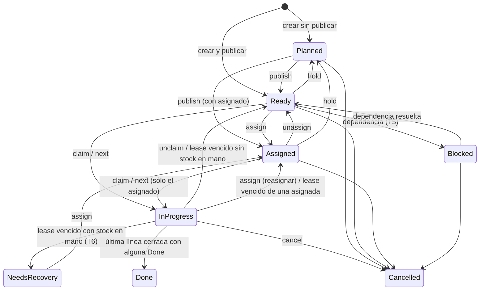

# WMS de QEP: motor de tareas y operaciones de bodega — diseño

- **Fecha:** 2026-11-26
- **Módulos:** Wms, Purchases, Quotations (pedidos), Tenancy, Authorization, Bootstrapper, `qep-android`, `qep-frontend`
- **Estado:** borrador escrito por un agente con el owner dormido. **Nada está aprobado.** Toda elección que el owner no hizo está
  marcada «Decisión del agente (por confirmar)» con un id `DA-xx` y reunida en §13. Las preguntas que sólo el owner puede contestar
  están en §14.
- **Verificado contra el código:** `qep-backend` en `feature/wms-tasks` (nace de `feature/wms-d` `d9895f319`, que ya contiene todo
  `develop` hasta `ed2a59637`), `qep-android` en `feature/scan-lab` (sobre `develop` `0167f6d`), `qep-frontend` en `develop`. Las citas
  al código van por símbolo, no por línea.
- **Entradas que no se reabren:** `2026-10-31-wms-arquitectura-design.md` (en adelante «spec de arquitectura»): D-01 (perfil logístico en
  WMS), D-02 (lote, serie y vencimiento en el modelo), D-03 (saldo en unidad base), D-12 / WMS-ADR-13 (unidad logística como dimensión
  del saldo) y WMS-ADR-12 (operación móvil nativa Android). El ledger, su idempotencia (IK/SK, §6.4) y sus reglas siguen como están.
  `qep-frontend/docs/superpowers/specs/2026-10-31-wms-recepcion-design.md` («spec de recepción»): sus 11 pantallas y su plan B sin
  conexión se mantienen.
- **Lo que este documento reemplaza del spec de arquitectura:** la orden de compra propia del WMS (§9.1 «documento origen», corte
  WMS-C) por la de `Purchases` (§9.1); `putaway-tasks` de §24.4 por el motor de tareas (§6); el agregado `Discrepancy` de §9.3 por la
  novedad unificada `Incident` (§8), que conserva sus cinco resoluciones y la regla de los dos momentos. Lo demás sigue vigente.

---

## 0. Resumen

QEP ya tiene la base del WMS: bodegas, ubicaciones (con las virtuales `SUPPLIER`, `CUSTOMER`, `ADJUSTMENT`, `TRANSIT` y el muelle
`REC-01`), dueños, unidades, perfiles logísticos, un **ledger inmutable** con saldos materializados en la misma transacción,
idempotencia, ajustes, carga inicial y exportación. No tiene nada que diga **quién hace qué, dónde y en qué orden**: no hay tareas,
recepción, almacenamiento, salidas ni novedades.

La propuesta es un **motor de tareas genérico dentro del módulo `Wms`** (área nueva `Tasks`), con un modelo de dos niveles
(`WarehouseTask` asignable + `WarehouseTaskLine` por movimiento planeado), una máquina de estados única para todos los procesos,
asignación **pull dirigida** («siguiente tarea», el servidor elige) más **push** opcional del supervisor, reclamo atómico con
`FOR UPDATE SKIP LOCKED`, **lease con token de exclusión** y barrido de leases vencidos. La tarea es una intención; sólo la
confirmación por escaneo produce un movimiento del ledger. Las desviaciones se registran como **novedades** (`Incident`) con un
catálogo cerrado de tipos y resoluciones.

Encima del motor se construyen, en cortes independientes y mergeables: recepción contra la orden de compra de `Purchases`,
almacenamiento dirigido, salidas desde los pedidos de Quotations (reservas, picking, empaque, alistamiento y despacho) y
cross-docking. El primer corte (T1) entrega el motor con un tipo real, el **movimiento interno** (`Move`), y tiene su plan en
`docs/superpowers/plans/2026-11-26-wms-t1-motor-de-tareas.md`.

---

## 1. Intención

Lo que pidió el owner (2026-11-26, en sus palabras): «terminar de construir todo el módulo de Wms … motor robusto de
asignación/gestión de tareas para asignar tareas de todos los procesos. Que quede recepción, putaway, cross docking, picking,
packing, staging; … la app donde los operarios reciben las tareas; investiga escenarios en cada fase y posibles soluciones, gestión de
novedades».

Se lee así: un solo motor reparte el trabajo de todos los procesos; cada proceso tiene su flujo, sus excepciones y su forma de
resolverlas; el operario recibe y ejecuta las tareas desde la app Android; el supervisor controla todo desde la web.

## 2. Metas y no-metas

### Metas

1. **Un motor, todos los procesos.** Putaway, cross-dock, reabastecimiento, picking, empaque, alistamiento, conteo de verificación y
   movimientos internos son tipos de la misma tarea, con el mismo ciclo de vida, la misma asignación y la misma recuperación.
2. **Nadie trabaja dos veces lo mismo.** Dos operarios nunca reciben la misma tarea; un reintento de la app nunca duplica stock.
3. **Nada queda en el aire.** Una tarea abandonada a medias se detecta, y toda mercancía física tiene una ubicación en el sistema.
4. **Las excepciones son datos.** Toda desviación del plan queda como novedad con código, evidencia, decisión y movimientos.
5. **El supervisor ve y corrige.** Tablero por bodega, reasignar, priorizar, retener, cancelar, todo auditado.
6. **Cortes chicos.** Cada corte se mergea solo a `develop` y deja algo usable.

### No-metas

- Planificador de olas, cluster o batch picking, put wall, zone picking con consolidación (§7.10).
- Optimización de rutas (TSP), slotting automático, estándares de mano de obra, voz, RFID.
- Motor de reglas configurable por el tenant: las políticas son código con pocos parámetros.
- Costeo y contabilidad (no-meta del spec de arquitectura).
- Que las ventas del POS descuenten stock del WMS (§9.4, pregunta O-5).
- Conteos cíclicos programados, devoluciones de clientes y traslados entre bodegas: quedan para cortes posteriores (§7.10).

## 3. Restricciones verificadas

| Hecho | Dónde | Consecuencia |
| --- | --- | --- |
| El ledger es el único escritor de `stock_movements` y `stock_balances`; una llamada por transacción, lote de hasta 500 | `IInventoryLedger.PostAsync`, `LedgerBatch.MaxEntries`, `WmsLayerTests.TheDbContextExposesNoSetForLedgerTables` | Toda confirmación de tarea arma **un** `LedgerBatch` y llama al ledger una vez |
| El ledger valida ubicación bloqueada o en conteo, lote según perfil, ventana de `occurredAt` y saldo insuficiente | `LedgerEntryRules`, `InventoryLedger`, `CheckViolation` | El motor no repite esas reglas; propaga los 422 `wms.location.blocked`, `wms.location.counting`, `wms.lot.required`, `wms.stock.insufficient` |
| Mientras no exista el agregado `HandlingUnit`, el ledger rechaza toda entrada con unidad que no sea un reverso | `InventoryLedger.PostAsync` | Las tareas sobre unidades llegan con el corte de recepción (T3) |
| Idempotencia: rutas IK (header `Idempotency-Key` UUID) y SK (clave `"{doc}:{id}:{acción}:{version}"`); el recibo se graba antes de `SaveChangesAsync` | `IdempotencyKeyFilter`, `IOperationReceipts.Record`, regla de `.claude/rules/wms.md` | Confirmar una línea es IK; las acciones del supervisor se protegen con `version` (412), como `approve`/`reject` de ajustes |
| Las áreas del dominio sólo dependen hacia abajo: `Inventory` → nada; `Warehousing` → `Inventory`; las demás → `Inventory` y `Warehousing`, nunca entre sí | `WmsLayerTests.DomainAreasOnlyDependDownwards` | El motor es un área nueva `Tasks` al nivel de las de proceso (DA-01). Procesos y tareas se enlazan por `Guid`, no por tipo |
| Cruzar módulos va por puertos del WMS con adaptador en `src/Bootstrapper/Wms*.cs`; `Application` sólo ve Tenancy | `WmsLayerTests.ApplicationOnlyReferencesTenancyAmongTheModules`, `NoLayerReferencesTheModulesBehindThePorts` | Purchases, Quotations y las membresías entran por puertos nuevos (§9) |
| Un permiso nuevo necesita constante, `PermissionDefinition` con `Shape` y `RequiredModules: [Wms]`, y política; los permisos WMS sólo los trae `admin` | `WmsPermissions`, `QepServiceCollectionExtensions` (definiciones, `AddAuthorization`, rol `admin`), `CompositionRootTests.EveryPermissionConstantDeclaresItsModules`, `NoEntityRepeatsAnAction` | Cada permiso nuevo trae sus tres registros en el mismo commit |
| Un hosted service nuevo se clasifica en `MultiReplicaInventory` en el mismo commit | `.claude/rules/build-y-despliegue.md`, `MultiReplicaInventoryTests` | El barrido de leases se clasifica `Claimed` |
| El actor de un cambio es la **membresía** (`WmsCaller.RequireAsync`), no el `SubjectId` | `WmsCaller`, `PostAdjustmentHandler` | Asignación, reclamo y eventos de tarea guardan `member_id` |
| `Purchases` tiene su propia orden de compra: `Draft → Sent → Confirmed → Received/Cancelled`, recepción manual sólo de cabecera, sin parciales, **sin bodega**, líneas con `VariantId` opcional y `ConfirmedQuantity` | `Modules.Purchases.Domain.PurchaseOrder`, `PurchaseOrderLine`, `PurchaseOrderStatus` | El WMS recibe contra esa orden y no crea la suya (DA-03) |
| El pedido de Quotations tiene cuatro ejes: `OrderStatus = Open/Archived/Cancelled`, pago, `OrderFulfillmentStatus = NotPrepared/Prepared` (`Order.Prepare` «congela el pedido») y marca de facturado; eventos publicados: `quotations.order.created.v1`, `quotations.order.cancelled.v1` y otros, **no** existe un evento de aprobado | `Modules.Quotations.Domain.Order`, `OrderStatus`, `OrderFulfillmentStatus` | El WMS libera pedidos por pull (DA-05) y avisa con eventos (§9.2) |
| Las ventas del POS no descuentan stock del WMS | (no hay código que lo haga) | Fuera de alcance (O-5) |
| La app Android sólo tiene login, sesión y elección de empresa (más un laboratorio de escaneo sin commitear). No manda `X-Tenant-Id` ni `Idempotency-Key`, no tiene Room ni WorkManager | `qep-android` `co.qcode.qepapp.*`, `QepHeadersInterceptor` | El primer corte de la app (A1) trae esa base antes de cualquier pantalla de tareas |

---

## 4. Enfoques

| | A. Motor genérico de tareas dentro de `Wms` | B. Tareas por proceso | C. Cola genérica de plataforma |
| --- | --- | --- | --- |
| Forma | Un agregado `WarehouseTask` con tipo, líneas y ciclo de vida único; cada proceso crea tareas y reacciona a su confirmación | `putaway_tasks`, `pick_tasks`, `count_tasks`… cada una con su reclamo, su lease y su pantalla | Un módulo `Jobs`/`Tasks` transversal (como las tareas internas de Soporte) que el WMS usa |
| Asignación y prioridad entre procesos | Una sola cola por bodega: el operario con equipo para putaway y reabastecimiento recibe la mejor de las dos | Cada cola compite sola; intercalar exige un orquestador más | Posible, pero la cola no sabe de bodegas, ubicaciones ni stock en mano |
| Recuperación de tareas abandonadas | Una regla para todo | Una por tipo, divergen | Re-encolar ciegamente: incorrecto con mercancía en el carro |
| Transacción con el ledger | Misma transacción (mismo `WmsDbContext`) | Igual | Por outbox entre módulos: la confirmación y el movimiento no cierran juntos |
| Costo | Un modelo, una API de operario, una app que no cambia por proceso | N modelos, N APIs | Módulo nuevo y puertos en las dos direcciones |

**Decisión: A** (DA-01). Es lo que hacen los WMS maduros (work/work lines de Dynamics 365, warehouse order/tasks de SAP EWM,
task/task details de Oracle WMS) y es lo único que permite priorizar e intercalar entre procesos con una sola cola. C se descarta por
la regla de «documento y movimiento en la misma transacción» del spec de arquitectura §4.1. B se descarta porque multiplica justo lo
que tiene que ser uno solo: reclamo, lease, recuperación y pantalla del operario.

Consecuencia en la arquitectura: un área nueva `Modules.Wms.Domain.Tasks` que sólo depende de `Inventory` y `Warehousing`. Ningún otro
área la referencia por tipo: un proceso guarda el `Guid` de sus tareas y la tarea guarda `source_type` + `source_id` del proceso. La
coordinación vive en `Application` (que no está sujeta a la regla de áreas). Cambia `WmsLayerTests`: es un **cambio de arquitectura
que el owner autoriza antes del merge** (`CLAUDE.md`, decisión del 2026-11-25).

---

## 5. Principios

1. **La tarea es una intención; el ledger es el hecho.** Crear, asignar, priorizar o cancelar una tarea nunca mueve stock. Sólo
   confirmar una línea escaneando produce movimientos.
2. **Toda mercancía tiene una ubicación en el sistema**, aunque sea la mano del operario (ubicación `HANDLING`, §7.5). Una tarea a
   medias nunca deja stock «en ninguna parte».
3. **Reserva ≠ tarea ≠ movimiento.** La asignación de stock reserva contra una demanda; la tarea ejecuta; el movimiento consume. Tres
   registros, tres ciclos de vida.
4. **La novedad es un objeto**, no un texto ni un `if`: tipo de un catálogo cerrado, evidencia, resolución, quién decidió y qué
   movimientos produjo.
5. **El servidor decide; el dispositivo propone.** Sin conexión se confirma lo que ya se tiene reclamado; reclamar, reasignar o
   resolver exige servidor.
6. **El ajuste nunca es la primera reacción.** Un faltante se verifica con un conteo antes de ajustar, y quien lo reporta no aprueba
   su propio ajuste.

---

## 6. Motor de tareas

### 6.1 Modelo de datos

Tres tablas en el esquema `wms`. Los nombres de clase llevan prefijo `WarehouseTask` para no chocar con `System.Threading.Tasks.Task`.

**`wms.tasks`** (agregado `WarehouseTask`, raíz):

| Columna | Tipo | Nota |
| --- | --- | --- |
| `id` | `uuid` PK | UUID v7 del servidor |
| `tenant_id` | `uuid` | |
| `warehouse_id` | `uuid` FK `warehouses` RESTRICT | La tarea es de una bodega; todas sus ubicaciones son de esa bodega |
| `owner_id` | `uuid` FK `owners` RESTRICT | **Un dueño por tarea** (3PL: nunca se mezcla mercancía de dos clientes en un recorrido) |
| `number` | `varchar(32)` | `TSK-yyyyMMdd-NNNN`, único por tenant (DA-29), numerado como los ajustes |
| `type` | `varchar(16)` | `WarehouseTaskType` (§6.2) |
| `status` | `varchar(16)` | `WarehouseTaskStatus` (§6.3) |
| `priority` | `smallint` | 1..9; default por tipo |
| `urgent` | `boolean` | Botón «urgente» del supervisor; auditado |
| `due_at` | `timestamptz` null | Corte o promesa; alimenta la urgencia |
| `released_at` | `timestamptz` null | Desde cuándo está en el pool; alimenta el envejecimiento. Obligatoria en `Ready`, `Assigned`, `InProgress` |
| `source_type`, `source_id` | `varchar(32)`, `uuid` null | `Manual`, `Receipt`, `OutboundOrder`, `Incident`, `Replenishment`; el proceso que la creó |
| `note` | `varchar(500)` null | |
| `assigned_member_id` | `uuid` null | Push: preasignada a una membresía |
| `claimed_by_member_id`, `claimed_device_id` | `uuid` null, `varchar(64)` null | Quién la tiene en la mano y desde qué celular |
| `lease_token` | `uuid` null | Token de exclusión (fencing). Cambia en cada reclamo |
| `lease_expires_at` | `timestamptz` null | |
| `last_activity_at` | `timestamptz` null | Última confirmación o latido; el tablero lo muestra |
| `created_by`, `created_at` | `uuid`, `timestamptz` | Membresía; `Guid.Empty` si la creó el sistema |
| `completed_at`, `cancelled_at`, `cancel_reason` | null | |
| `version` | `bigint` | Token de concurrencia optimista |

Índices y restricciones: `IX_tasks_tenant_number` único `(tenant_id, number)`; `IX_tasks_pool` `(tenant_id, warehouse_id, status)
WHERE status IN ('Ready','Assigned')`; **`IX_tasks_member_in_progress` único `(tenant_id, claimed_by_member_id) WHERE status =
'InProgress'`** (una tarea en curso por operario, DA-08); `IX_tasks_lease` `(lease_expires_at) WHERE status = 'InProgress'`;
`IX_tasks_source` `(tenant_id, source_type, source_id)`; `IX_tasks_board` `(tenant_id, warehouse_id, status, type)` (los conteos del tablero) e `IX_tasks_list` `(tenant_id, warehouse_id, created_at DESC, number DESC)` (el listado del supervisor), de la revisión de T1. `CHECK` de `type`, `status`, `priority BETWEEN 1 AND 9`;
`CK_tasks_claim`: `status <> 'InProgress' OR (claimed_by_member_id, lease_token, lease_expires_at) todos no nulos`;
`CK_tasks_assigned`: `status <> 'Assigned' OR assigned_member_id IS NOT NULL`; `CK_tasks_released`: `status NOT IN
('Ready','Assigned','InProgress') OR released_at IS NOT NULL`.

**`wms.task_lines`** (`WarehouseTaskLine`, hija):

| Columna | Nota |
| --- | --- |
| `id`, `task_id` (FK cascade), `position` | Orden de recorrido; único `(task_id, position)` |
| `variant_id`, `lot_id` (null = cualquiera que cumpla la regla) | Lo planeado. El nombre y el código se resuelven al leer por `IWmsCatalogReader`, como hace `AdjustmentDtoComposer` |
| `stock_status` | Estado del saldo que se mueve (`Available`, `Received`…) |
| `from_location_id` FK RESTRICT, `to_location_id` FK RESTRICT null | `to` nulo = el operario elige destino (sólo tipos que lo admiten) |
| `quantity_planned` `numeric(18,6)` `> 0`, `quantity_taken`, `quantity_confirmed` | En unidad base. `taken` sólo en tipos de dos pasos (§6.2): lo que está en `HANDLING` es `taken − confirmed` |
| `line_status` | `Open`, `Done`, `Short` (T2), `Cancelled` |
| `reservation_id` null | La reserva que consume (T5) |
| `cancel_reason` null | |

Las unidades logísticas (D-12) entran en T3 con `handling_unit_id` null y `CK (variant_id IS NOT NULL OR handling_unit_id IS NOT
NULL)`: una línea «mover el palet entero» no nombra variante, porque el contenido son sus saldos. En T1 `variant_id` es obligatoria.

**`wms.task_events`** (`WarehouseTaskEvent`, append-only): `id`, `tenant_id`, `task_id`, `kind`, `member_id` (null = sistema),
`device_id`, `line_id` null, `quantity` null, `detail varchar(500)` null, `occurred_at` (la hora del hecho: la del escaneo en lo que deja una confirmación, DA-36) y `recorded_at` (la hora del servidor al guardarlo). La historia se ordena por `recorded_at`, luego por tipo (orden causal del enum) e id: así una confirmación tardía aparece después del vencimiento que la precedió en el servidor, con su hora de escaneo intacta. `recorded_at` nace `NOT NULL DEFAULT now()` para que un pod viejo que no la escribe siga insertando, y la migración la llena con `occurred_at` en las filas existentes. Índice `(task_id, occurred_at)`. Es la
historia de la tarea y la fuente de los indicadores (§6.12); la aplicación sólo inserta.

### 6.2 Tipos de tarea

| Tipo | Qué hace | Pasos | Permiso para ejecutarla | Lease | Destino libre | Corte |
| --- | --- | --- | --- | --- | --- | --- |
| `Move` | Reubicar stock entre dos ubicaciones físicas de la bodega (también reabastecer a mano) | 1 | `wms.putaway.perform` | 15 min | Con motivo | **T1** |
| `Count` | Verificar una ubicación, a ciegas | 1 | `wms.count.perform` | 30 min | No aplica | T2 |
| `Putaway` | Llevar lo recibido del muelle a almacenamiento | 1 | `wms.putaway.perform` | 15 min | Con motivo | T4 |
| `Replenish` | Llevar de reserva a picking antes de un pick | 2 | `wms.putaway.perform` | 15 min | No | T5 |
| `Pick` | Tomar lo reservado de un pedido y dejarlo en la estación de empaque | 2 | `wms.pick.perform` (nuevo en T6) | 15 min | No | T6 |
| `Pack` | Verificar y empacar un pedido en cajas | 1 | `wms.pack.perform` (nuevo en T7) | 30 min | No aplica | T7 |
| `Stage` | Llevar las cajas de un pedido al carril de alistamiento | 1 | `wms.pack.perform` | 15 min | Carril del mismo pedido | T7 |
| `CrossDock` | Llevar lo recibido directo al carril de un pedido que lo espera | 1 | `wms.putaway.perform` | 15 min | No | T8 |

- **Un paso:** la confirmación de una línea mueve `from → to` en un solo movimiento, al escanear el destino. Si la tarea se abandona,
  lo confirmado ya está en su destino y lo pendiente sigue en el origen: no hay stock en mano.
- **Dos pasos:** «tomar» mueve `from → HANDLING` (`quantity_taken`) y «entregar» mueve `HANDLING → to` (`quantity_confirmed`). Se usa
  donde un recorrido junta varias líneas antes de soltarlas. Es lo que vuelve necesaria la recuperación (§6.7).
- La recepción **no es una tarea** con lease (DA-02): es el documento colaborativo del spec de recepción (varios operarios cuentan
  deltas sobre el mismo `Receipt`). Su confirmación **genera** tareas `Putaway` y `CrossDock`.
- El despacho tampoco: es una acción SK sobre el pedido de salida (§7.8).
- Prioridad base por tipo (de mayor a menor, DA-10): `Replenish` de emergencia 8 → `Pick` 7 → `Stage` 6 → `CrossDock` 6 → `Putaway` 5
  → `Pack` 5 → `Count` 3 → `Move` 3.

### 6.3 Máquina de estados



| Estado | Significa | Corte |
| --- | --- | --- |
| `Planned` | Creada, no publicada. No aparece en el pool | T1 |
| `Ready` | En el pool; cualquier operario elegible la puede reclamar | T1 |
| `Assigned` | Preasignada a una membresía; sólo ella la reclama | T1 |
| `InProgress` | Reclamada con lease vigente | T1 |
| `Done` | Todas las líneas cerradas, al menos una `Done` (puede ser corta) | T1 |
| `Cancelled` | Terminal. Si había stock en mano, primero se recupera (§6.7) | T1 |
| `Blocked` | Espera algo: un reabastecimiento, los picks de un pedido. Lleva `blocked_reason` | T5 |
| `NeedsRecovery` | Lease vencido **con stock en `HANDLING`**. No vuelve sola al pool | T6 |

Reglas:

- `Done` y `Cancelled` son terminales. Corregir después es otra tarea u otro movimiento, nunca editar la tarea.
- Cerrar la última línea abierta cierra la tarea: `Done` si alguna línea quedó `Done` o `Short`, `Cancelled` si todas se cancelaron.
- Cancelar una tarea cancela sus líneas abiertas. Desde `InProgress` cancela el supervisor, con motivo, y revoca el lease. Con stock
  en mano (T6) no se cancela: primero se recupera.
- Toda transición sube `version` y escribe un `task_events`, salvo el latido, que sólo extiende el lease (para no invalidar la
  versión que el supervisor tiene en pantalla cada dos minutos).
- `Blocked` y `NeedsRecovery` entran en el `CHECK` de `status` con el corte que los usa (un cambio de `CHECK` aditivo: ningún pod viejo
  escribe esos valores).

### 6.4 Generación

| Origen | Crea | Cuándo | Idempotencia |
| --- | --- | --- | --- |
| Supervisor (web) | `Move` | `POST /tasks` (IK) | Header `Idempotency-Key` |
| Confirmación de recepción (T3) | `Putaway` por unidad logística o por línea suelta; `CrossDock` si aplica (T8) | En la misma transacción que la confirmación SK | La clave SK de la confirmación |
| Novedad (T2) | `Count` de verificación de una ubicación | Al registrar `SHORT_PICK`, `LOCATION_MISMATCH`, `LOCATION_FULL`, `QTY_MISMATCH` | La clave IK de la confirmación que la originó |
| Liberación de un pedido (T5/T6) | `Replenish` por demanda, `Pick` por pedido | Al asignar stock | Una tarea `Pick` abierta por pedido (`IX_tasks_source` + verificación en el handler) |
| Picks completos (T7) | `Pack` (nace `Blocked` en T5/T6 y se libera) y luego `Stage` | Al cerrar el último pick / el empaque | Una abierta por pedido y tipo |

Regla general: **una tarea se genera en la misma transacción que el hecho que la origina**, con la misma clave de idempotencia. Si la
tarea no se puede guardar, el hecho tampoco.

### 6.5 Asignación: pull dirigido más push

- **Pull dirigido (por defecto).** El operario pide «siguiente tarea» y el servidor le entrega la mejor elegible ya reclamada. La app
  **no muestra el pool** para escoger (DA-09): sólo «Siguiente tarea» y «Mis tareas» (la que tiene en curso y las que le asignaron).
  Saltar la propuesta es soltarla (`unclaim`) con un código de motivo, que se mide.
- **Push (opcional).** El supervisor asigna una tarea a una persona (`assign`). La asignación queda hasta que el supervisor la quite;
  la persona la ve primero en «Mis tareas» y «Siguiente tarea» se la entrega antes que cualquier otra.
- **Reasignar** una tarea en curso (`assign` desde `InProgress`) revoca el lease del actual (su próxima confirmación recibe
  `wms.task.lease_lost`) y la deja `Assigned` al nuevo.

**Elegibilidad** (todas):

1. Tenant y bodega de la petición (`X-Tenant-Id` y `warehouseId` del cuerpo).
2. El operario tiene el permiso del tipo (§6.2); los tipos permitidos salen de `IExecutionContext.HasPermission`.
3. `assigned_member_id` nulo o igual al operario.
4. Dueño dentro de su alcance: la firma de `WmsAuthorization.EnsureAsync(…, ownerId, warehouseId)` ya existe y hoy se ignora; cuando
   la fase 3 llene `wms.member_scopes`, el filtro entra en la consulta sin cambiar el contrato.

Zonas por turno, equipo (montacargas) y habilidades quedan fuera hasta que una bodega lo necesite (DA-14): son columnas aditivas y un
filtro más en la misma consulta.

### 6.6 Prioridad

Se calcula **al reclamar**, no se guarda (nada que recalcular en segundo plano):

```
score = priority                                   -- 1..9, por tipo o fijado por el supervisor
      + (urgent ? 10 : 0)                          -- botón del supervisor
      + min(3, floor(minutos desde released_at / 20))   -- envejecimiento con tope: lo viejo sube, pero no le gana a un corte
      + tramo(due_at)                              -- 0 sin fecha o a más de 2 h; 1 a ≤ 2 h; 2 a ≤ 1 h; 3 a ≤ 30 min; 4 vencida
orden: asignada a mí primero, luego score desc, due_at asc (nulos al final), released_at asc, id
```

Los pesos son constantes en el código (`TaskPriority`, DA-10). La proximidad (distancia por pasillo) se agrega cuando haya una bodega
grande que la pida: es un término más de la misma fórmula. El tablero muestra `effectivePriority` con la misma función.

### 6.7 Reclamo, lease, latido y recuperación

- **Reclamo** (`next` o `claim`): transición atómica a `InProgress` que fija `claimed_by_member_id`, `claimed_device_id`,
  `lease_token` nuevo y `lease_expires_at = now + lease del tipo`. Si la misma persona retoma desde el mismo celular su reclamo
  vencido, el token se conserva (DA-34).
- **Pedir otra vez la tarea en curso** (`next` o `claim` de quien ya la tiene `InProgress`): el servidor bloquea la fila y le
  renueva el lease con el mismo token, sin evento ni versión, como el latido. Vale también si el lease venció y el barrido todavía
  no pasó: nadie más pudo tomarla. Nunca devuelve un `leaseExpiresAt` vencido.
- **Latido:** la app lo manda cada 2 minutos mientras la tarea está en pantalla, y toda confirmación lo renueva. El lease no es de
  segundos: el operario camina, busca y habla.
- **Fencing:** toda acción del operario sobre la tarea lleva el `leaseToken`. Si no coincide con el vigente, 409
  `wms.task.lease_lost` con la extensión `resumable`: `true` si el lease venció y nadie más tomó la tarea (la app la pide otra vez
  con `claim` y sigue; su cola vale si es el mismo celular, DA-34), `false` si la tiene otra persona, se la reasignaron, la
  retuvieron o ya terminó. Con `false` la app muestra «Esta tarea ya no es tuya».
- **Barrido** (`TaskLeaseSweeper`, cada `TaskLeaseSweepSeconds`, 60 por defecto): toma con `FOR UPDATE SKIP LOCKED` las `InProgress`
  con `lease_expires_at < now` y:
  - **sin stock en mano** (toda tarea de un paso, o de dos pasos con `taken = confirmed` en todas sus líneas) → `Ready`, o `Assigned`
    si tenía asignado. Lo confirmado ya está en su destino; lo pendiente sigue en el origen. Evento `LeaseExpired`;
  - **con stock en mano** (T6) → `NeedsRecovery` y aviso en el tablero. El supervisor la reasigna; quien la recibe ve en la app lo que
    está en `HANDLING` a nombre de esa tarea y empieza por entregarlo.
- **Confirmación tardía** (DA-13): el barrido conserva `claimed_by_member_id` y `lease_token`. Si llega una confirmación con ese mismo
  token, del mismo operario, y nadie más reclamó la tarea, el servidor **la reanuda** (vuelve a `InProgress`, renueva el lease, evento
  `LeaseResumed`) y aplica la confirmación: la mercancía ya se movió en el piso y rechazarla dejaría el sistema mintiendo. Si otro la
  reclamó, el token cambió: 409 `wms.task.lease_lost`, y desde T2 la confirmación rechazada se registra como novedad `SYNC_CONFLICT`.
  Si quien confirma tarde ya tiene otra tarea en curso, la confirmación se aplica igual pero la vieja no vuelve a `InProgress` (DA-32).
  Una tarea retenida (`hold`, vuelve a `Planned`) rechaza las confirmaciones tardías (DA-35), y retenerla borra el reclamo que haya quedado del lease vencido: después de retener y publicar, una confirmación de antes ya no la reanuda.
- **Soltar** (`unclaim`): el operario devuelve la tarea con motivo (`ShiftEnd`, `CannotReach`, `Skipped`, `Other`). Vuelve a `Ready`
  (deja de estar asignada si lo estaba a él). Con stock en mano no se puede soltar: primero entrega lo que lleva. Repetir un `unclaim` que ya se aplicó (la app no recibió la respuesta) da 409 `wms.task.lease_lost` con `resumable: false`: la app lo trata como éxito, porque la tarea ya no es suya.

### 6.8 Concurrencia

- **Siguiente tarea**, en la transacción del handler:
  1. `LockAsync("task-member:{memberId}")` (advisory bloqueante): dos toques seguidos del mismo operario se serializan.
  2. Si el operario ya tiene una `InProgress` en esa bodega, se bloquea esa fila (`LockAsync`), se le renueva el lease (§6.7) y se devuelve: repetir «siguiente» es idempotente. Si la tiene en
     otra bodega, 409 `wms.task.member_busy` con `{ taskId }` en las extensiones.
  3. Candidata con una sola sentencia:

     ```sql
     SELECT t.id FROM wms.tasks t
     WHERE t.tenant_id = @tenant AND t.warehouse_id = @warehouse
       AND t.status IN ('Ready','Assigned')
       AND (t.assigned_member_id IS NULL OR t.assigned_member_id = @member)
       AND t.type = ANY(@types)
     ORDER BY (t.assigned_member_id IS NOT NULL) DESC, <score de §6.6 con @now> DESC,
              t.due_at NULLS LAST, t.released_at, t.id
     LIMIT 1
     FOR UPDATE SKIP LOCKED
     ```

     `SKIP LOCKED` hace que dos operarios que piden a la vez reciban tareas distintas sin esperarse: «la mejor no bloqueada en este
     instante». La consulta excluye además lo que esa persona soltó con motivo `Skipped` en los últimos 15 minutos, salvo que se lo
     hayan asignado (DA-33).
  4. EF carga el agregado (la fila ya está bloqueada por esta transacción) y el dominio aplica `Claim`. El índice único
     `IX_tasks_member_in_progress` es la última red: si algo lo viola, 409 `wms.task.member_busy`.
- **Reclamar una tarea concreta** (`claim`, desde «Mis tareas»): `SELECT … FOR UPDATE` de esa fila (bloqueante, corto) y `Claim` del
  dominio; si otro la tomó, 422 `wms.task.invalid_transition`.
- **Confirmar una línea:** `SELECT … FOR UPDATE` de la tarea antes de cargarla (dos confirmaciones de la misma tarea, por ejemplo la
  cola de la app al reconectar, se serializan), validación de lease en el dominio y **una** llamada al ledger. Los saldos se bloquean
  en el orden de `StockKeyComparer` dentro del ledger; la tarea siempre se bloquea **antes** que los saldos, en todos los caminos.
- **Acciones del supervisor:** `version` (412 `concurrency.conflict`), como `ApproveAdjustment`.
- `READ COMMITTED` + bloqueos explícitos + `CHECK`; nunca `SERIALIZABLE` como default.

### 6.9 Sin conexión e idempotencia

| Acción | ¿Sin conexión? | Por qué |
| --- | --- | --- |
| Confirmar líneas de una tarea **ya reclamada** | Sí, en cola | El lease protege; el servidor valida al sincronizar y acepta la tardía (§6.7) |
| Registrar una novedad desde una tarea | Sí, en cola | Sólo captura; la decisión es del servidor |
| Contar en una recepción | Sí (spec de recepción §7) | Deltas idempotentes |
| Reclamar o pedir la siguiente tarea | **No** | Compite con otros operarios: sin servidor no hay árbitro |
| Finalizar recepción, despachar, soltar | **No** | Cierra documentos o libera trabajo |

- Cada acción de la app lleva un UUID generado **al escanear** (no al enviar), que viaja como `Idempotency-Key`: el recibo de
  `operation_receipts` devuelve la misma respuesta con 200 y el ledger guarda la misma clave en su lote.
- La cola local (Room) es por usuario y por tarea, en orden FIFO. Si el servidor rechaza una operación, las siguientes de **esa** tarea
  se pausan y la app lo muestra; las de otras tareas siguen.
- `occurredAt` es la hora del escaneo, dentro de la ventana del ledger (`[now − 30 días, now + 5 min]`) y no más de 5 minutos antes de la publicación de la tarea (`released_at`, o `created_at` si nunca se publicó; la misma tolerancia de reloj del ledger), *decisión del agente, por confirmar*; un escaneo anterior es imposible y llega como 422 `wms.movement.occurred_at_out_of_range`. Es también la fecha de los
  eventos que la confirmación deja en `task_events` (`LeaseResumed`, `LineConfirmed`, `Completed`) y de `completed_at` (DA-36).
- La doble lectura del mismo código es UX, no idempotencia: la app ignora el mismo código en menos de 1 s y el servidor no deja
  superar lo planeado (`wms.task.quantity_exceeds_remaining`).

### 6.10 Control del supervisor

Web (`qep-frontend`, corte W1), con `wms.task.manage` para actuar y `wms.document.read` para ver:

- **Tablero por bodega:** conteo por estado (completo, incluidos los ceros: la pantalla no conoce el enum) y por tipo; operarios con
  tarea en curso, desde cuándo y su última actividad; arriba, `NeedsRecovery` y novedades abiertas (desde T2); arriba también las **asignaciones huérfanas** (`staleAssignments`): tareas `Planned` o `Assigned` asignadas a alguien que ya no está activo o perdió el permiso del tipo. Nadie más puede reclamarlas, así que el supervisor las reasigna.
- **Sobre una tarea:** publicar / retener, asignar / quitar asignación / reasignar, cambiar prioridad y urgencia, cancelar con motivo,
  cancelar una línea con motivo. Todo con `version` y auditado.
- **Selector de asignado:** las membresías activas con el permiso del tipo (`GET /tasks/assignees`).
- Fuera de T1: dividir una tarea, forzar desbloqueo, cerrar la sesión de un celular perdido, zonas y equipo por turno.

### 6.11 API del motor (T1)

Base `/api/v1/tenants/{tenantId:guid}/wms`. Convenciones del spec de arquitectura §24.1 (enums por nombre, cantidades en unidad base,
403 nunca 404, paginación `page`/`pageSize` con `WmsPaging`).

**Supervisor**

```
POST /tasks                      IK  [wms.task.manage]   CreateMoveTaskRequest → 201 TaskDto
     { warehouseId, ownerId?, priority?, dueAt?, note?, publish = true, assignToMemberId?,
       lines: [{ variantId, lotId?, stockStatus = "Available", fromLocationId, toLocationId, quantity }] }   // 1..100 líneas
GET  /tasks?warehouseId&status&type&assignedMemberId&page&pageSize   [wms.document.read] → { items: TaskSummaryDto[], page, pageSize, totalCount }
GET  /tasks/summary?warehouseId  [wms.document.read]  → TaskBoardDto
GET  /tasks/assignees?warehouseId&type   [wms.task.manage]  → { items: [{ memberId, name }] }
GET  /tasks/{id}                 [wms.document.read]  → TaskDto (con líneas y eventos)
POST /tasks/{id}/publish         [wms.task.manage]   { version }
POST /tasks/{id}/hold            [wms.task.manage]   { version, reason? }
POST /tasks/{id}/assign          [wms.task.manage]   { memberId, version, reason? }       // reason obligatorio si estaba InProgress
POST /tasks/{id}/unassign        [wms.task.manage]   { version }
POST /tasks/{id}/priority        [wms.task.manage]   { priority, urgent, version }
POST /tasks/{id}/cancel          [wms.task.manage]   { reason, version }
POST /tasks/{id}/lines/{lineId}/cancel   [wms.task.manage]   { reason, version }
```

**Operario** (la ruta exige `wms.document.read`; el handler exige además el permiso del tipo de la tarea)

```
GET  /tasks/mine?warehouseId     → { current: TaskDto?, assigned: TaskSummaryDto[] }
POST /tasks/next                 { warehouseId, deviceId }  → 200 TaskDto | 204 sin tareas elegibles
POST /tasks/{id}/claim           { deviceId }               → 200 TaskDto
POST /tasks/{id}/heartbeat       { leaseToken }             → 200 { leaseExpiresAt }
POST /tasks/{id}/unclaim         { leaseToken, reason }     → 200 TaskDto        // reason ∈ ShiftEnd|CannotReach|Skipped|Other
POST /tasks/{id}/lines/{lineId}/confirm   IK
     { leaseToken, fromLocationId, toLocationId, lotId?, quantity, overrideReason?, occurredAt, deviceId }  → 200 TaskDto
```

```
TaskSummaryDto { id, number, type, status, warehouseId, ownerId, priority, urgent, effectivePriority, dueAt, releasedAt,
                 assignedMemberId, assignedMemberName, claimedByMemberId, claimedByMemberName, lineCount, openLineCount,
                 firstFromLocationCode, lastActivityAt, version }
TaskDto        { ...TaskSummaryDto, sourceType, sourceId, note, leaseToken, leaseExpiresAt,
                 lines: [{ id, position, variantId, variantCode, productName, lotId, lotCode, stockStatus,
                           fromLocationId, fromLocationCode, toLocationId, toLocationCode,
                           quantityPlanned, quantityConfirmed, quantityRemaining, lineStatus, baseUom }],
                 events: [{ kind, memberId, memberName, deviceId, lineId, quantity, detail, occurredAt }] }
TaskBoardDto   { warehouseId, byStatus: [{ status, count }], byType: [{ type, open }],
                 operators: [{ memberId, name, taskId, taskNumber, type, since, lastActivityAt }],
                 staleAssignments: [{ taskId, taskNumber, memberId, name }] }
```

- `leaseToken` sólo viaja a quien tiene la tarea reclamada; para cualquier otro va `null` (nadie más puede firmar sus confirmaciones).
- `events` viaja sólo en `GET /tasks/{id}` (la ficha del supervisor); en las respuestas al operario va vacío porque la app no lo
  dibuja y cada byte cuenta con mala señal. El DTO lo dice en su comentario.
- `byStatus` viaja completo, también en cero, y los nombres de miembro se resuelven en el servidor: la pantalla no conoce el enum ni
  Tenancy (regla BFF del `CLAUDE.md`).
- `staleAssignments` viaja completa (sin paginar), en orden de número: la pantalla no puede saber si el asignado sigue activo ni qué
  permisos tiene (Tenancy no es suyo), y sin esta lista una tarea asignada a quien ya no puede hacerla espera para siempre. Se arma
  con una sola consulta de asignadas y una consulta de elegibles por permiso, no una por tarea.
- `events` va en orden de `recorded_at` (hora del servidor), luego tipo e id; cada evento conserva su `occurredAt` (hora del
  escaneo). `recordedAt` no viaja: ninguna pantalla lo dibuja.
- Confirmar exige: lease válido (o reanudable, §6.7); `occurredAt` dentro de la ventana del ledger y no más de 5 minutos antes de la publicación (la misma tolerancia de reloj del ledger; decisión del agente, por confirmar) (`wms.movement.occurred_at_out_of_range`); línea `Open`; `fromLocationId` = el planeado (`wms.task.location_mismatch`);
  `toLocationId` = el planeado, o distinto con `overrideReason` si el tipo lo admite y la ubicación es física, de la misma bodega y
  admite almacenamiento (`wms.task.location_mismatch` / `wms.task.location_invalid`); `lotId` igual al de la línea si la línea lo fija
  (`wms.task.lot_mismatch`); `quantity ≤ remaining` (`wms.task.quantity_exceeds_remaining`). El movimiento: de
  `(owner, from, variant, lot, stockStatus)` a `(owner, to, variant, lot, stockStatus)`, motivo `InternalMove`, documento
  `("Task", taskId, lineId)`, actor la membresía con su `deviceId`, `overrideReason` en el movimiento.

**Códigos de error nuevos (T1)**

| Código | HTTP | Cuándo |
| --- | --- | --- |
| `wms.task.not_found` | 404 | Tarea o línea que no existe en el tenant |
| `wms.task.invalid_transition` | 422 | Acción que el estado no admite; extensiones `{ from, action }` (misma forma que `wms.document.invalid_transition`) |
| `wms.task.lease_lost` | 409 | `leaseToken` que no es el vigente ni reanudable; extensiones `{ resumable }` (§6.7) |
| `wms.task.member_busy` | 409 | El operario ya tiene otra tarea en curso; extensiones `{ taskId }` |
| `wms.task.assigned_to_other` | 422 | Reclamar una tarea asignada a otra persona |
| `wms.task.assignee_not_eligible` | 422 | Asignar a una membresía inactiva o sin el permiso del tipo |
| `wms.task.location_invalid` | 422 | Ubicación de otra bodega o virtual, destino que no admite almacenamiento, o `from = to` (el origen puede ser un muelle) |
| `wms.task.location_mismatch` | 422 | Lo escaneado no es lo planeado y no hay `overrideReason` (o el tipo no lo admite) |
| `wms.task.lot_mismatch` | 422 | Lote escaneado distinto del planeado |
| `wms.task.quantity_exceeds_remaining` | 422 | Confirmar más de lo que falta |
| `wms.task.line_invalid` | 422 | Líneas fuera de 1..100, cantidad ≤ 0, prioridad fuera de 1..9, motivo vacío (el validador da además el mapa `errors`) |

Los 422 del ledger (`wms.stock.insufficient`, `wms.location.blocked`, `wms.location.counting`, `wms.lot.required`,
`wms.movement.occurred_at_out_of_range`…) llegan tal cual al confirmar.

**Permiso nuevo:** `wms.task.manage` — «Supervisar tareas de bodega», categoría `Bodegas`, `Shape("wms.task", "Tareas de bodega",
"manage")`, riesgo `medium`, sólo en `admin` (DA-15). La lista de WMS pasa de 16 a 17. Los operarios usan los permisos de proceso
que ya existen.

### 6.12 Eventos y auditoría

- `task_events` guarda toda transición (`Created`, `Published`, `Held`, `Assigned`, `Unassigned`, `Claimed`, `Unclaimed`,
  `LeaseExpired`, `LeaseResumed`, `PriorityChanged`, `LineConfirmed`, `LineCancelled`, `Completed`, `Cancelled`; desde T2 `LineShort`,
  desde T5 `Blocked`/`Unblocked`, desde T6 `LineTaken`, `NeedsRecovery`).
- `audit.entries` (por `IWmsAuditRecorder`) sólo para las acciones del supervisor: crear, asignar, reasignar, priorizar, cancelar
  (DA-27). Las del operario ya quedan en `task_events` y en el movimiento del ledger con actor y dispositivo; auditarlas duplicaría
  volumen sin información nueva.
- Las tareas **no publican eventos de integración**: son internas del WMS. Los procesos publican los suyos
  (`wms.receipt.confirmed.v1`, `wms.putaway.completed.v1`, `wms.outbound.packed.v1`, `wms.shipment.dispatched.v1`).
- **Indicadores** (se calculan desde `task_events`, líneas y ledger; el tablero llega en un corte posterior): productividad
  (líneas/hora por operario y tipo, descontando pausas), tasa de faltante en picking, tiempo muelle-a-stock, ciclo del pedido,
  backlog por tramo de urgencia, novedades por tipo, salud del motor (leases vencidos, `NeedsRecovery`, saltos de propuesta).

### 6.13 Dependencias (T5)

Tabla `wms.task_dependencies (task_id, depends_on_task_id)`, plana (una tarea espera a N, sin motor de DAG). La tarea dependiente nace
`Blocked` con `blocked_reason` (`WaitingReplenishment`, `WaitingPicks`). Al cerrar o cancelar una tarea, en la misma transacción se
revisan sus dependientes y se liberan las que ya no esperan nada (`Blocked → Ready`). Casos: pick tras reabastecimiento por demanda,
pack tras los picks del pedido.

---

## 7. Procesos

Convenciones: un movimiento se escribe `(ubicación, estado[, unidad]) → (ubicación, estado[, unidad])`. Las ubicaciones nuevas que
este diseño necesita (DA-20):

| Ubicación | Rol | Física | Nace | Para qué |
| --- | --- | --- | --- | --- |
| `REC-01…` | `Receiving` (existe) | Sí | Con la bodega (existe) | Muelle de recepción |
| Bins de almacenamiento y picking | `Storage` / `Picking` (existen) | Sí | El usuario | |
| `PACK-xx` | **`Packing`** (nuevo) | Sí | El usuario | Estación de empaque: allí se entrega el picking |
| Carriles de alistamiento | `Shipping` (existe) | Sí | El usuario | Donde esperan las cajas cerradas hasta el despacho |
| `HANDLING` | **`Handling`** (nuevo) | **Sí**, sin almacenamiento ni picking | Con la bodega, por el dominio (y backfill para las existentes) | La mano o el carro del operario en tareas de dos pasos. Física para que cuente en la existencia; no es pickable; su contenido por operario sale de las líneas (`taken − confirmed`) |

### 7.1 Recepción (T3)

**Documento origen.** La orden de compra de `Purchases` (DA-03). El WMS la lee por el puerto `IWmsPurchaseOrderReader` (adaptador en
Bootstrapper) y la considera recibible si está `Confirmed` o `Received` y el WMS no la cerró. Sus líneas con `VariantId` son lo
esperado (`ConfirmedQuantity ?? Quantity`); **una línea sin variante no se recibe a stock**: se muestra como «Sin producto en
catálogo» y lo que llegue de ella entra por la novedad «No venía» (§8). La bodega la elige quien inicia la recepción (la orden no la
tiene). Los traslados entre bodegas usan el mismo flujo cuando exista su corte.

**Modelo.** `InboundDocument` (área `Inbound`): la foto del documento origen en el WMS, creada al iniciar la primera recepción —
`source_type = PurchaseOrder`, `source_id`, `number`, `warehouse_id`, `status Open | Closed`, líneas `(source_line_id, variant_id,
expected_qty, received_qty)`. Alimenta `expected` del resumen de saldos (spec de arquitectura §5.3). `Receipt` (la sesión de conteo,
spec de arquitectura §9.1): `Counting → Confirmed | Discarded`, a lo sumo una en `Counting` por documento, conteos por deltas IK de
varios operarios. `HandlingUnit` (D-12): «Cerrar caja / palet» la crea `Building`; al confirmar pasa a `Active` o se cierra vacía.

**Flujo.** Por recibir → documento → escanear → cantidad (lote y vencimiento si el perfil lo pide) → … → confirmar (SK, exige
conexión) → la confirmación, en una transacción: crea lotes; escribe `SUPPLIER → (REC, Received[, HU])` por lo esperado y
`SUPPLIER → (REC, Quarantine)` por lo sobrante o no esperado (D-05); suma `received_qty`; crea las novedades; activa las unidades;
**genera las tareas `Putaway`** (una por unidad; una por línea suelta con lo recibido) y `CrossDock` si aplica (T8); publica
`wms.receipt.confirmed.v1`. «Cerrar documento» cierra el `InboundDocument` (con faltantes como novedad `SHORT_RECEIPT` aceptada).

**Escenarios.**

| Escenario | Resolución | Quién decide | Movimiento |
| --- | --- | --- | --- |
| Llega más de lo esperado | Lo esperado entra `Received`; el sobrante, `Quarantine` con novedad `OVER_RECEIPT` (tolerancia 0 % por defecto, DA-19) | Supervisor: aceptar o devolver | Sobrante `SUPPLIER → (REC, Quarantine)`; luego `→ (REC, Received)` o `→ SUPPLIER` |
| Llega menos | Se confirma lo contado; «Dejar abierto» sigue esperando; «Cerrar documento» registra `SHORT_RECEIPT` | Supervisor | Sólo lo recibido |
| Dañado | Se cuenta aparte con foto: novedad `DAMAGED_ON_RECEIPT` | Supervisor: aceptar, devolver, dar de baja, reubicar | `SUPPLIER → (REC, Damaged)` |
| Producto que no está en la orden | Si existe en el catálogo: `Quarantine` con `UNEXPECTED_ITEM`. Si no se identifica: código crudo, foto y nota sin movimiento (`wms.unidentified_stock`, spec de arquitectura §9.3) | Supervisor | `SUPPLIER → (REC, Quarantine)` o nada |
| Llegó B en lugar de A | B como no esperado y A como faltante. Nunca «recibir B como A» | Supervisor | B `→ (REC, Quarantine)` |
| Código ilegible | Elegir la variante de la lista del documento o escribirla; novedad informativa `UNREADABLE_LABEL` (alimenta el reporte por proveedor) | Operario | Normal |
| Lote o vencimiento faltante en variante que lo exige | No deja contar (`wms.lot.required`). Si no hay forma de saberlo: novedad `LOT_MISSING` con la cantidad, sin movimiento, hasta que el supervisor la complete | Supervisor | Ninguno hasta resolver |
| Vencimiento corto (menos vida útil de la aceptable) | Fuera de este corte: no existe la vida útil mínima en el perfil. Se registra como `DAMAGED_ON_RECEIPT` con nota si el operario lo detecta | — | — |
| Conteo que llega con la recepción ya confirmada | Se acepta y crea `LATE_COUNT` (spec de recepción §4); no reabre ni mueve hasta resolver | Supervisor | Al resolver |
| Dos personas cuentan la misma línea | Deltas: se suman (spec de recepción §7) | — | — |
| Escaneo doble de una unidad ya recibida | La unidad es única: «Ya recibida» | Sistema | Ninguno |
| Recepción interrumpida | El `Receipt` sigue `Counting`; otro operario continúa; nada está en el ledger hasta confirmar | — | — |
| Celular sin señal | Contar sigue (cola local); confirmar exige conexión | — | — |
| La orden se cancela en Purchases con mercancía ya recibida | Lo recibido se queda; nuevas recepciones de esa orden: 422 `wms.inbound.source_not_receivable`; lo que llegue va por `UNEXPECTED_ITEM` | Supervisor | — |
| Mercancía de otro dueño (3PL) | Nunca se recibe con el dueño equivocado: `WRONG_OWNER`, `Quarantine` con el dueño del documento hasta aclarar | Supervisor | `→ (REC, Quarantine)` |

### 7.2 Almacenamiento dirigido (putaway, T4)

**Flujo.** Siguiente tarea → `Putaway` → escanear la unidad (o la variante si es suelta) en el muelle → el servidor sugiere destino
(al reclamar, no al crear: la ocupación cambia) → ir y escanear el bin → confirmar. Unidad entera: una línea sin variante que mueve
todos sus saldos en un lote (D-12). Al cerrar todas las tareas `Putaway` de una recepción se publica `wms.putaway.completed.v1`.

**Sugerencia** (`IPutawayStrategy.DirectedByRules`, determinística): bins `Storage`/`Picking` activos de la bodega que admiten
almacenamiento → mismo variante y lote ya presente (consolidar) → clase de almacenamiento compatible → `putaway_priority` → `path`.
Capacidad (`max_units`, `max_weight`) es entrada, no bloqueo (spec de arquitectura §8). Se devuelven hasta 3 sugerencias.

**Movimiento.** `(REC, Received[, HU]) → (bin, Available[, HU])`, motivo `Putaway`. Recién ahí es disponible (D-04).

| Escenario | Resolución | Quién | Movimiento |
| --- | --- | --- | --- |
| Bin sugerido lleno | El operario marca «Ubicación llena»: novedad `LOCATION_FULL`, nueva sugerencia y `Count` de verificación del bin | Operario | `REC → bin nuevo` |
| Bin vacío pero el sistema dice que tiene otra cosa | `LOCATION_MISMATCH`: `Count` del bin; el putaway sigue a otro | Sistema | Ninguno extra |
| Deja en otro bin (override) | Permitido con motivo si es físico, de la bodega y admite almacenamiento; queda `override_reason` en el movimiento | Operario | `REC → bin escaneado` |
| Escanea un bin equivocado sin motivo | Rechazo inmediato (`wms.task.location_mismatch`) | Sistema | Ninguno |
| Bin bloqueado o en conteo | No se sugiere; si se escanea, el ledger rechaza (`wms.location.blocked` / `counting`) | Sistema | Ninguno |
| Se daña al moverlo | Confirmar hacia una ubicación `Quarantine` con `DAMAGED_IN_HANDLING` | Operario registra, supervisor dispone | `(REC, Received) → (QUAR, Damaged)` |
| La cantidad no coincide al manipular | `QTY_MISMATCH`: lo que hay va a cuarentena para recontar | Supervisor | `→ (QUAR, Quarantine)` |
| Dividir en varios bins | Confirmación parcial de la línea; el resto sigue en la misma línea con nueva sugerencia. Sacar sueltas de una unidad la rompe (regla 3 de D-12) | Operario | `(…, HU) → (bin A, Available, NULL)` n |
| Abandona | Un paso: lo confirmado está en su bin, el resto en el muelle; la tarea vuelve al pool | Sistema | Ninguno |

### 7.3 Cross-docking (T8)

Sólo **planeado contra faltantes** (DA-23): al confirmar una recepción, si la bodega tiene `cross_dock_enabled` (apagado por
defecto) y hay pedidos de salida de la misma bodega y dueño en `Short` por esa variante (y lote compatible), la confirmación genera
`CrossDock` por `min(recibido, faltante)` en orden de `due_at`, en vez de `Putaway` por esa cantidad, y asigna la reserva al pedido en
la misma transacción. El oportunista sin pedidos en espera no existe: compite con la asignación normal y sorprende.

**Movimiento.** `(REC, Received) → (carril del pedido, Available)`, motivo `CrossDock` (valor nuevo de `MovementReason`, sin
`CHECK` en la base), con la reserva del pedido viajando con la mercancía (§7.5).

| Escenario | Resolución | Movimiento |
| --- | --- | --- |
| El pedido se cancela antes de mover | La tarea se cancela y se genera `Putaway` por esa cantidad | `REC → bin` |
| Llega menos de lo que falta | Se cruza lo que llegó; el resto del pedido sigue `Short` | `REC → carril` por lo recibido |
| Llega más | El excedente va a `Putaway` | `REC → bin` |
| Lote o vencimiento que el pedido no acepta | No se cruza; `Putaway` normal | `REC → bin` |
| El pedido no sale y la mercancía espera en el carril | Alerta en el tablero tras `cross_dock_max_hours` (24 por defecto); el supervisor puede crear un `Move` de vuelta y liberar la reserva | `carril → bin` |

### 7.4 Reabastecimiento (T5, versión barata)

- **Manual:** una tarea `Move` de un bin de reserva a uno de picking (T1 ya lo cubre).
- **Por demanda:** al asignar stock a un pedido (§7.5), si lo `pickable` no alcanza pero hay `available` en ubicaciones de reserva, se
  crea `Replenish` (reserva → picking, dos pasos) y el `Pick` nace `Blocked(WaitingReplenishment)` con dependencia. La reposición
  recibe prioridad 8.
- **Min/max por ubicación:** fuera hasta que haya configuración de mínimos y máximos por bin (§7.10).

| Escenario | Resolución |
| --- | --- |
| La reserva tiene menos | Confirma lo que hay con `SHORT_REPLEN` (T2): `Count` de la reserva y se busca otra reserva; si no hay, el pick queda `Short` |
| El bin de picking no recibe todo | Entrega lo que cabe; el resto vuelve a reserva con una línea nueva |
| El pedido se cancela antes de reponer | La reposición por demanda se cancela |

### 7.5 Pedido de salida, asignación y picking (T5 y T6)

**Origen** (DA-05). El supervisor ve en la web «Pedidos por preparar»: los pedidos de Quotations `Open` + `NotPrepared` leídos por el
puerto `IWmsOrderReader`. «Liberar a bodega» crea un `OutboundOrder` (área `Outbound`) con la foto de las líneas (variante, cantidad,
versión del pedido), bodega y dueño. No se consume `quotations.order.created.v1` para crearlo: no todo pedido sale de la bodega, y
automatizarlo es una decisión del owner (O-2).

**Estados del pedido de salida.** `Pending → Allocated | Short → Picking → Picked → Packed → Shipped`, con `Cancelled` desde
cualquiera antes de `Shipped`. `Short`: alguna línea sin stock suficiente; espera stock (cross-dock, T8) o una decisión del supervisor
(despachar parcial si el owner lo habilita, DA-24, o cancelar la línea).

**Asignación** (`IPickAllocationStrategy`, SQL determinístico): sólo claves `Available` del dueño en ubicaciones `pickable`; **FEFO**
si la variante controla vencimiento, si no **FIFO** (por `lot.manufactured_at`, luego primer movimiento). Crea `Reservation` por clave
(el agregado y la tabla ya existen, vacíos). Lo que falte en picking y exista en reserva dispara `Replenish` (§7.4).

**Picking discreto** (DA-22): un `Pick` por pedido, líneas ordenadas por `path` de la ubicación (serpentina por pasillo). Dos pasos:

1. **Tomar:** escanear ubicación → variante (y lote si la ubicación tiene más de uno o el perfil lo exige) → cantidad. Movimiento
   `(bin, Available) → (HANDLING, Available)`, motivo `Pick`. La reserva **viaja con la mercancía** (DA-21): se consume en la clave de
   origen y se reabre, para la misma demanda, en la de destino, en la misma transacción. Así lo que está en `HANDLING`, en empaque o en
   el carril nunca aparece como disponible.
2. **Entregar:** escanear la estación de empaque → movimiento `(HANDLING) → (PACK-xx, Available)` de todo lo tomado.

| Escenario | Resolución | Movimiento |
| --- | --- | --- |
| **Faltante en la ubicación** | El operario confirma lo que hay y declara faltante (`SHORT_PICK`): (1) el sistema busca otra clave asignable y agrega la línea a la misma tarea; (2) si no hay, la línea queda `Short` y el pedido `Short`. Siempre genera `Count` de la ubicación. La diferencia **no** se ajusta en el piso (DA-18): se ajusta con el conteo | Lo tomado `bin → HANDLING` |
| Ubicación vacía | Faltante con cantidad 0 | Ninguno |
| Producto equivocado en la ubicación | El escaneo no coincide: rechazo; `WRONG_ITEM_IN_LOCATION` + `Count`; la línea se trata como faltante si no está el correcto | Ninguno |
| Dañado en la ubicación | Se toma uno bueno si hay; el dañado se declara: `DAMAGED_IN_HANDLING` y su estado pasa a `Damaged` | `(bin, Available) → (bin, Damaged)` |
| Lote distinto al asignado | Si el pedido no exige lote y cumple la regla de rotación: se acepta y la reserva cambia de clave en la misma transacción. Si no: rechazo; si el asignado no está, faltante | `bin → HANDLING` con el lote real |
| Vencido | Rechazo, `EXPIRED_STOCK`, la clave pasa a `Blocked` y se busca otro lote | `(bin, Available) → (bin, Blocked)` |
| Cantidad mayor a la pedida | No se deja superar lo planeado | Ninguno |
| El pedido se cancela a mitad | Las líneas no tomadas se cancelan y su reserva se libera; lo tomado genera un `Move` de devolución que el mismo operario recibe al terminar | Luego `HANDLING → bin` |
| El pedido cambia en Quotations | Se detecta por `version` del pedido al empacar (§7.6) | — |
| Abandona con mercancía en mano | Lease vencido → `NeedsRecovery`; el supervisor reasigna; el nuevo operario ve lo que hay en `HANDLING` a nombre de la tarea y empieza por entregarlo | Ya está en `HANDLING` |
| Celular muere sin señal | La cola se sincroniza con las mismas claves; si otro reclamó, `SYNC_CONFLICT` | Lo sincronizado |
| Stock de otro dueño en la ubicación | La clave incluye el dueño: nunca se asigna ni se toma el de otro | Ninguno |

### 7.6 Empaque (T7)

**Flujo.** Al entregar el último pick del pedido se libera su `Pack` (nació `Blocked(WaitingPicks)`). En la estación: escanear cada
unidad del pedido (verificación contra lo pickeado) → «Cerrar caja» crea una `HandlingUnit` `Box`, imprime su etiqueta y mueve lo
escaneado `(PACK, Available) → (PACK, Available, HU caja)`, motivo `Pack`, con la reserva viajando → cuando todo está en cajas, el
pedido pasa a `Packed`, se publica `wms.outbound.packed.v1` y se genera el `Stage`.

**Cambio del pedido** (DA-07): antes de pasar a `Packed`, el WMS compara la `version` del pedido (por `IWmsOrderReader`) con la de la
foto. Si cambió, novedad `ORDER_CHANGED` que bloquea el cierre: el supervisor decide (ajustar el pedido de salida y devolver lo que
sobra, o seguir).

| Escenario | Resolución | Movimiento |
| --- | --- | --- |
| Falta una unidad | `PACK_SHORT`: se busca en el carro y la ruta; si no aparece, repick (nueva línea en un `Pick`) o despacho parcial si está habilitado | Repick normal |
| Sobra una unidad | `PACK_OVER`: va a un contenedor de sobrantes y se crea un `Move` de devolución | `PACK → bin` |
| Producto equivocado | Sobrante + faltante; cuenta como error del pick original | Igual |
| Se daña en el empaque | `DAMAGED_IN_HANDLING` y repick | `(PACK, Available) → (QUAR, Damaged)` |
| Pedido en varias cajas | Una unidad por caja, todas del pedido | `PACK → HU 1..n` |
| El pedido se cancela en empaque | No se cierra; todo vuelve con `Move` de devolución | `PACK → bin` |
| Falla la etiqueta | La caja se cierra; la reimpresión es una acción aparte | — |

### 7.7 Alistamiento (staging, T7)

**Flujo.** `Stage` por pedido: escanear cada caja → escanear el carril (`Shipping`) → movimiento de la unidad entera
`(PACK, Available, HU) → (carril, Available, HU)`, motivo `Stage`. El pedido queda listo para despacho cuando todas sus cajas están en
un carril.

| Escenario | Resolución |
| --- | --- |
| Carril lleno | Se escanea otro carril de alistamiento; queda el carril real en el movimiento |
| Caja dejada en el carril de otro pedido | Los carriles no son por pedido: el despacho verifica por caja, no por carril |
| Pedido incompleto a la hora de corte | Alerta en el tablero (`due_at`); el supervisor espera, despacha parcial (si está habilitado) o reprograma |
| Caja perdida | Búsqueda; si no aparece, `LOST_HANDLING_UNIT` y repick del contenido |

### 7.8 Despacho (T7)

Acción SK sobre el pedido de salida, con conexión: `POST /outbound-orders/{id}/dispatch { version, handlingUnitIds, carrierName?,
trackingNumber? }`. La app escanea cada caja al subirla; el servidor exige que la lista sea exactamente las cajas del pedido
(salvo despacho parcial habilitado, con `LOAD_SHORT`). En una transacción: `(carril, Available, HU) → (CUSTOMER, Available)` por cada
clave, motivo `Ship`; reservas `Consumed`; unidades `Closed`; pedido `Shipped`; evento `wms.shipment.dispatched.v1`. **La salida del
inventario ocurre aquí**, no al tomar (spec de arquitectura §9.5).

| Escenario | Resolución |
| --- | --- |
| Caja de otro pedido | Rechazo al escanear |
| Falta una caja | No despacha salvo parcial habilitado, con `LOAD_SHORT` |
| El vehículo no tiene espacio | Se despacha lo que va en otro pedido de salida (dividir), o se espera |
| Pedido cancelado con cajas ya subidas antes de confirmar | Se bajan; `Move` de vuelta. Después de confirmar es una devolución (fuera de este diseño) |
| Sin señal al cargar | La app guarda los escaneos; confirmar exige conexión |

### 7.9 Movimiento interno (T1)

El supervisor crea un `Move` (una o varias líneas, mismo dueño y bodega, ubicaciones físicas) → queda `Ready` (o `Assigned`) →
el operario lo recibe con «Siguiente tarea» → escanea origen, variante, destino → confirma → `(from, estado) → (to, estado)`,
motivo `InternalMove`. Es el primer tipo porque ejercita todo el motor (pool, prioridad, lease, fencing, idempotencia, ledger) sin
depender de recepción ni de pedidos, y sirve desde el día uno para reabastecer a mano y reordenar la bodega.

| Escenario | Resolución (T1) |
| --- | --- |
| No hay lo planeado en el origen | El ledger responde `wms.stock.insufficient`; en T1 el supervisor cancela la línea. Desde T2 el operario declara el faltante (novedad + `Count`) |
| Destino distinto | Con `overrideReason`, si es físico, de la bodega y admite almacenamiento |
| Origen bloqueado o en conteo | El ledger lo rechaza; el supervisor decide |
| Lote | Si la línea no fija lote y la variante lo controla, el operario escanea el lote (`wms.lot.required` si falta) |

### 7.10 Lo que se difiere

| Proceso | Por qué ahora no | Qué lo trae |
| --- | --- | --- |
| Conteo cíclico programado (ABC, por ubicación cada N días, oportunista) y conteo general | El owner no lo pidió; el `Count` de verificación de T2 cubre lo que las novedades necesitan | Corte de control (spec de arquitectura §9.4, fase 3) sobre el mismo tipo `Count` |
| Devoluciones de clientes | No pedido; reutiliza recepción (`Quarantine` + inspección) | Fase 4 del spec de arquitectura (§23.1) |
| Traslados entre bodegas | No pedido ahora; la recepción de T3 ya admite otro `source_type` | Corte WMS-F del spec de recepción |
| Olas, cluster y batch picking, put wall | En una bodega manual chica la diferencia práctica es pequeña | Cuando haya volumen de e-commerce que lo pida |
| Zonas por turno, equipo, habilidades | Bodegas pequeñas no lo necesitan | Columnas aditivas y un filtro en la consulta de §6.8 |
| Min/max por bin | Falta configuración por ubicación-variante | Fase 5 del spec de arquitectura |
| Vida útil mínima de recepción y de cliente | El perfil no la tiene | Campo en `variant_profiles` |
| Prefetch de tareas para zonas sin señal | Riesgo de trabajo duplicado | Decisión del owner |

---

## 8. Novedades: modelo unificado (T2)

> **Estado de T2 (2026-11-27).** Construido en la rama `feature/wms-t2-incidents` (backend), sin mergear: novedades `ShortMove`,
> `LocationMismatch`, `UnreadableLabel`, `CountVariance` y `SyncConflict`; la línea `Short`; el tipo `Count` a ciegas con la acción
> `count` y el ajuste `CountVariance`; el catálogo de uso de variante (DA-51). **Sigue sin aprobar el owner**: DA-38 a DA-51 y las
> decisiones del agente del [plan](../plans/2026-11-26-wms-t2-novedades.md) esperan su respuesta antes del merge. Quedan fuera de
> T2, como dice el plan, las resoluciones `ReturnToSupplier`, `WriteOff`, `Relocate`, `Count` y `Adjust`, `TASK_ABANDONED`, el
> frontend y la app. Ante una discrepancia entre este documento y el código, gana el código.

Una **novedad** registra que la realidad no coincidió con el plan, con lo necesario para decidir y para auditar. Reemplaza el
`Discrepancy` del spec de arquitectura §9.3 (DA-16) y conserva su regla de los dos momentos: lo físico entra al ledger cuando se
registra (en `Quarantine`, `Damaged` o `Blocked`), y la resolución genera el segundo movimiento.

### 8.1 Entidades

- **`Incident`** (área `Control`, tabla `wms.incidents`): `id`, `tenant_id`, `warehouse_id`, `owner_id`, `number` (`NOV-yyyyMMdd-NNNN`),
  `type`, `severity`, `status`, `source_task_id`, `source_task_line_id`, `document_type`, `document_id`, `location_id`,
  `handling_unit_id`, `variant_id`, `lot_id`, `expected_qty`, `actual_qty`, `raw_code`, `note`, `reported_by`, `device_id`,
  `reported_at`, `resolution`, `resolved_by`, `resolved_at`, `resolution_note`, `batch_id` (movimientos de la resolución),
  `parent_incident_id` (un conteo que resuelve varias), `version`.
- **`incident_evidence`**: `file_id` de Storage (`FileOwnerType.WmsEvidence`, ya previsto en el spec de arquitectura §1.1), tipo
  `Photo | Scan`, valor crudo.
- **`incident_events`**: historia append-only (creada, comentada, en revisión, resuelta, rechazada).

### 8.2 Catálogo de tipos (en código, no configurable por tenant)

| Tipo | Proceso | Al registrarse | Resoluciones permitidas | Bloquea la tarea |
| --- | --- | --- | --- | --- |
| `OVER_RECEIPT` | Recepción | Sobrante a `(REC, Quarantine)` | `AcceptIntoStock`, `ReturnToSupplier`, `WriteOff`, `Relocate` | No |
| `SHORT_RECEIPT` | Recepción | Nada | `Accept` | No |
| `DAMAGED_ON_RECEIPT` | Recepción | A `(REC, Damaged)` con foto | `AcceptIntoStock`, `ReturnToSupplier`, `WriteOff`, `Relocate` | No |
| `UNEXPECTED_ITEM` | Recepción | A `(REC, Quarantine)`, o sin movimiento si no se identifica | `AcceptIntoStock`, `ReturnToSupplier`, `WriteOff`, `Relocate`, `Reject` (sólo sin movimiento) | No |
| `LOT_MISSING` | Recepción | Nada | `AcceptIntoStock` (con el lote que fija el supervisor), `Reject` | No |
| `LATE_COUNT` | Recepción | Nada | `AcceptIntoStock`, `Reject` | No |
| `WRONG_OWNER` | Cualquiera | A `Quarantine` con el dueño del documento | `Relocate`, `ReturnToSupplier` (cambio de dueño: fuera de este diseño) | Sí |
| `UNREADABLE_LABEL` | Cualquiera | Nada (informativa) | `Accept` | No |
| `LOCATION_FULL` | Putaway, reposición | `Count` del bin | `Accept` | No |
| `LOCATION_MISMATCH` | Putaway, move, pick | `Count` de la ubicación | `Accept` | No |
| `QTY_MISMATCH` | Putaway, move | A `(QUAR, Quarantine)` | `AcceptIntoStock`, `Count` | No |
| `DAMAGED_IN_HANDLING` | Cualquiera | Estado a `Damaged` (en sitio o a `QUAR`) | `WriteOff`, `Relocate`, `AcceptIntoStock` | No |
| `SHORT_PICK`, `SHORT_REPLEN`, `SHORT_MOVE` | Pick, reposición, move | Línea `Short` + `Count` de la ubicación | `Accept` (la diferencia la ajusta el conteo) | No |
| `WRONG_ITEM_IN_LOCATION` | Pick | `Count` | `Accept` | No |
| `EXPIRED_STOCK` | Pick | Estado a `Blocked` | `WriteOff`, `ReturnToSupplier`, `Relocate` | No |
| `PACK_SHORT`, `PACK_OVER` | Empaque | Ver §7.6 | `Accept` | Sí, hasta resolver |
| `ORDER_CHANGED` | Empaque | Bloquea el cierre | `Accept`, `Adjust` (cambia la foto y crea devoluciones) | Sí |
| `LOAD_SHORT` | Despacho | — | `Accept` (despacho parcial) | Sí |
| `LOST_HANDLING_UNIT` | Alistamiento | `Count` | `WriteOff` | No |
| `COUNT_VARIANCE` | Conteo | Propone un `Adjustment` | Se resuelve con el ajuste | No |
| `SYNC_CONFLICT` | Sin conexión | La confirmación rechazada, cruda | `AcceptIntoStock` (aplica la confirmación como movimiento del supervisor), `Reject` | No |
| `TASK_ABANDONED` | Cualquiera | Al pasar a `NeedsRecovery` | `Accept` | — |

**Resoluciones** (cada una es un comando con efectos concretos y queda en la novedad): `Accept` (sin movimiento; cierra),
`AcceptIntoStock` (`Quarantine/Damaged → Received` o `→ Available` según origen, y de ahí putaway), `ReturnToSupplier`
(`→ SUPPLIER`), `WriteOff` (`→ ADJUSTMENT`, exige `wms.adjustment.approve` además), `Relocate` (a otra ubicación sin cambiar estado),
`Count` (crea un `Count` de verificación), `Adjust` (cambia la foto del documento), `Reject` (sólo si la novedad no metió nada al
ledger; spec de arquitectura §9.3).

### 8.3 Estados

`Open → InReview → Resolved | Rejected`, con `InReview` opcional (el supervisor la toma para que dos no decidan a la vez). Terminales:
`Resolved`, `Rejected`. Una novedad nunca se borra ni se edita al resolver: se agregan eventos.

### 8.4 Reglas

1. **La novedad se registra en la misma transacción que la confirmación que la origina** (el faltante confirma lo tomado y crea la
   novedad juntos), con la misma clave de idempotencia: un reintento no la duplica.
2. **El conteo antes que el ajuste** (DA-18). `Count` de verificación: tarea de una ubicación, a ciegas (la app no muestra lo
   esperado), por otra persona que quien reportó si hay alguien elegible. Sin diferencia: cierra las novedades hijas. Con diferencia:
   propone un `Adjustment` (agregado existente, motivo `CountVariance`) que aprueba quien tenga `wms.adjustment.approve`.
3. **Separación de funciones** (DA-17): quien reportó la novedad no resuelve con `WriteOff` ni aprueba el ajuste que sale de ella
   (422 `wms.incident.self_resolution`). **Decisión del owner, 2026-11-27 (decisión 33):** nadie cuenta el `Count` de verificación
   de una novedad que reportó: ni con `next`, ni reclamándolo por id, ni porque el supervisor se lo asigne (el `assign` falla), y la
   acción `count` también lo rechaza (defensa en profundidad), siempre con 422 `wms.incident.self_resolution`. En una bodega de una
   persona el `Count` espera y el supervisor resuelve la novedad a mano. Los reportantes que no pueden aprobar el ajuste salen de
   toda novedad con `verification_task_id` igual al `Count` de origen, sin mirar su estado ni su padre.
7. **El ajuste de un conteo sólo vale con el saldo que el conteo vio** (decisión del owner, 2026-11-27, H1). Al aprobar o
   contabilizar un ajuste con `CountVariance`, si el saldo actual de la clave difiere de lo esperado que vio el conteo, el sistema
   rechaza el ajuste y la `CountVariance` (nota «El saldo cambió desde el conteo TSK-…: había M y ahora hay K. Se pidió un conteo
   nuevo.»), genera un `Count` nuevo de la misma clave (o enlaza el abierto), enlaza a él las novedades que verificaba el viejo,
   guarda y responde 422 `wms.adjustment.count_stale`. Contabilizar bloquea los saldos en el orden del ledger y vuelve a leer.
4. **La app no deja escribir códigos libres:** elige el tipo de la lista permitida para el paso y agrega nota y foto.
5. **3PL:** toda novedad y ajuste de stock de un dueño `Client` queda filtrable por dueño para informarle (el portal es fase 6).
6. Umbrales por valor no existen (no hay costeo en el WMS): la aprobación es por permiso, no por monto.

### 8.5 API (T2)

```
POST /tasks/{id}/lines/{lineId}/short   IK  [permiso del tipo]  { leaseToken, quantityFound, incidentType, note?, photoFileIds?, occurredAt, deviceId } → 200 TaskDto
POST /incidents                          IK  [permiso del proceso]  { warehouseId, type, locationId?, variantId?, lotId?, quantity?, rawCode?, note, photoFileIds, sourceTaskId?, occurredAt, deviceId } → 201 IncidentDto
GET  /incidents?warehouseId&status&type&page    [wms.document.read]
GET  /incidents/{id}                    [wms.document.read]
POST /incidents/{id}/review             [wms.discrepancy.resolve]  { version }
POST /incidents/{id}/resolve        SK  [wms.discrepancy.resolve]  { version, resolution, toLocationId?, lotCode?, note }  → 200 { batchId?, createdTaskIds }
POST /incidents/{id}/reject             [wms.discrepancy.resolve]  { version, note }
```

El permiso `wms.discrepancy.resolve` ya existe y se reutiliza («Resolver novedades»); renombrarlo exigiría migrar los roles.

---

## 9. Integración

### 9.1 Purchases

- **Puerto** `IWmsPurchaseOrderReader` (Application del WMS), adaptador `src/Bootstrapper/WmsPurchaseOrderReader.cs` sobre las tablas
  de Purchases (lectura, como hace Reporting con otros módulos) o su repositorio:
  `ListReceivableAsync(tenantId, search, page)` → `{ id, number, supplierId, supplierName, status, lineCount }`;
  `GetAsync(tenantId, id)` → `{ id, number, status, supplierName, lines: [{ lineId, variantId?, code, name, quantity }] }`
  (`quantity = ConfirmedQuantity ?? Quantity`).
- **El WMS no escribe en Purchases** en T3 (DA-04). Publica `wms.receipt.confirmed.v1 { purchaseOrderId, inboundDocumentId,
  documentClosed, lines: [{ sourceLineId, receivedQty }] }`. Que Purchases marque `Received` sola al cerrarse el documento en el WMS
  es un corte pequeño de Purchases (consumidor de outbox), si el owner lo aprueba (O-1).
- **Conflicto con el «Recibir» manual de Purchases:** no bloquea al WMS; una orden `Received` sigue recibible mientras el WMS no cierre
  su documento. Con el módulo `wms` prendido, ocultar el botón manual es decisión del owner (O-1).

### 9.2 Pedidos (Quotations)

- **Puerto** `IWmsOrderReader`: `ListReleasableAsync(tenantId, search, page)` (pedidos `Open` + `NotPrepared`, con cliente, fecha,
  transportadora) y `GetAsync(tenantId, orderId)` → `{ id, number, version, status, fulfillmentStatus, lines: [{ lineId, variantId,
  quantity }] }`. Adaptador en Bootstrapper.
- **Liberación manual** (DA-05): `POST /outbound-orders { orderId, warehouseId }` crea el pedido de salida. Un pedido liberado no se
  libera dos veces (`UNIQUE (tenant_id, order_id) WHERE status <> 'Cancelled'`).
- **Cancelación:** el WMS consume `quotations.order.cancelled.v1` por `wms.inbox_messages` (copia de `ClaimedOutboxConsumer`) y cancela
  el pedido de salida: libera reservas y genera `Move` de devolución de lo ya tomado.
- **Preparado** (DA-06): al pasar a `Packed` el WMS publica `wms.outbound.packed.v1 { orderId, outboundOrderId, packedAt }`; un
  consumidor nuevo en Quotations llama `Order.Prepare` (que congela el pedido). Al despachar publica `wms.shipment.dispatched.v1
  { orderId, handlingUnitCount, carrierName, trackingNumber, shippedAt }`; qué hace Quotations con eso es decisión del owner (O-3).

### 9.3 Membresías

Puerto `IWmsMemberDirectory` (T1), adaptador `src/Bootstrapper/WmsMemberDirectory.cs` sobre `TenancyDbContext` e
`IRolePermissionChecker`, copia de `PurchasesMemberDirectory` + `SupportMemberPermissions`: nombres visibles (cualquier estado),
«¿esta membresía activa tiene este permiso?» y «membresías activas con este permiso».

### 9.4 POS y Shopify

Fuera de alcance: el POS vende sin descontar del WMS y Shopify no lee existencias. Si el owner quiere que el POS descuente, es un
consumidor del evento de venta que crea un `Move`/salida contra una ubicación de tienda (O-5).

---

## 10. App del operario (`qep-android`)

Kotlin + Compose + CameraX + ML Kit (WMS-ADR-12). Mantiene la identidad del spec de recepción §8 («Operativo limpio», una acción
terracota abajo, cifra primero, estado con palabra e ícono, 360 × 800).

### 10.1 Base que falta (corte A1)

- Encabezado `X-Tenant-Id` en toda llamada a `/tenants/{id}/…` (hoy no se manda) y `Idempotency-Key` en las rutas IK.
- **Elegir bodega** al iniciar el turno (se recuerda por usuario); `GET /warehouses` y cache de `GET /warehouses/{id}/locations/scannable`
  con su `ETag`.
- Room como fuente de verdad de la pantalla; cola de operaciones por usuario y por tarea; WorkManager con espera creciente; indicador
  de conexión y de pendientes; cerrar sesión con cola pendiente se bloquea (spec de recepción §7).
- Escáner: el laboratorio de `feature/scan-lab` se promueve a componente (`CameraScanner`, filtro de lecturas consecutivas).

### 10.2 Pantallas de tareas

| # | Pantalla | Contrato |
| --- | --- | --- |
| T-1 | **Inicio de turno**: bodega, «Siguiente tarea», «Mis tareas (n)», pestañas por proceso según permisos (Recibir, Tareas) | `GET /tasks/mine` |
| T-2 | **Tarea**: tipo, número, prioridad, líneas con cifra planeada/confirmada, «Empezar» | `POST /tasks/next` o `/claim` |
| T-3 | **Paso de línea**: «Ve a A-01-02» → escanear origen → escanear producto (y lote) → cantidad → escanear destino; vibración y sonido por lectura | `POST …/lines/{lineId}/confirm` (IK) |
| T-4 | **Destino distinto**: motivo de una lista corta | `overrideReason` |
| T-5 | **No se pudo** (desde T2): «No estaba», «Estaba dañado», «Ubicación llena», «Otro producto»; cantidad encontrada, foto opcional | `POST …/short` o `/incidents` |
| T-6 | **Soltar tarea**: motivo | `POST /tasks/{id}/unclaim` |
| T-7 | **La tarea ya no es tuya**: tras `wms.task.lease_lost`; lo pendiente de esa tarea queda visible para el supervisor | — |
| T-8 | **Tarea terminada** y salto directo a la siguiente | `POST /tasks/next` |

Recepción conserva sus 11 pantallas (corte A2). Picking, empaque, alistamiento y despacho (corte A4) reutilizan T-2/T-3 con los pasos
de §7.5–7.8; sus pantallas se diseñan al planear ese corte, con lo aprendido de A1–A3.

### 10.3 Reglas de la app

- Latido cada 2 minutos con la tarea en pantalla; al volver de segundo plano, `GET /tasks/mine` antes de seguir.
- Sin conexión: confirma líneas de la tarea reclamada (en cola) y registra novedades; «Siguiente tarea», «Soltar» y «Finalizar
  recepción» se deshabilitan con la razón visible.
- `204` en «Siguiente tarea»: «No hay tareas para ti ahora» y reintento manual (sin sondeo continuo en T1).
- Un 409 `wms.task.lease_lost` pausa la cola de esa tarea; un 422 de negocio muestra el mensaje y deja corregir; un 5xx o un corte de
  red reintenta con la misma clave.

---

## 11. Cortes en orden de dependencias

Cada corte es una rama, un spec/plan si hace falta, y un merge a `develop` con `.\scripts\test-feature.ps1` en verde. Los de la app y la
web van en su repo.

| Corte | Repo | Entrega | Depende de |
| --- | --- | --- | --- |
| **T1 · Motor de tareas** | backend | Área `Tasks`, `WarehouseTask`/líneas/eventos, migración, siguiente tarea con `SKIP LOCKED`, lease/latido/barrido, API de supervisor y de operario, tipo `Move` con confirmación al ledger, permiso `wms.task.manage`, puerto de membresías. **Plan:** `2026-11-26-wms-t1-motor-de-tareas.md` | `feature/wms-d` mergeado (ledger) |
| W1 · Tablero de tareas | frontend | Tablero por bodega, lista y ficha de tarea, crear `Move`, asignar, priorizar, cancelar | T1 |
| A1 · Base operativa y tareas | android | `X-Tenant-Id`, `Idempotency-Key`, bodega, cache de ubicaciones, Room + cola, pantallas T-1…T-4, T-6…T-8 | T1 |
| **T2 · Novedades y verificación** | backend | `Incident` (§8), `short` en líneas, `Count` de verificación con propuesta de `Adjustment`, `SYNC_CONFLICT`, evidencia por Storage. **Plan:** `2026-11-26-wms-t2-novedades.md` | T1 |
| W2 · Bandeja de novedades | frontend | Lista, ficha, resolver, rechazar | T2 |
| **T3 · Recepción** | backend | Puerto de Purchases, `InboundDocument`, `Receipt` con conteos IK y confirmación SK, `HandlingUnit` y etiquetas (D-12), novedades de recepción, genera `Putaway`; `expected` en el resumen | T1, T2 |
| A2 · Recepción en la app | android | Las 11 pantallas del spec de recepción | A1, T3 |
| **T4 · Almacenamiento dirigido** | backend | Tipo `Putaway`, sugerencias, unidad entera, override, `LOCATION_FULL`/`QTY_MISMATCH` | T3 |
| A3 · Putaway y novedades en la app | android | Pasos de putaway, escaneo de unidad, T-5 | A1, T2, T4 |
| **T5 · Pedido de salida y asignación** | backend | Puerto de pedidos, liberación manual, `OutboundOrder`, reservas, FEFO/FIFO, `Replenish` por demanda, dependencias y `Blocked`, inbox de `order.cancelled` | T1, T2 |
| **T6 · Picking** | backend | Tipo `Pick` de dos pasos, ubicación `HANDLING` (rol nuevo + backfill), reserva que viaja, `NeedsRecovery`, faltantes | T5 |
| **T7 · Empaque, alistamiento y despacho** | backend | Rol `Packing`, `Pack`, cajas como `HandlingUnit`, `Stage`, despacho SK, `ORDER_CHANGED`, eventos a Quotations y su consumidor de `Prepare` | T6 |
| A4 · Salidas en la app | android | Picking, empaque, alistamiento, despacho | A1, T6, T7 |
| W3 · Salidas en la web | frontend | Pedidos por preparar, liberar, seguimiento, despacho masivo | T5, T7 |
| **T8 · Cross-docking** | backend | Ajuste por bodega, `CrossDock` en la confirmación de recepción, alerta de espera en carril | T3, T7 |

Después, sin orden fijo: traslados (WMS-F), conteo cíclico programado, devoluciones, indicadores, zonas/equipos, olas.

---

## 12. Pruebas

- **TDD obligatorio,** RED antes que GREEN con evidencia literal; el RED de un fallo de compilación no levanta contenedores.
- **Dominio (unitarias):** cada transición de `WarehouseTask` permitida y prohibida, lease (vigente, vencido, reanudable, perdido),
  completitud, prioridad (`TaskPriority.Score`), reglas de líneas.
- **Integración (Testcontainers, `WmsApiHarness`, filtradas por nombre mientras se itera):**
  - dos operarios piden «siguiente» a la vez y reciben tareas distintas; el mismo operario dos veces recibe la misma;
  - el orden respeta asignación, urgencia, envejecimiento y vencimiento;
  - confirmar mueve el stock y es idempotente (misma clave → 200 guardado, sin segundo movimiento; otro cuerpo → 409);
  - token viejo → 409 `wms.task.lease_lost`; confirmación tardía con el mismo token y sin otro dueño → se reanuda;
  - el barrido devuelve al pool y no toca las vigentes; dos barridos a la vez no se pisan;
  - 403 sin el permiso del tipo, 403 con otro tenant, nunca 404;
  - auditoría de las acciones del supervisor y `task_events` de todas;
  - otro tenant → 403 en toda ruta de tareas (operario, supervisor y lecturas); misma clave con otro cuerpo al confirmar → 409; retener
    contra una confirmación tardía; reasignar en curso → 409 con `resumable: false`; lease vencido sin barrer: `next`/`claim` lo
    renuevan y el latido también; después del barrido, el latido da 409 con `resumable: true`; la historia en orden del servidor con
    la hora del escaneo; `staleAssignments` en el tablero.
- **Arquitectura:** `WmsLayerTests` con el área `Tasks`; `MultiReplicaInventory` con el barrido; `CompositionRootTests` (handlers,
  permiso con forma y política).
- **App:** JUnit + MockWebServer por cada fila de la tabla de errores de §6.11; Room y la cola con pruebas de reintento y pausa por
  tarea; Compose para carga, vacío, error y éxito de T-1…T-8.
- **Para mergear a `develop`:** `.\scripts\test-feature.ps1` en verde leyendo sus avisos; la suite completa corre de noche.

---

## 13. Decisiones del agente (por confirmar)

Tomadas con criterio conservador porque el owner no podía contestar. Cada una dice qué se eligió y qué cambia si se revierte.

| Id | Decisión del agente (por confirmar) | Alternativa | Si se revierte |
| --- | --- | --- | --- |
| DA-01 | El motor es un área nueva `Tasks` del módulo `Wms`, al nivel de las de proceso; cambia `WmsLayerTests` **Aprobada (O-7, §13.1).** | Módulo aparte | Mover el área; nada del contrato HTTP cambia |
| DA-02 | La recepción no es una tarea con lease: sigue siendo el documento colaborativo del spec de recepción y genera tareas | Una tarea `Receive` por documento | Envolver el `Receipt` en una tarea; la app cambiaría su lista |
| DA-03 | El WMS recibe contra la orden de compra de `Purchases` (`Confirmed` o `Received`); no crea orden propia; la bodega se elige al recibir; las líneas sin variante no entran a stock | Orden de compra propia del WMS (WMS-C del spec de arquitectura) | Duplicar el maestro de compras |
| DA-04 | El WMS no cambia el estado de la orden en Purchases; publica `wms.receipt.confirmed.v1` **Revertida por el owner el 2026-11-26 (§13.1).** | Marcar `Received` desde el WMS | Un consumidor en Purchases |
| DA-05 | Los pedidos llegan al WMS por liberación manual del supervisor **Revertida por el owner el 2026-11-26 (§13.1).** | Automático con `quotations.order.created.v1` | Un consumidor que libera solo |
| DA-06 | Al pasar a `Packed`, Quotations marca el pedido `Prepared` (evento + consumidor) **Confirmada por el owner el 2026-11-26 (§13.1).** | Marcarlo al despachar, o no tocarlo | Cambia el evento que se consume |
| DA-07 | Un cambio del pedido después de liberarlo se detecta por `version` al empacar y bloquea el cierre con `ORDER_CHANGED` | Congelar el pedido al liberar | Llamar `Prepare` antes |
| DA-08 | Una sola tarea en curso por operario (índice único parcial) | Varias | Quitar el índice y la regla de `next` |
| DA-09 | La app no muestra el pool: sólo «Siguiente tarea» y «Mis tareas» | Lista para escoger | Una ruta de listado para el operario |
| DA-10 | Prioridad con pesos fijos en código y prioridad base por tipo de §6.2 | Pesos por tenant | Una tabla de configuración |
| DA-11 | Lease fijo por tipo (15 o 30 min) y latido cada 2 min | Configurable | Opciones por tenant |
| DA-12 | Lease vencido sin stock en mano vuelve al pool; con stock en mano pasa a `NeedsRecovery` | Siempre recuperación manual | Regla del barrido |
| DA-13 | Una confirmación tardía con el mismo token y sin otro dueño reanuda la tarea | Rechazarla siempre | Más novedades `SYNC_CONFLICT` |
| DA-14 | Elegibilidad sólo por bodega, permiso del tipo y asignación; zonas, equipos y habilidades después | Desde T1 | Columnas y filtro aditivos |
| DA-15 | Permiso nuevo `wms.task.manage` sólo en `admin`; ejecutar usa el permiso del proceso; los de salidas (`wms.outbound.manage`, `wms.pick.perform`, `wms.pack.perform`, `wms.shipment.dispatch`) nacen en T5–T7 **Aprobada (O-7, §13.1).** | Un permiso por tipo desde ya | Más permisos |
| DA-16 | `Incident` reemplaza a `Discrepancy`; rutas `/incidents`; se resuelve con el permiso existente `wms.discrepancy.resolve` | Mantener `Discrepancy` sólo para recepción | Dos modelos de excepción |
| DA-17 | Quien reporta no da de baja ni aprueba el ajuste de su propia novedad | Sin separación | Quitar `wms.incident.self_resolution` |
| DA-18 | Un faltante nunca se ajusta en el piso: genera `Count` de verificación, y el ajuste sale del conteo como `Adjustment` propuesto | Ajuste inmediato | Un movimiento a `ADJUSTMENT` desde la tarea |
| DA-19 | Tolerancia de sobrante 0 %: todo sobrante es novedad | Tolerancia por tenant u orden | Un parámetro y una rama |
| DA-20 | Roles nuevos `Packing` y `Handling`; `HANDLING` es una ubicación física de sistema por bodega | Usar `Shipping` para todo y mover directo a empaque | Sin rastro de la mercancía en el carro |
| DA-21 | La reserva viaja con la mercancía hasta el despacho | Consumirla al tomar | Lo pickeado contaría como disponible |
| DA-22 | Picking discreto (una tarea por pedido) | Cluster o batch | Agrupar pedidos en la tarea |
| DA-23 | Cross-dock sólo contra pedidos en `Short`, apagado por defecto por bodega **Confirmada por el owner el 2026-11-26 (§13.1).** | Oportunista siempre | Más sorpresas en la asignación |
| DA-24 | Despacho parcial no permitido por defecto **Confirmada por el owner el 2026-11-26 (§13.1).** | Permitido | Un parámetro por tenant |
| DA-25 | `Move` manual es el primer tipo de tarea (T1) y cubre el reabastecimiento manual | Empezar por putaway | T1 dependería de recepción |
| DA-26 | T1 no valida disponibilidad al crear un `Move`; la valida el ledger al confirmar | Validar al crear | Una consulta de saldo más |
| DA-27 | Las tareas no publican eventos de integración; auditoría sólo de acciones del supervisor | Auditar todo | Más volumen en `audit.entries` |
| DA-28 | POS fuera de alcance **Revertida por el owner el 2026-11-26 (§13.1).** | Que descuente | Un consumidor nuevo (O-5) |
| DA-29 | Número de tarea `TSK-yyyyMMdd-NNNN` por tenant, con el lock de numeración de los ajustes | Secuencia global | Otro formato en pantalla |
| DA-30 | Recepción no ciega (la app muestra lo esperado), como el supuesto P-7 del spec de recepción | Ciega por tenant | Un parámetro |
| DA-31 | Sin plantillas de rol nuevas («Operario de bodega», «Supervisor de bodega»); el tenant arma sus roles **Revertida por el owner el 2026-11-26 (§13.1).** | Plantillas de fábrica | `RoleTemplate` nuevos (sólo llegan a tenants nuevos) |
| DA-32 | Una confirmación tardía de quien ya tiene otra tarea en curso se aplica sin devolver la vieja a `InProgress` ni darle lease: queda donde está (`Ready` o `Assigned`) o se cierra si era lo último | 409 `wms.task.member_busy` | Mercancía ya movida que el sistema no registra |
| DA-33 | «Siguiente tarea» no le vuelve a ofrecer a una persona lo que soltó con motivo `Skipped` en los últimos 15 minutos; si el supervisor se lo asigna después, sí. `claim` no cambia | Ofrecerlo de inmediato | Saltar devuelve la misma tarea |
| DA-34 | La misma persona que retoma desde el mismo celular su reclamo vencido conserva el `leaseToken`: lo que dejó en cola sigue valiendo. Desde otro celular, o si otro la tuvo en medio, el token cambia | Token nuevo en cada reclamo | La cola offline se rechaza con `wms.task.lease_lost` |
| DA-35 | Retener una tarea (`hold`) rechaza las confirmaciones tardías, y cancelar su única línea confirmada en parte la deja `Cancelled` (§6.3 al pie de la letra); lo ya movido queda en el ledger | Aceptar la tardía de una retenida, o cerrar en `Done` | Otra regla en `CheckLease` o en el cierre |
| DA-36 | Los eventos que deja una confirmación y `completed_at` llevan la hora del escaneo (`occurredAt`, dentro de la ventana del ledger), no la de sincronización; el lease y `last_activity_at` usan la del servidor | Hora del servidor | Los indicadores medirían la sincronización, no el trabajo |
| DA-37 | Una variante con una línea abierta en una tarea sin terminar no se borra de Catalog (`CatalogVariantUsageChecker`), como las de un ajuste abierto | No contarlas | Una tarea confirmaría un movimiento inmutable sobre una variante borrada |
| DA-38 | (T2) El `Count` de verificación cubre una clave (ubicación, variante, lote, estado) con una línea, no la ubicación entera; no pone la ubicación en `Counting`; en T2 sólo lo generan las novedades (sin `Count` manual del supervisor) | Contar toda la ubicación y bloquearla | Varias líneas por ubicación, bloqueo de la ubicación y una ruta de creación manual |
| DA-39 | (T2) La línea de un `Count` lleva `quantity_planned = 0` y una columna nueva `quantity_counted`; `CK_task_lines_quantity` se relaja a `quantity_planned >= 0`. Lo esperado se calcula al contar contra el saldo de la clave y nunca viaja a la app | Guardar lo esperado en la línea y ocultarlo en el DTO | Un dato que una pantalla mal hecha podría mostrar |
| DA-40 | (T2) Ruta nueva `POST /tasks/{id}/lines/{lineId}/count` (IK) `{ leaseToken, locationId, lotId?, quantityCounted, occurredAt, deviceId }` para registrar el conteo; `confirm` sobre un `Count` y `count` sobre un `Move` dan `wms.task.invalid_transition`. Es contrato HTTP nuevo | Reusar `confirm` (exige destino y cantidad > 0) | Otro cuerpo para `confirm` |
| DA-41 | (T2) `short` mueve `quantityFound` al destino **planeado**; para otro destino se confirma antes con motivo y se declara el faltante con 0. El cuerpo suma `lotId?`; `quantityFound` va de 0 a menos de lo que falta (todo encontrado es `confirm`) | Un `toLocationId` en el cuerpo de `short` | Las reglas de destino de `confirm` duplicadas en `short` |
| DA-42 | (T2) Tipos de novedad de T2: `ShortMove`, `LocationMismatch`, `UnreadableLabel`, `CountVariance`, `SyncConflict`; los demás de §8.2 entran con su corte. Se persisten y viajan en PascalCase, como todos los enums del módulo: los nombres en mayúsculas de §8.2 son descripción. Resoluciones de T2: `Accept` y `AcceptIntoStock`; rechazar es la ruta `reject` | Todo el catálogo desde T2; nombres `SHORT_MOVE` en la API | Resoluciones con movimientos que ningún flujo de T2 produce |
| DA-43 | (T2) `incidents` sin `severity` (§8.1 no define sus valores), sin `handling_unit_id` ni `document_type`/`document_id` (entran con T3). Columnas que §8.1 no lista: `verification_task_id` (el `Count` que la verifica), `adjustment_id` (el ajuste que propuso una `CountVariance`), `stock_status`, `operation_key` (la `Idempotency-Key` que la originó, única por tenant) y `raw_payload` (`jsonb`, la confirmación cruda de un `SyncConflict`) | Las columnas de §8.1 tal cual | Inventar valores de severidad; enlaces por texto en `note` |
| DA-44 | (T2) Si ya hay un `Count` abierto de la misma clave, la novedad nueva se enlaza a él en vez de crear otro. Las variantes con serie no generan `Count` en T2: la novedad queda sin verificación y el supervisor la acepta | Un `Count` por novedad; contar series | Conteos duplicados de la misma clave |
| DA-45 | (T2) «Otra persona que quien reportó» (§8.4 regla 2): «Siguiente tarea» no le ofrece a quien reportó el `Count` que verifica su novedad; el supervisor sí se lo puede asignar (eso cubre «si no hay nadie más elegible») | Asignarlo automáticamente a otra persona | Una regla de asignación automática |
| DA-46 | (T2) Al cerrar el `Count`: sin diferencia, sus novedades se resuelven `Accept` por el sistema; con diferencia nace una `CountVariance` (reportada por quien contó) con un `Adjustment` `CountVariance` propuesto, y las novedades verificadas se resuelven `Accept` apuntándola como padre. La `CountVariance` no tiene `resolve` manual: se resuelve al contabilizar el ajuste (`Accept` con su `batch_id`) o queda `Rejected` si el ajuste se rechaza | Dejar abiertas las hijas hasta el ajuste | El supervisor cierra cada hija a mano |
| DA-47 | (T2) Separación de funciones (DA-17) ampliada: ni quien reportó las novedades verificadas ni quien contó aprueban el ajuste de la `CountVariance`; quien reportó tampoco resuelve con `AcceptIntoStock` (mueve stock). Se comparan membresías | Sólo quien reportó la novedad original; sólo `WriteOff` | Quitar esas comprobaciones |
| DA-48 | (T2) `SyncConflict` se guarda en la transacción del handler, que se confirma con sólo la novedad antes de responder 409 `wms.task.lease_lost`; se deduplica por la `Idempotency-Key`. Aplica a `confirm`, `short` y `count`; no a latido ni a soltar. `raw_payload` no guarda el `leaseToken`. `AcceptIntoStock` repite el movimiento de la línea por `actualQty` con el supervisor como actor y documento `("Incident", id, lineId)`, sin tocar la tarea | Una transacción aparte; aplicar la confirmación al resolver reabriendo la tarea | Novedades duplicadas por reintento, o una tarea terminal que se edita |
| DA-48a | (T2) decisión del agente, por confirmar: sólo quien tuvo el reclamo deja novedad. `SyncConflict` se guarda únicamente si la membresía tiene un hecho `Claimed` en la historia de esa tarea (también si la tarea ya es `Done` o `Cancelled`); para cualquier otra persona es el mismo 409 `wms.task.lease_lost` y no se guarda nada | Guardarla para cualquiera con el permiso del tipo | Inundar la bandeja con novedades falsas cambiando la `Idempotency-Key` |
| DA-49 | (T2) `POST /incidents` admite sólo `UnreadableLabel` y `LocationMismatch` (esta genera `Count` si trae variante); la ruta pide `wms.document.read` y el handler el permiso de algún tipo de tarea. Evidencia: hasta 5 archivos `WmsEvidence` del tenant, en cualquier estado (pueden estar subiendo); si no, `wms.incident.evidence_invalid` | Cualquier tipo; exigir archivos ya disponibles | Una novedad sin conexión se rechazaría por una foto en camino |
| DA-50 | (T2) `reported_at` es la hora del escaneo (`occurredAt`) en las novedades que vienen de la app y la del servidor en las del sistema. Las del operario no se auditan (quedan en `incident_events`); revisar, resolver y rechazar sí (`wms.incident.*`) | Hora del servidor; auditar todo | Indicadores que miden la sincronización |
| DA-51 | (T2) Una novedad abierta (`Open`, `InReview`) con variante impide borrar la variante en Catalog (`CatalogVariantUsageChecker`): un `SyncConflict` puede escribir al ledger al resolverse | No contarlas | Un movimiento inmutable sobre una variante borrada |

### 13.1 Revisión final de T1 y respuestas del owner (2026-11-26)

**O-7.** El 2026-11-26 el owner delegó en el revisor final (Fable 5.2) las cuatro decisiones de arquitectura y contrato de T1:

- El área `Tasks` en `WmsLayerTests` (DA-01): **aprobada**.
- La entrada `Claimed` de `TaskLeaseSweeper` en `MultiReplicaInventory`: **aprobada**, con la cita corregida a `LockExpiredAsync`.
- El permiso `wms.task.manage` (DA-15): **aprobado**; la prueba ancla de permisos se renombró (ya no lleva la cuenta en el
  nombre). Unas plantillas de rol que traigan este permiso más adelante (O-6) necesitan una autorización nueva.
- El contrato de §6.11: **aprobado con cambios**: M2 (`next`/`claim` renuevan el lease de quien ya tiene la tarea en curso, y
  `wms.task.lease_lost` lleva `resumable`), B2 (`occurredAt` no más de 5 minutos antes de la publicación, la misma tolerancia de reloj del ledger: decisión del agente, por confirmar) y la nota del `unclaim` repetido (409
  con `resumable: false`, que la app trata como éxito). M3 queda pendiente del owner.

La misma revisión agregó, sin cambiar rutas ni códigos: `staleAssignments` en el tablero (M1), DTOs compuestos sólo con las
ubicaciones de las líneas e índices del tablero y del listado (M4), `hold` que borra el reclamo vencido (B1) y `recorded_at` en
`task_events` para ordenar la historia (B3).

**Respuestas del owner del 2026-11-26** (entradas para los cortes siguientes; ninguna cambia T1):

| Pregunta | Respuesta | Decisión que cambia | Corte |
| --- | --- | --- | --- |
| O-1 | La recepción del WMS suma stock y marca la orden de compra `Received` sola; el «Recibir» manual de Purchases queda sólo para los tenants que no usan recepción | Revierte DA-04 | T3 |
| O-2 | De dónde salen los pedidos y si la liberación y la asignación son automáticas por reglas o manuales se configura en el motor de tareas | Revierte DA-05 | T5 |
| O-3 | El pedido pasa a `Prepared` al cerrar el empaque | Confirma DA-06 | T7 |
| O-4 | Despacho parcial por tenant, apagado por defecto; cross-docking sólo para faltantes, por bodega, apagado por defecto | Confirma DA-24 (con parámetro por tenant) y DA-23 | T7, T8 |
| O-5 | El POS descuenta stock, a través del inventario básico | Revierte DA-28 | Por definir |
| O-6 | Plantillas de rol de fábrica «Supervisor de bodega» y «Operario de bodega», también para los tenants existentes cuando se prende el módulo | Revierte DA-31 | Por definir (necesita autorización, ver O-7) |

**Revisión final de T2 y respuestas del owner (2026-11-27):**

- **Decisión 33** (nadie cuenta el `Count` de una novedad que reportó, también por `claim`, `assign` y `count`): ver §8.4 regla 3.
- **H1** (el ajuste de un conteo se rechaza solo si el saldo cambió desde el conteo, 422 `wms.adjustment.count_stale`): ver §8.4
  regla 7.

**Pendientes del owner** (no se implementan sin respuesta):

- **M3.** ¿`claim` admite sólo las tareas asignadas a quien reclama y su propio reclamo vencido, o cualquier tarea del pool? Hoy
  admite cualquiera que esté en el pool (DA-09 sólo esconde el pool en la app).
- **B4.** ¿Un reclamo tiene una edad máxima, aunque siga latiendo? Hoy un operario que deja la app abierta la conserva sin límite.
- **B5.** ¿La numeración diaria `TSK-yyyyMMdd-NNNN` corta el día en hora de Colombia? Hoy corta en UTC.

## 14. Preguntas para el owner

O-1 a O-7 se contestaron el 2026-11-26: ver §13.1. Siguen abiertas M3, B4 y B5 (§13.1).

## 15. Riesgos

| Riesgo | Mitigación |
| --- | --- |
| La dimensión de unidad logística (WMS-D T18) nunca se probó contra la base | T1 no la usa (todas sus claves van con unidad nula); el plan de T1 corre `InventoryLedgerPostingTests` antes de empezar como verificación de la base |
| Una tarea y sus saldos bloqueados en orden distinto en dos caminos | Regla única: tarea primero (`FOR UPDATE`), saldos después en el orden del ledger |
| La cola de la app reintenta contra una tarea reasignada | Fencing por `lease_token` y `SYNC_CONFLICT` |
| El tablero sondea y carga la base | `GET /tasks/summary` es una consulta agregada por bodega; sin tiempo real hasta que haga falta |
| `NeedsRecovery` sin nadie que la atienda | Arriba del tablero; novedad `TASK_ABANDONED` |
| Pedido editado en Quotations mientras se prepara | `version` del pedido al empacar (DA-07) |
